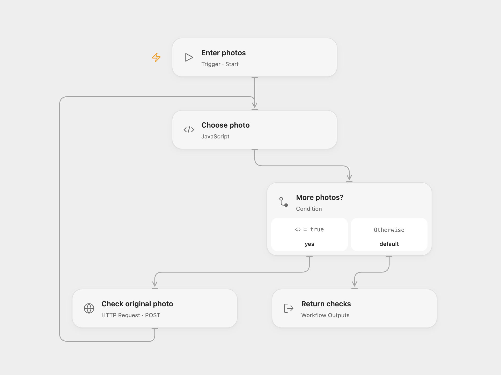

# Check Drive Passport Photo Guidance

Check Google Drive portraits against digital passport photo guidance and review the results.

<picture>
  <source media="(prefers-color-scheme: dark)" srcset="preview-dark.png">
  
</picture>

[Open Flow JSON](templates/check-drive-passport-photo-guidance.openflow.json) · [n8n JSON](templates/check-drive-passport-photo-guidance.n8n.json)

## Setup

Import the n8n workflow, connect Google Drive and Gemini, and configure a current vision-capable Gemini model. Activate the photo relay. In Open Flow set **Check original photo** to its production webhook URL and run with photos containing a name and Google Drive file ID. To run n8n directly, set the photo list in **Photo URLs** and use its manual trigger. Restrict access to the relay; it does not authenticate callers.

## Behavior

For each original image, the relay measures pixel dimensions and byte length before resizing for the model. It returns those measurements, whether the digital size requirements pass, and the model's assessment of visible features. Review each result against the original image and current official guidance; a model cannot establish all requirements or guarantee acceptance. Images are sent to Gemini.

Inspiration &amp; credits

## Changes to the source

Measure original pixel dimensions and byte length before resizing; return separate objective and visual checks. Add an n8n relay and replace private photo IDs and the retired model.

Adapted from [Automate Image Validation Tasks using AI Vision](https://github.com/enescingoz/awesome-n8n-templates/blob/827110332c21cbe000ab13f6d292d5adb1f1f8db/OpenAI_and_LLMs/Automate%20Image%20Validation%20Tasks%20using%20AI%20Vision.json) in [enescingoz/awesome-n8n-templates](https://github.com/enescingoz/awesome-n8n-templates).

Source collection notice: © 2024–2026 Enes Cingoz, [CC BY 4.0](https://github.com/enescingoz/awesome-n8n-templates/blob/827110332c21cbe000ab13f6d292d5adb1f1f8db/LICENSE). The source export does not identify a separate template author or license. See [repository licensing](../../README.md#licensing) for the scope of OOMOL contributions and third-party material.

