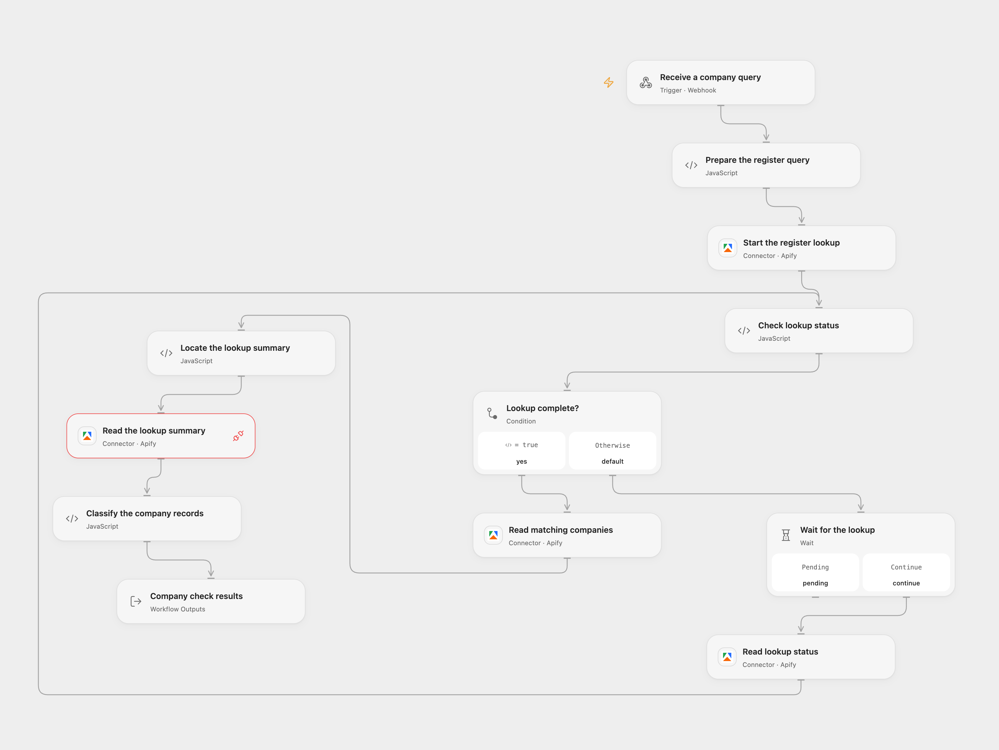

# Check a European Company Register

Look up a company in one of seven national registers and flag non-active results for review.

<picture>
  <source media="(prefers-color-scheme: dark)" srcset="preview-dark.png">
  
</picture>

[Open Flow JSON](templates/check-european-company-register.openflow.json) · [n8n JSON](templates/check-european-company-register.n8n.json)

## Setup

Connect Apify and enable the company registry Actor. In Open Flow, send a POST request to the webhook with a JSON object whose `data` object contains `Company name or registration number` and `Country`; the country must be one of cz, ee, fi, fr, no, pl or sk. In n8n, use a Header Auth credential named `Authorization` with value `Bearer YOUR_APIFY_TOKEN` on every HTTP Request node, then submit the form. Use one format.

## Behavior

The workflow searches the selected register for up to five matches. Each active record receives the verdict **ok** and includes identifying registry fields; other statuses receive **check by hand**. No match returns no records. Similar names can produce multiple companies: confirm registration numbers and follow the official registry links before making decisions. The Actor cannot search Polish records by name. The verdict reflects the Actor's status at lookup time and is not an official extract.

Both formats use the Apify summary and avoid automatic Actor start retries. Open Flow acknowledges the webhook immediately; inspect the completed run outputs for records and the Actor’s lookup summary. The Actor can stop with partial results when a register fails or a run approaches its deadline. Check the `SUMMARY` record in the run's key-value store in Apify to distinguish a complete search from an incomplete one. n8n results appear in its execution. Unknown run outcomes may have started an Actor; inspect Apify before retrying.

Inspiration &amp; credits

## Changes to the source

- Open Flow accepts a JSON webhook in place of the hosted n8n form and waits asynchronously for the Actor using the formal Apify Actions. Both formats include the Actor’s summary for manual completeness review; n8n uses standard HTTP nodes so an uncertain Actor start is not automatically replayed.

Adapted from [Check a company in seven EU business registers from a form](https://github.com/enescingoz/awesome-n8n-templates/blob/827110332c21cbe000ab13f6d292d5adb1f1f8db/Forms_and_Surveys/Check%20a%20company%20in%20seven%20EU%20business%20registers%20from%20a%20form.json) in [enescingoz/awesome-n8n-templates](https://github.com/enescingoz/awesome-n8n-templates).

Source collection notice: © 2024–2026 Enes Cingoz, [CC BY 4.0](https://github.com/enescingoz/awesome-n8n-templates/blob/827110332c21cbe000ab13f6d292d5adb1f1f8db/LICENSE). The source export does not identify a separate template author or license. See [repository licensing](../../README.md#licensing) for the scope of OOMOL contributions and third-party material.

