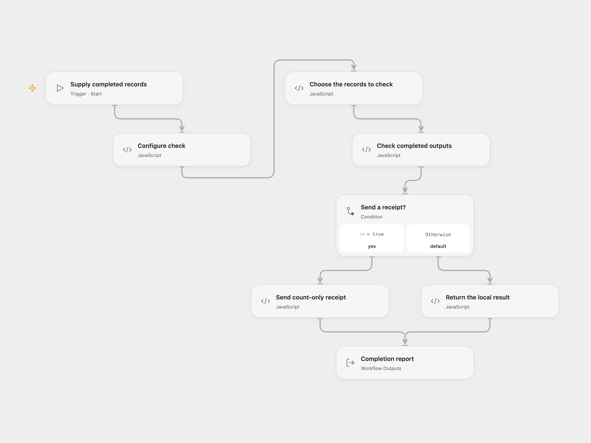

# Check Completed Outputs with an Optional Keptick Receipt

Count distinct completed-record IDs, detect empty or invalid output, and optionally send a count-only receipt to Keptick.

<!-- template-actions:start -->
 
<!-- template-actions:end -->

<picture>
  <source media="(prefers-color-scheme: dark)" srcset="preview-dark.png">
  
</picture>

## Setup

1. Run the workflow with no accounts to check the fictional records. In **Configure check**, choose `healthy`, `empty`, `invalid`, or `duplicates`.
2. For live data, supply your completed records in the `records` array, or connect your producer and pass its array to **Check completed outputs**. Set `recordIdField` and `minimumItems` in **Configure check**. The defaults are `recordId` and one.
3. To enable delivery, create a monitor and bind its private `https://keptick.aifirm.app/api/v1/ingest/…` URL to `receiptUrl` in **Send count-only receipt** as a Secret Variable. Set `sendReceipt` to true. Keep `testReceipt` true while testing. Set it to false when the monitor should receive a production receipt.

## Behavior

The report counts distinct nonempty string or finite numeric IDs, invalid records, and duplicate IDs. Empty objects are ignored. IDs are trimmed before comparing. The check passes when the distinct count reaches the minimum and there are no invalid IDs. The report still reaches the receipt branch when the check fails.

Receipt sending is off by default. When enabled, the workflow sends the check result, distinct item count, test flag, count summary, and its own execution ID. Raw records and record IDs stay in the workflow. Use the private URL as a credential and restrict access to execution data where it is configured. Keptick must return JSON with `received: true` to confirm delivery. A rejected or unconfirmed receipt stops the run. The workflow times out after 15 seconds, disallows redirects, and makes one send attempt. Check the monitor before retrying an uncertain delivery.

The request and receipt fields come from the original workflow and were verified with simulated responses. Confirm delivery to your monitor during setup. The check covers records that reach this step. It cannot observe work that never starts or fails earlier, or verify business correctness.

In n8n

Use **Configure check** to change the demo and receipt settings. To inspect a real output, replace **Choose the records to check** with your completed-record producer. Keep **Configure check** upstream and enable **Always Output Data** on the producer so an empty batch reaches the check.

Set `KEPTICK_RECEIPT_URL` as a private environment value on the self-hosted instance that runs the workflow. The exported receipt node reads it only when sending is enabled. The environment approach requires `N8N_BLOCK_ENV_ACCESS_IN_NODE=false`. If your instance uses managed secrets, substitute its secret expression for `$env.KEPTICK_RECEIPT_URL` in **Send count-only receipt** and keep the URL validation. Keep workflow and execution access restricted. The local check works without any receipt secret.

Inspiration &amp; credits

## Changes to the source

Accept completed-record arrays as input and keep the fictional demo for testing. Supply private receipt URLs through secrets and restrict requests to the Keptick ingest host.

Adapted from [Detect Empty Workflow Outputs with an Optional Keptick Receipt](https://github.com/enescingoz/awesome-n8n-templates/blob/827110332c21cbe000ab13f6d292d5adb1f1f8db/devops/Detect%20Empty%20Workflow%20Outputs%20with%20an%20Optional%20Keptick%20Receipt.json) in [enescingoz/awesome-n8n-templates](https://github.com/enescingoz/awesome-n8n-templates).

Source collection notice: © 2024–2026 Enes Cingoz, [CC BY 4.0](https://github.com/enescingoz/awesome-n8n-templates/blob/827110332c21cbe000ab13f6d292d5adb1f1f8db/LICENSE). Original workflow made by Keptick, with AI assistance. No affiliation with n8n. See [repository licensing](../../README.md#licensing) for the scope of OOMOL contributions and third-party material.

