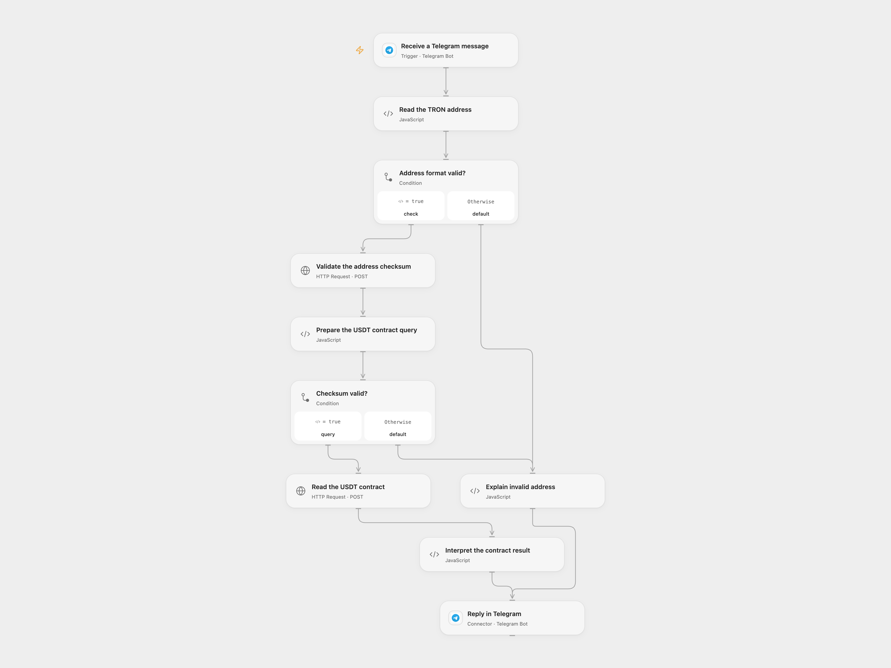

# Check TRON USDT Blacklist in Telegram

Reply to a Telegram message with the current TRON USDT contract blacklist status for an address.

<picture>
  <source media="(prefers-color-scheme: dark)" srcset="preview-dark.png">
  
</picture>

[Open Flow JSON](templates/check-tron-usdt-blacklist-in-telegram.openflow.json) · [n8n JSON](templates/check-tron-usdt-blacklist-in-telegram.n8n.json)

## Setup

Connect the same Telegram bot to **Receive a Telegram message** and **Reply in Telegram**. In n8n, connect the bot to **Telegram Trigger** and **Telegram Send Message**. Activate one format. A bot can have only one active webhook subscription and must have access to the chat. Public group messages can expose submitted addresses to group members.

## Behavior

Send a TRON Base58Check address as the complete message. The workflow validates its checksum through a TRON mainnet node and reads the USDT contract's `getBlackListStatus(address)` view. It replies to the original message in the same chat with the returned status. An invalid address receives a format message; an unavailable or malformed node response fails without claiming a status. This is a point-in-time contract reading, not a general fraud or sanctions check. Recheck before acting: status and node data can change.

The public TronGrid endpoint applies rate limits and may require an API key depending on traffic. If needed, configure the `TRON-PRO-API-KEY` header as a secret on both HTTP nodes in the chosen format. Requests disclose the address to the node service. Each valid request makes two API calls. A failed or uncertain Telegram reply may already have been delivered; inspect the chat before retrying.

## Changes to the source

- Query the current USDT contract state instead of treating TronScan's historical blacklist transactions across stablecoins as current USDT status. Reject malformed responses instead of reporting them as clear.
- Validate the complete address and checksum, and reply in the source chat so replies also work in groups.

Source and license

Adapted from [TRON USDT Blacklist Checker](https://github.com/Zie619/n8n-workflows/blob/ae8cf6dc5b873cbb4f74587aa9180ed3a9f70682/workflows/Http/1632_HTTP_Telegram_Monitor_Webhook.json) in [Zie619/n8n-workflows](https://github.com/Zie619/n8n-workflows). The matching [n8n listing](https://n8n.io/workflows/3797-check-tron-wallet-usdt-blacklist-status-via-telegram/) credits FORK SOFTWARE TECHNOLOGIES INC. The original template does not state a separate license.

The collection’s [MIT notice](https://github.com/Zie619/n8n-workflows/blob/94007c1445d9258a7da116646b79473e7c7c3282/LICENSE) is pinned at a later revision. This is the collection notice at that revision; it does not establish a separate original template author's license. Our changes are listed above; see [repository licensing](../../README.md#licensing).

> MIT License
>
> Copyright (c) 2025 Zie619
>
> Permission is hereby granted, free of charge, to any person obtaining a copy
> of this software and associated documentation files (the "Software"), to deal
> in the Software without restriction, including without limitation the rights
> to use, copy, modify, merge, publish, distribute, sublicense, and/or sell
> copies of the Software, and to permit persons to whom the Software is
> furnished to do so, subject to the following conditions:
>
> The above copyright notice and this permission notice shall be included in all
> copies or substantial portions of the Software.
>
> THE SOFTWARE IS PROVIDED "AS IS", WITHOUT WARRANTY OF ANY KIND, EXPRESS OR
> IMPLIED, INCLUDING BUT NOT LIMITED TO THE WARRANTIES OF MERCHANTABILITY,
> FITNESS FOR A PARTICULAR PURPOSE AND NONINFRINGEMENT. IN NO EVENT SHALL THE
> AUTHORS OR COPYRIGHT HOLDERS BE LIABLE FOR ANY CLAIM, DAMAGES OR OTHER
> LIABILITY, WHETHER IN AN ACTION OF CONTRACT, TORT OR OTHERWISE, ARISING FROM,
> OUT OF OR IN CONNECTION WITH THE SOFTWARE OR THE USE OR OTHER DEALINGS IN THE
> SOFTWARE.

