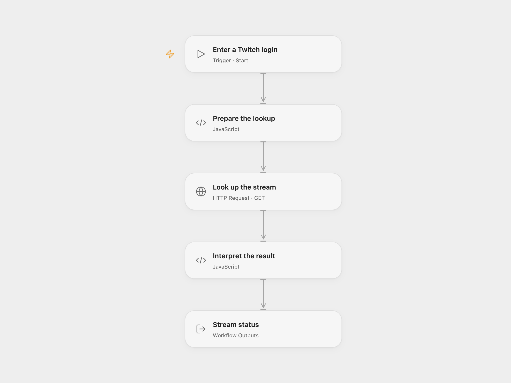

# Check Whether a Twitch Stream Is Live

Look up a Twitch login and inspect the live stream returned by Twitch.

<picture>
  <source media="(prefers-color-scheme: dark)" srcset="preview-dark.png">
  
</picture>

[Open Flow JSON](templates/check-twitch-stream-live.openflow.json) · [n8n JSON](templates/check-twitch-stream-live.n8n.json)

## Setup

Register a Twitch application and obtain an app or user OAuth access token for the same client ID. In Open Flow, bind the token as a secret Variable to **Look up the stream**, and run with the login and client ID. In n8n, set the login in **Document**, set your client ID in **Twitch GraphQL**, and configure its header credential with name `Authorization` and value `Bearer YOUR_ACCESS_TOKEN`. Refresh or replace the token when it expires.

## Behavior

A returned live stream includes its ID, viewer count, title, type, and game ID when available. An empty result means Twitch returned no discoverable live stream for that login. It may be offline, unknown, or restricted from discovery; it does not prove the account exists or is offline. Request and authentication errors stop the workflow.

Inspiration &amp; credits

## Changes to the source

- Both formats replace the source's undocumented website GraphQL endpoint and shared client ID with Twitch's [Get Streams API](https://dev.twitch.tv/docs/api/reference/streams), using your client ID and OAuth token. They map the returned fields to the source's stream shape.
- Open Flow returns an `online` boolean and a stream object or null. n8n routes the mapped stream through an explicit boolean condition.

Adapted from [Check a Twitch stream](https://github.com/Zie619/n8n-workflows/blob/ae8cf6dc5b873cbb4f74587aa9180ed3a9f70682/workflows/Manual/0678_Manual_Stickynote_Automate_Triggered.json) in [Zie619/n8n-workflows](https://github.com/Zie619/n8n-workflows). The source export does not identify a separate template author or license.

The collection’s [MIT notice](https://github.com/Zie619/n8n-workflows/blob/94007c1445d9258a7da116646b79473e7c7c3282/LICENSE) is pinned at a later revision. This is the collection notice at that revision; it does not establish a separate original template author's license. Our changes are listed above; see [repository licensing](../../README.md#licensing).

> MIT License
>
> Copyright (c) 2025 Zie619
>
> Permission is hereby granted, free of charge, to any person obtaining a copy
> of this software and associated documentation files (the "Software"), to deal
> in the Software without restriction, including without limitation the rights
> to use, copy, modify, merge, publish, distribute, sublicense, and/or sell
> copies of the Software, and to permit persons to whom the Software is
> furnished to do so, subject to the following conditions:
>
> The above copyright notice and this permission notice shall be included in all
> copies or substantial portions of the Software.
>
> THE SOFTWARE IS PROVIDED "AS IS", WITHOUT WARRANTY OF ANY KIND, EXPRESS OR
> IMPLIED, INCLUDING BUT NOT LIMITED TO THE WARRANTIES OF MERCHANTABILITY,
> FITNESS FOR A PARTICULAR PURPOSE AND NONINFRINGEMENT. IN NO EVENT SHALL THE
> AUTHORS OR COPYRIGHT HOLDERS BE LIABLE FOR ANY CLAIM, DAMAGES OR OTHER
> LIABILITY, WHETHER IN AN ACTION OF CONTRACT, TORT OR OTHERWISE, ARISING FROM,
> OUT OF OR IN CONNECTION WITH THE SOFTWARE OR THE USE OR OTHER DEALINGS IN THE
> SOFTWARE.

