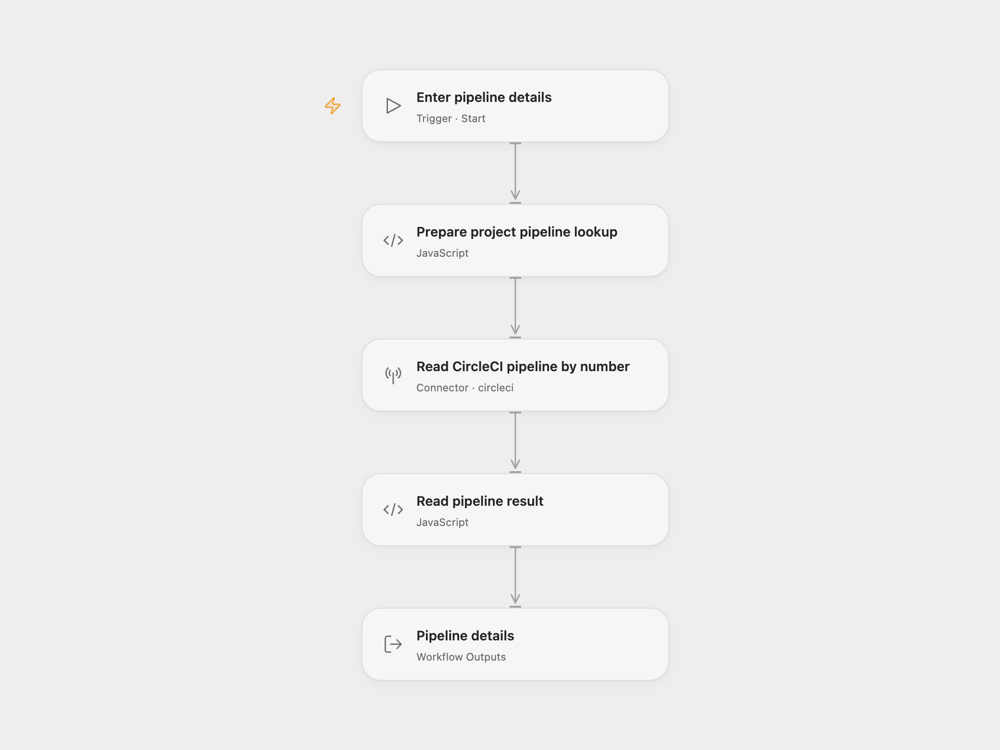

# CircleCI Pipeline Lookup

Read one CircleCI pipeline by its project and pipeline number, including its state, errors and version-control details.

<picture>
  <source media="(prefers-color-scheme: dark)" srcset="preview-dark.png">
  
</picture>

[Open Flow JSON](templates/circleci-pipeline-lookup.openflow.json) · [n8n JSON](templates/circleci-pipeline-lookup.n8n.json)

## Setup

Select your CircleCI account in **Read CircleCI pipeline by number** and grant **Provider API** permission. This permission is separate from individual Action permissions. The account needs read access to a CircleCI Cloud project using GitHub OAuth or Bitbucket Cloud. Run with **Vcs** set to `github` or `bitbucket`, **Project Slug** in `organization/repository` form, and a positive **Pipeline Number**. The number is the project’s pipeline number, rather than the pipeline UUID.

In n8n, select CircleCI credentials, choose the source-control provider and set the project slug and pipeline number in **CircleCI**. The default pipeline number is `1`; replace it with the pipeline you need.

Each run makes one read request and returns the complete pipeline object. A pipeline in an errored state is still a valid lookup result; inspect its `state` and `errors`. The workflow does not trigger, retry or modify a pipeline. A missing pipeline, inaccessible project or failed request stops the run. No workflow retry is configured.

Inspiration &amp; credits

## Changes to the source

- Replace blank project configuration with user-supplied provider, project slug and pipeline number.
- Use the CircleCI Provider API for the project-and-number lookup in Open Flow.
- Expose the complete pipeline as an Open Flow output.

Adapted from [Get a pipeline in CircleCI](https://github.com/Zie619/n8n-workflows/blob/ae8cf6dc5b873cbb4f74587aa9180ed3a9f70682/workflows/Manual/1162_Manual_Circleci_Import_Triggered.json) in [Zie619/n8n-workflows](https://github.com/Zie619/n8n-workflows). The source export does not identify a separate template author or license.

The collection’s [MIT notice](https://github.com/Zie619/n8n-workflows/blob/94007c1445d9258a7da116646b79473e7c7c3282/LICENSE) is pinned at a later revision. This is the collection notice at that revision; it does not establish a separate original template author's license. Our changes are listed above; see [repository licensing](../../README.md#licensing).

> MIT License
>
> Copyright (c) 2025 Zie619
>
> Permission is hereby granted, free of charge, to any person obtaining a copy
> of this software and associated documentation files (the "Software"), to deal
> in the Software without restriction, including without limitation the rights
> to use, copy, modify, merge, publish, distribute, sublicense, and/or sell
> copies of the Software, and to permit persons to whom the Software is
> furnished to do so, subject to the following conditions:
>
> The above copyright notice and this permission notice shall be included in all
> copies or substantial portions of the Software.
>
> THE SOFTWARE IS PROVIDED "AS IS", WITHOUT WARRANTY OF ANY KIND, EXPRESS OR
> IMPLIED, INCLUDING BUT NOT LIMITED TO THE WARRANTIES OF MERCHANTABILITY,
> FITNESS FOR A PARTICULAR PURPOSE AND NONINFRINGEMENT. IN NO EVENT SHALL THE
> AUTHORS OR COPYRIGHT HOLDERS BE LIABLE FOR ANY CLAIM, DAMAGES OR OTHER
> LIABILITY, WHETHER IN AN ACTION OF CONTRACT, TORT OR OTHERWISE, ARISING FROM,
> OUT OF OR IN CONNECTION WITH THE SOFTWARE OR THE USE OR OTHER DEALINGS IN THE
> SOFTWARE.

