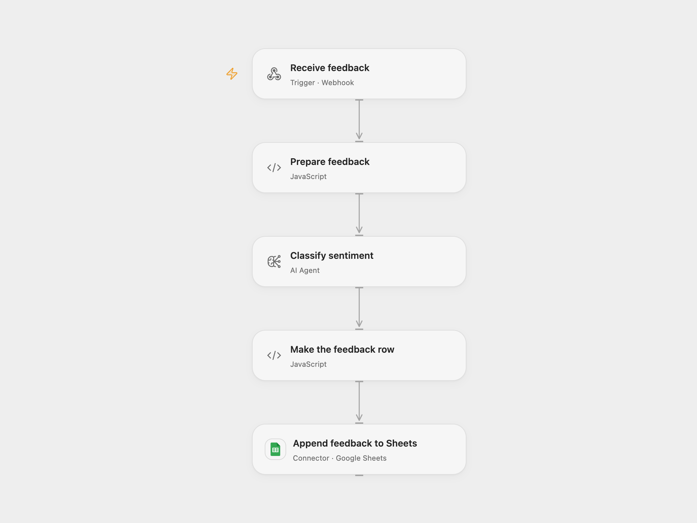

# Classify Customer Feedback to Google Sheets

Classify customer feedback sentiment and save the feedback with the result in Google Sheets.

<picture>
  <source media="(prefers-color-scheme: dark)" srcset="preview-dark.png">
  
</picture>

[Open Flow JSON](templates/classify-customer-feedback-to-google-sheets.openflow.json) · [n8n JSON](templates/classify-customer-feedback-to-google-sheets.n8n.json)

## Setup

Configure the model in **Classify sentiment** and connect Google Sheets. Set the spreadsheet ID and range in **Append feedback to Sheets**. Create a sheet named Feedback with columns in this order: Timestamp, Category, Customer Feedback, Customer Name, Customer contact, Entered by, Sentiment.

The Open Flow webhook is public and accepts JSON such as `{"name":"Alex","category":"Product","feedback":"Easy to use","contact":"alex@example.com"}`; restrict access to its URL. Contact is optional. In n8n, configure the OpenAI and Google Sheets credentials, select the spreadsheet and sheet in **Add customer feedback to Google Sheets**, and use the included customer feedback form. Activate one format.

## Behavior

Each submission sends its feedback text to the model for sentiment classification, then appends the original fields and classification as a new row. Open Flow uses its receipt time for Timestamp; n8n uses the form submission time. Model output can be wrong and should be reviewed. Do not submit information you are not authorized to send to the model provider. Form data and contact details can appear in execution history and the sheet.

An invalid submission or model failure stops before writing. An uncertain append may already have succeeded; check the sheet before replaying. Repeated submissions can create duplicate rows.

Inspiration &amp; credits

## Changes to the source

- Replace the private sheet with configuration and use RAW cell values.
- Use a configured chat model in place of the original completion node and require a nonempty result.

Adapted from [Customer feedback sentiment in Google Sheets](https://github.com/Zie619/n8n-workflows/blob/ae8cf6dc5b873cbb4f74587aa9180ed3a9f70682/workflows/Openai/0334_Openai_Form_Create_Triggered.json) in [Zie619/n8n-workflows](https://github.com/Zie619/n8n-workflows). The source export does not identify a separate template author or license.

The collection’s [MIT notice](https://github.com/Zie619/n8n-workflows/blob/94007c1445d9258a7da116646b79473e7c7c3282/LICENSE) is pinned at a later revision. This is the collection notice at that revision; it does not establish a separate original template author's license. Our changes are listed above; see [repository licensing](../../README.md#licensing).

> MIT License
>
> Copyright (c) 2025 Zie619
>
> Permission is hereby granted, free of charge, to any person obtaining a copy
> of this software and associated documentation files (the "Software"), to deal
> in the Software without restriction, including without limitation the rights
> to use, copy, modify, merge, publish, distribute, sublicense, and/or sell
> copies of the Software, and to permit persons to whom the Software is
> furnished to do so, subject to the following conditions:
>
> The above copyright notice and this permission notice shall be included in all
> copies or substantial portions of the Software.
>
> THE SOFTWARE IS PROVIDED "AS IS", WITHOUT WARRANTY OF ANY KIND, EXPRESS OR
> IMPLIED, INCLUDING BUT NOT LIMITED TO THE WARRANTIES OF MERCHANTABILITY,
> FITNESS FOR A PARTICULAR PURPOSE AND NONINFRINGEMENT. IN NO EVENT SHALL THE
> AUTHORS OR COPYRIGHT HOLDERS BE LIABLE FOR ANY CLAIM, DAMAGES OR OTHER
> LIABILITY, WHETHER IN AN ACTION OF CONTRACT, TORT OR OTHERWISE, ARISING FROM,
> OUT OF OR IN CONNECTION WITH THE SOFTWARE OR THE USE OR OTHER DEALINGS IN THE
> SOFTWARE.

