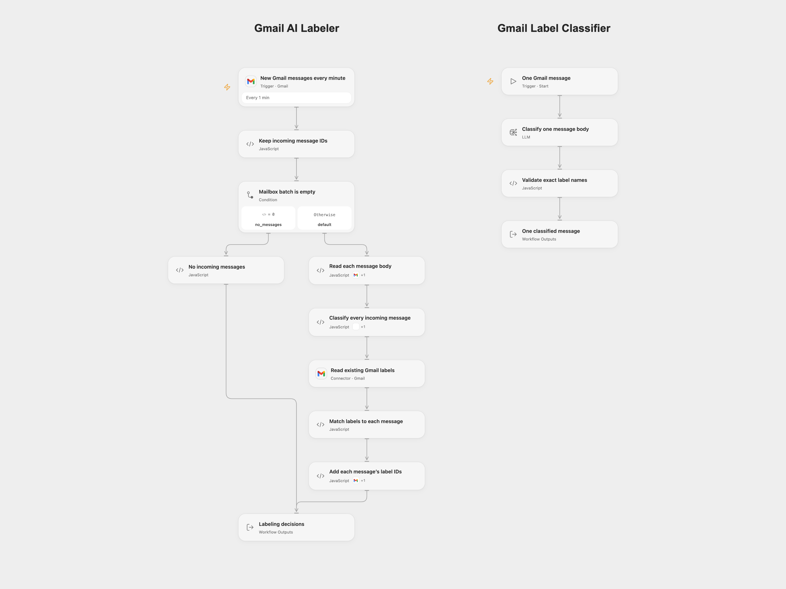

# Classify Gmail Messages with AI

Classify incoming Gmail messages and add the matching existing labels.

<picture>
  <source media="(prefers-color-scheme: dark)" srcset="preview-dark.png">
  
</picture>

[Open Flow JSON](templates/classify-gmail-messages-with-ai.openflow.json) · [n8n JSON](templates/classify-gmail-messages-with-ai.n8n.json)

## Setup

Create Gmail labels named exactly `Inquiry`, `Partnership` and `Notification`. Select the same mailbox on every Gmail trigger, body read, label catalog and label update. The account needs permission to read messages and labels and modify message labels. No labels are created automatically.

The Open Flow JSON imports two workflows, **Gmail AI Labeler** and **Gmail Label Classifier**. Configure the classifier’s model service, publish that workflow, then refresh the **Classify every incoming message** workflow capability in the main workflow to select the published interface. Select the Gmail account on the poll, on the body-read Code node’s Actions and on the label-update Code node’s Actions, as well as the label catalog Connector. Enable the main one-minute poll after setup. The shared worker revision is intentionally unconfigured until you publish it.

In n8n, select the Gmail credential on **Gmail trigger**, **Get message content**, **Get all labels** and **Add labels to message**, then select the OpenAI credential on **OpenAI Chat**. Activate the workflow after checking those settings and labels.

Both formats use `gpt-4o-mini-2024-07-18`, temperature `0` and JSON output. OpenAI lists **January 14, 2027** as its [shutdown date](https://developers.openai.com/api/docs/deprecations/). Choose and recheck an available model in both formats before that date. Model results may differ even with the same input. Message bodies from delivered messages are sent to the configured model service. When an HTML alternative is available, its body including HTML markup is preferred; otherwise the text body is used. Headers and attachments are not added to the classification prompt.

## Behavior and recovery

The poll runs every minute with a 25-message budget and includes read and unread messages while excluding drafts. Outgoing-only messages, spam and trash are excluded. A new poll begins at the current mailbox position; it does not label historical mail. n8n’s native trigger also excludes scheduled messages. Open Flow has no equivalent fixed scheduled-message filter in this template, so scheduled messages can differ between platforms.

Every delivered message body is read before classification. Each message gets its own model step and validated list of label names. The workflow reads the Gmail label catalog once, checks the complete batch, then adds only each message’s selected label IDs. Unknown names, a missing selected Gmail label or a failed read/classification stop all writes. Duplicate model labels are collapsed; an empty label list leaves that message unchanged. The result lists decisions and the number of messages updated. Existing labels, read/unread status and inbox placement are retained.

Open Flow preserves Gmail history page tokens and in-page offsets between bounded polls. An expired history checkpoint fails and requires trigger recreation; recreating it starts at the current position, so reconcile missed messages separately. n8n Trigger 1.4 scans at most 20 pages per poll budget and keeps a bounded pending/failed-fetch queue. Its backlog limit is 5,000 IDs. A failed message fetch can be abandoned after 10 attempts. After 3 consecutive polls unable to progress through an incomplete scan, the native trigger can advance past older unscanned messages. These limits produce warnings. Monitor execution and trigger logs rather than assuming complete mailbox delivery.

No workflow-level retries are configured. The n8n model adapter allows two additional transient transport retries for each classification step. Open Flow’s model service may apply its own transport policy. A later Gmail write failure stops remaining writes and leaves earlier updates in place. Poll delivery and workflow success have separate checkpoints: a failed run does not guarantee automatic redelivery. Check affected message IDs before an explicit rerun. Adding an existing label is additive, but a rerun can produce different classifications. No exactly-once delivery or batch rollback is promised.

Inspiration &amp; credits

## Changes to the source

- Keep each message’s ID through classification and label lookup, replacing the source’s cross-message merge/aggregate path. Read and validate the whole batch before writing any labels.
- Pin the model snapshot and add category instructions to the prompt. The source used gpt-4o-mini and its schema named the three categories but the exported chain contained no category instructions. Validate the returned labels without an automatic correction call.
- Make the 25-message budget explicit in both formats. Upgrade the n8n trigger to its native 1.4 queue implementation so a full first page does not silently discard its tail. The original Trigger 1.2 read one Gmail list page and did not apply the current outgoing-only filter; the polling differences and recovery limits are described above.
- Use the Gmail Action’s HTML-first body representation in both formats instead of the source’s text-first representation.
- Skip empty label writes, collapse repeated label names and fail on missing selected labels instead of silently losing them during a merge.

Adapted from [Add AI labels to Gmail messages](https://github.com/Zie619/n8n-workflows/blob/ae8cf6dc5b873cbb4f74587aa9180ed3a9f70682/workflows/Aggregate/0472_Aggregate_Gmail_Create_Triggered.json) in [Zie619/n8n-workflows](https://github.com/Zie619/n8n-workflows). The source credits [workfloows.com](https://workfloows.com/) and [@workfloows](https://www.youtube.com/@workfloows), with a [video guide](https://youtu.be/a8Dhj3Zh9vQ); no separate original template license was found.

The collection’s [MIT notice](https://github.com/Zie619/n8n-workflows/blob/94007c1445d9258a7da116646b79473e7c7c3282/LICENSE) is pinned at a later revision. This is the collection notice at that revision; it does not establish a separate original template author's license. Our changes are listed above; see [repository licensing](../../README.md#licensing).

> MIT License
>
> Copyright (c) 2025 Zie619
>
> Permission is hereby granted, free of charge, to any person obtaining a copy
> of this software and associated documentation files (the "Software"), to deal
> in the Software without restriction, including without limitation the rights
> to use, copy, modify, merge, publish, distribute, sublicense, and/or sell
> copies of the Software, and to permit persons to whom the Software is
> furnished to do so, subject to the following conditions:
>
> The above copyright notice and this permission notice shall be included in all
> copies or substantial portions of the Software.
>
> THE SOFTWARE IS PROVIDED "AS IS", WITHOUT WARRANTY OF ANY KIND, EXPRESS OR
> IMPLIED, INCLUDING BUT NOT LIMITED TO THE WARRANTIES OF MERCHANTABILITY,
> FITNESS FOR A PARTICULAR PURPOSE AND NONINFRINGEMENT. IN NO EVENT SHALL THE
> AUTHORS OR COPYRIGHT HOLDERS BE LIABLE FOR ANY CLAIM, DAMAGES OR OTHER
> LIABILITY, WHETHER IN AN ACTION OF CONTRACT, TORT OR OTHERWISE, ARISING FROM,
> OUT OF OR IN CONNECTION WITH THE SOFTWARE OR THE USE OR OTHER DEALINGS IN THE
> SOFTWARE.

