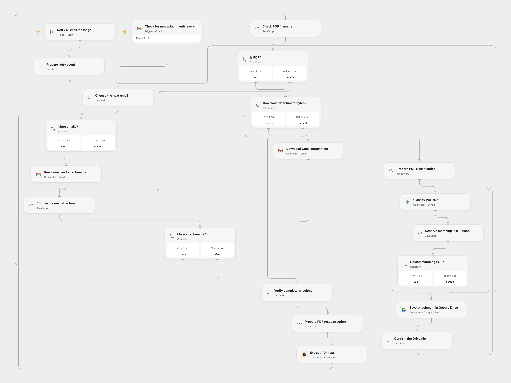

# Classify Gmail PDFs and Save to Drive

Classify incoming PDF attachments and save matching originals to Google Drive.

<!-- template-actions:start -->
 
<!-- template-actions:end -->

<picture>
  <source media="(prefers-color-scheme: dark)" srcset="preview-dark.png">
  
</picture>

## Setup

Connect Gmail, Encodian, Gemini and Google Drive. Set the destination folder ID in **Choose the next attachment** and the document type in **Prepare PDF classification**. Configure Gmail file transit and replace the example hostname in **Verify complete attachment** with your transit hostname. Enable persistent State.

In n8n, connect Gmail, Gemini and Google Drive, select the destination folder in **Upload matching PDF**, and set the document type in **Configure PDF matching**. Select one Data Table with text columns `item_key` and `status` in all checkpoint nodes. Keep relay mode disabled; the direct path processes the attachment in n8n. Use one format at a time.

## Behavior

The workflow checks Gmail every minute, examines each PDF attachment separately and uploads the original file when its extracted text matches the configured document type. Non-PDF attachments are skipped. PDF text must be extractable; scanned PDFs need OCR. Gemini classification can be wrong. Encodian receives PDF bytes, and Gemini receives the extracted text and filename. Restrict access to transit URLs, email data and execution history.

Open Flow processes at most 50 messages per poll and requires attachment bytes to fit its 1 MiB fetch and execution limits. An empty or failed text extraction or text longer than 15,800 characters stops the run. n8n skips text over that limit. Earlier matching files may already have been uploaded.

If an upload is uncertain, inspect Drive before retrying. In Open Flow enter `gmail-pdf:<message ID>:<attachment index>` and `confirmed` or `absent` in **Reserve matching PDF upload**, run **Retry a Gmail message** with the original message ID, then clear the recovery fields. In n8n set the matching pending Data Table row to `done` if uploaded or delete it if absent, enable the authenticated **Resume email** webhook and POST the original `messageId`. Avoid overlapping runs; checkpoints are not atomic locks.

Inspiration &amp; credits

The source credits [David Sha](https://davidsha.me). Use official Gmail, Encodian, Gemini and Drive actions, preserve attachment identity, and stop on uncertain uploads.

Adapted from [Send specific PDF attachments from Gmail to Google Drive using OpenAI](https://github.com/Zie619/n8n-workflows/blob/ae8cf6dc5b873cbb4f74587aa9180ed3a9f70682/workflows/Code/1656_Code_Readpdf_Send_Triggered.json) in [Zie619/n8n-workflows](https://github.com/Zie619/n8n-workflows). Attribution: David Sha / Zie619.

The collection’s [MIT notice](https://github.com/Zie619/n8n-workflows/blob/94007c1445d9258a7da116646b79473e7c7c3282/LICENSE) is pinned at a later revision. This is the collection notice at that revision; it does not establish a separate original template author's license. Our changes are listed above; see [repository licensing](../../README.md#licensing).

> MIT License
>
> Copyright (c) 2025 Zie619
>
> Permission is hereby granted, free of charge, to any person obtaining a copy
> of this software and associated documentation files (the "Software"), to deal
> in the Software without restriction, including without limitation the rights
> to use, copy, modify, merge, publish, distribute, sublicense, and/or sell
> copies of the Software, and to permit persons to whom the Software is
> furnished to do so, subject to the following conditions:
>
> The above copyright notice and this permission notice shall be included in all
> copies or substantial portions of the Software.
>
> THE SOFTWARE IS PROVIDED "AS IS", WITHOUT WARRANTY OF ANY KIND, EXPRESS OR
> IMPLIED, INCLUDING BUT NOT LIMITED TO THE WARRANTIES OF MERCHANTABILITY,
> FITNESS FOR A PARTICULAR PURPOSE AND NONINFRINGEMENT. IN NO EVENT SHALL THE
> AUTHORS OR COPYRIGHT HOLDERS BE LIABLE FOR ANY CLAIM, DAMAGES OR OTHER
> LIABILITY, WHETHER IN AN ACTION OF CONTRACT, TORT OR OTHERWISE, ARISING FROM,
> OUT OF OR IN CONNECTION WITH THE SOFTWARE OR THE USE OR OTHER DEALINGS IN THE
> SOFTWARE.

