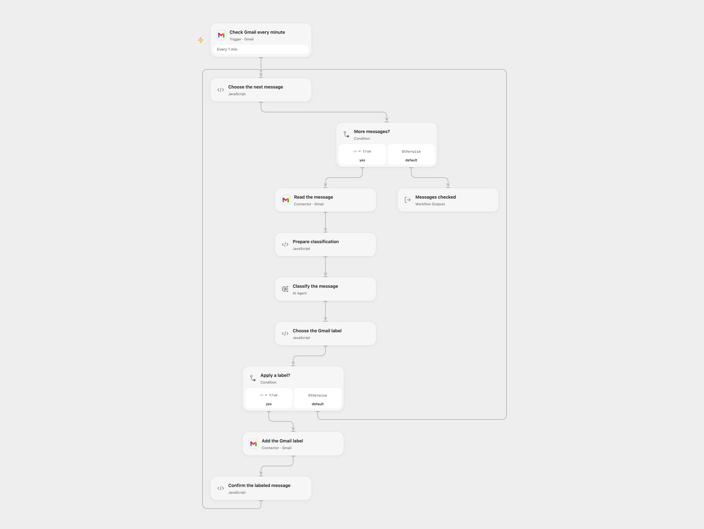

# Classify Incoming Gmail Messages with AI

Classify new Gmail messages and apply a priority, work or promotion label.

<picture>
  <source media="(prefers-color-scheme: dark)" srcset="preview-dark.png">
  
</picture>

[Open Flow JSON](templates/classify-incoming-gmail-messages-with-ai.openflow.json) · [n8n JSON](templates/classify-incoming-gmail-messages-with-ai.n8n.json)

## Setup

Create three Gmail labels for priority, work and promotions and obtain their label IDs. Connect the same mailbox in **Check Gmail every minute**, **Read the message** and **Add the Gmail label**. In **Prepare classification**, set the organization name and the three label IDs. Configure the AI model.

In n8n, connect Gmail and the classifier model, set the organization in the classifier's work category description, and select the corresponding existing label in each of the three Gmail nodes. Activate only one format.

## Behavior

Every minute the workflow reads new messages and classifies their body as high priority, organization work, promotion or other. It adds the corresponding label for the first three; other messages are unchanged. It does not send or draft replies. Classification is probabilistic and can be wrong; review labels before relying on them. Message content is sent to the configured model, so restrict model and execution-history access.

Both formats exclude drafts, spam, trash and outgoing-only messages. n8n also filters scheduled messages. Each poll handles up to 50 messages; Open Flow processes them sequentially and checks each returned message ID. A missing body, model error or Gmail failure stops the current run. Earlier labels can already be applied; check the mailbox before retrying an uncertain write. Gmail poll checkpoint behavior, overlapping runs and model limits can affect delivery; this is not an exactly-once guarantee.

Inspiration &amp; credits

## Changes to the source

- Replace private label IDs and the school name with user configuration.
- Open Flow uses an Agent and checks message association and label responses. n8n upgrades the Gmail Trigger to version 1.4 with a 50-message poll budget and the filters above. The original disabled, unconnected reply-draft branch remains inactive.

Adapted from [Email Classification](https://github.com/Zie619/n8n-workflows/blob/ae8cf6dc5b873cbb4f74587aa9180ed3a9f70682/workflows/Gmail/1914_Gmail_Stickynote_Send_Triggered.json) in [Zie619/n8n-workflows](https://github.com/Zie619/n8n-workflows). The source export does not identify a separate template author or license.

The collection’s [MIT notice](https://github.com/Zie619/n8n-workflows/blob/94007c1445d9258a7da116646b79473e7c7c3282/LICENSE) is pinned at a later revision. This is the collection notice at that revision; it does not establish a separate original template author's license. Our changes are listed above; see [repository licensing](../../README.md#licensing).

> MIT License
>
> Copyright (c) 2025 Zie619
>
> Permission is hereby granted, free of charge, to any person obtaining a copy
> of this software and associated documentation files (the "Software"), to deal
> in the Software without restriction, including without limitation the rights
> to use, copy, modify, merge, publish, distribute, sublicense, and/or sell
> copies of the Software, and to permit persons to whom the Software is
> furnished to do so, subject to the following conditions:
>
> The above copyright notice and this permission notice shall be included in all
> copies or substantial portions of the Software.
>
> THE SOFTWARE IS PROVIDED "AS IS", WITHOUT WARRANTY OF ANY KIND, EXPRESS OR
> IMPLIED, INCLUDING BUT NOT LIMITED TO THE WARRANTIES OF MERCHANTABILITY,
> FITNESS FOR A PARTICULAR PURPOSE AND NONINFRINGEMENT. IN NO EVENT SHALL THE
> AUTHORS OR COPYRIGHT HOLDERS BE LIABLE FOR ANY CLAIM, DAMAGES OR OTHER
> LIABILITY, WHETHER IN AN ACTION OF CONTRACT, TORT OR OTHERWISE, ARISING FROM,
> OUT OF OR IN CONNECTION WITH THE SOFTWARE OR THE USE OR OTHER DEALINGS IN THE
> SOFTWARE.

