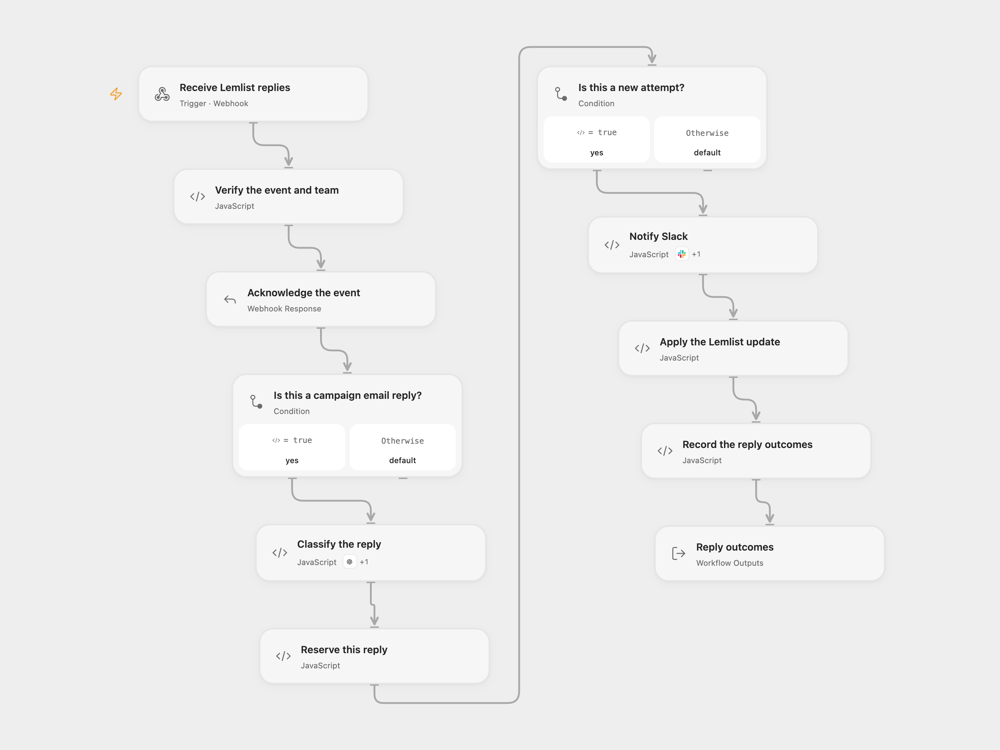

# Classify Lemlist Email Replies

Classify campaign email replies, alert Slack, and update the matching Lemlist lead when appropriate.

<!-- template-actions:start -->
 
<!-- template-actions:end -->

<picture>
  <source media="(prefers-color-scheme: dark)" srcset="preview-dark.png">
  
</picture>

## Setup

1. Set your Lemlist workspace ID and Slack channel ID in **Verify the event and team**. Bind OpenAI in **Classify the reply** and Slack in **Notify Slack**. Give the Slack connection access to post in the chosen channel.
2. Set the secret `LEMLIST_WEBHOOK_SECRET` to a random 64-character lowercase hex string. Set `LEMLIST_API_AUTH` to the Basic authorization header value for your Lemlist API key. Encode a colon followed by the key with Base64 and prefix it with `Basic `. Use a key for the same workspace.
3. Publish and enable the workflow. With the Lemlist API, register the production HTTPS URL through **Add Webhook**. Set `targetUrl` to the published URL, `type` to `emailsReplied`, and `secret` to the shared value. Lemlist sends that secret in the request body. Restrict access to run records and avoid logging request bodies. [Lemlist webhook registration](https://developer.lemlist.com/api-reference/endpoints/webhooks/add-webhook)

## Behavior

OpenAI categorizes the original reply as Interested, Out of office, Unsubscribe, Not interested, or Other. Each valid classification posts a Slack alert with the campaign, sender, lead and a short reply preview. An Interested reply can update the matched lead in that campaign. An explicit opt-out routes to the campaign unsubscribe endpoint for the matched email. Other categories only notify Slack. The workflow skips third-party replies and rejects events outside the configured workspace or without reply text.

A response of HTTP 202 acknowledges intake. Check the run for each action's confirmation. The workflow uses the Lemlist activity ID to reserve one attempt before any external write. If an outcome is unconfirmed, inspect the Slack channel or Lemlist before recovery. A replay of a reserved activity skips classification and both writes. Classification can make mistakes, so verify borderline replies and changes.

In n8n

Set your workspace and Slack channel in **Verify the event and team** and put the lowercase SHA-256 digest of the webhook secret in that node. Use the original secret when registering the production HTTPS URL with Lemlist. Bind your OpenAI credential in **Classify the reply** and the same Lemlist API credential in **Read the current Lemlist lead** and **Apply the Lemlist update**. In **Notify Slack**, use Header Auth with `Authorization` set to `Bearer YOUR_SLACK_BOT_TOKEN`. The bot needs permission to post in the channel.

Use one production execution slot and a dedicated Data Table with text columns `request_key`, `status`, and `receipt`. Select it in **Check reply attempts**, **Reserve this reply**, and **Record the reply outcomes**. Activate the workflow before registering the production URL. Keep the pending record until the affected service is checked. Retrying directly at a failed write node skips the reservation.

Inspiration &amp; credits

Adapted from [Classify lemlist replies using OpenAI and automate reply handling](https://github.com/enescingoz/awesome-n8n-templates/blob/827110332c21cbe000ab13f6d292d5adb1f1f8db/Gmail_and_Email_Automation/Classify%20lemlist%20replies%20using%20OpenAI%20and%20automate%20reply%20handling.json) in [enescingoz/awesome-n8n-templates](https://github.com/enescingoz/awesome-n8n-templates).

Source collection notice: © 2024–2026 Enes Cingoz, [CC BY 4.0](https://github.com/enescingoz/awesome-n8n-templates/blob/827110332c21cbe000ab13f6d292d5adb1f1f8db/LICENSE). The original workflow is credited to Lucas Perret. The collection notice does not establish a separate license for the original workflow. See [repository licensing](../../README.md#licensing) for the scope of OOMOL contributions and third-party material.

[Original n8n workflow by Lucas Perret](https://n8n.io/workflows/2287-classify-lemlist-replies-using-openai-and-automate-reply-handling/).

## Changes to the source

Use the same category field in the prompt and parser. Keep Slack alerts for all five categories, verify the event and original lead before campaign updates, and record both outcomes separately.

