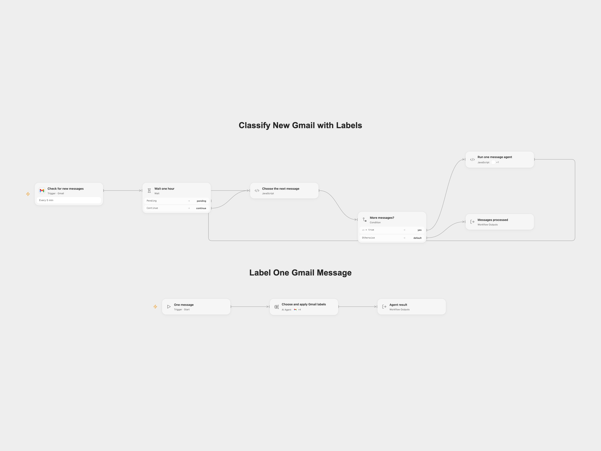

# Classify New Gmail with Labels

Classify new Gmail messages using existing labels and create a sublabel when needed.

<picture>
  <source media="(prefers-color-scheme: dark)" srcset="preview-dark.png">
  
</picture>

[Open Flow JSON](templates/classify-new-gmail-with-labels.openflow.json) · [n8n JSON](templates/classify-new-gmail-with-labels.n8n.json)

## Setup

Import both Open Flow workflows, publish **Label One Gmail Message**, and refresh its interface in **Run one message agent**. Connect Gmail to the trigger and each Gmail tool in **Choose and apply Gmail labels** in the worker, using the same mailbox. Select a tool-capable model. In n8n, connect the trigger and all four Gmail tools to the same mailbox and connect a model. Activate one format.

## Behavior

Every five minutes, the workflow checks new messages, waits one hour, and asks an AI agent to reuse an appropriate label or create a sublabel and apply it. The model reads message content and existing label names, which are sent to the configured AI provider. Review labels and model decisions. Drafts, spam and trash are excluded.

Open Flow processes up to 100 events per poll in sequence. A confirmed agent failure skips that message and processing continues with the next; an uncertain write or interrupted worker stops the run. Labels created or applied earlier remain. An uncertain label creation or modification may have succeeded; inspect Gmail before retrying. The model can choose imperfect labels or make no change. Concurrent runs can create conflicting labels.

Inspiration &amp; credits

## Changes to the source

- Exclude drafts, fetch the full message, and tie read and label tools to the current message. The original prompt asks for inbox removal, but the source has no tool to remove it; both formats keep labels and do not archive messages.
- Open Flow invokes a separate agent workflow for each event; confirmed worker errors allow the next message to proceed. The n8n error branch likewise continues the loop.

Adapted from [Basic automatic Gmail email labelling with OpenAI and Gmail API](https://github.com/enescingoz/awesome-n8n-templates/blob/827110332c21cbe000ab13f6d292d5adb1f1f8db/Gmail_and_Email_Automation/Basic%20Automatic%20Gmail%20Email%20Labelling%20with%20OpenAI%20and%20Gmail%20API.json) in [enescingoz/awesome-n8n-templates](https://github.com/enescingoz/awesome-n8n-templates).

Source collection notice: © 2024–2026 Enes Cingoz, [CC BY 4.0](https://github.com/enescingoz/awesome-n8n-templates/blob/827110332c21cbe000ab13f6d292d5adb1f1f8db/LICENSE). The matching [n8n listing](https://n8n.io/workflows/2740-basic-automatic-gmail-email-labelling-with-openai-and-gmail-api/) credits Martijn Kerver. The original template does not state a separate license. See [repository licensing](../../README.md#licensing) for the scope of OOMOL contributions and third-party material.

