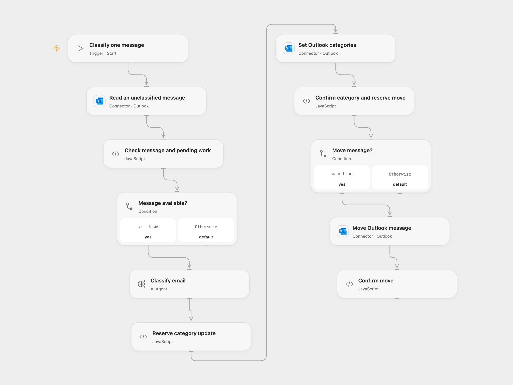

# Classify Outlook Mail with Custom Folders

Classify an unflagged Outlook message and move it to a matching folder.

<!-- template-actions:start -->
 
<!-- template-actions:end -->

<picture>
  <source media="(prefers-color-scheme: dark)" srcset="preview-dark.png">
  
</picture>

## Setup

Connect Outlook with Mail.ReadWrite access and configure a model. Set the source folder in **Read an unclassified message** and folder IDs in **Reserve category update**. Enable persistent State and avoid overlapping runs. In n8n connect Outlook and an Ollama model, set the input and destination folder IDs, and select a Data Table with item_key and status text columns. Use one format.

## Behavior

A manual run selects up to one message that is unflagged and has no categories. The model chooses action, junk, receipt, SaaS, community, business or other, with an optional subcategory. The workflow updates its categories. Junk, receipt, SaaS and community move to their corresponding folders; action and business move to Actioned only if already read. Other stays in place. Model classifications can be wrong; review them. Email content is sent to the selected model and may appear in execution history. Open Flow Code inputs and outputs must each fit within 1 MiB.

If an update or move has an unknown outcome, inspect the message and folders in Outlook and manually finish any missing action. In Open Flow enter the original message ID in **Check message and pending work** to acknowledge the completed reconciliation, run again and clear the field. In n8n inspect the pending Data Table row, complete any missing action manually, then mark the row done. Moves can change message IDs.

Inspiration &amp; credits

Validate model categories and stop on uncertain updates or moves.

Adapted from [Auto Categorise Outlook Emails with AI](https://github.com/Zie619/n8n-workflows/blob/ae8cf6dc5b873cbb4f74587aa9180ed3a9f70682/workflows/Filter/1321_Filter_Manual_Send_Triggered.json) in [Zie619/n8n-workflows](https://github.com/Zie619/n8n-workflows). The source export does not identify a separate template author or license.

The collection’s [MIT notice](https://github.com/Zie619/n8n-workflows/blob/94007c1445d9258a7da116646b79473e7c7c3282/LICENSE) is pinned at a later revision. This is the collection notice at that revision; it does not establish a separate original template author's license. Our changes are listed above; see [repository licensing](../../README.md#licensing).

> MIT License
>
> Copyright (c) 2025 Zie619
>
> Permission is hereby granted, free of charge, to any person obtaining a copy
> of this software and associated documentation files (the "Software"), to deal
> in the Software without restriction, including without limitation the rights
> to use, copy, modify, merge, publish, distribute, sublicense, and/or sell
> copies of the Software, and to permit persons to whom the Software is
> furnished to do so, subject to the following conditions:
>
> The above copyright notice and this permission notice shall be included in all
> copies or substantial portions of the Software.
>
> THE SOFTWARE IS PROVIDED "AS IS", WITHOUT WARRANTY OF ANY KIND, EXPRESS OR
> IMPLIED, INCLUDING BUT NOT LIMITED TO THE WARRANTIES OF MERCHANTABILITY,
> FITNESS FOR A PARTICULAR PURPOSE AND NONINFRINGEMENT. IN NO EVENT SHALL THE
> AUTHORS OR COPYRIGHT HOLDERS BE LIABLE FOR ANY CLAIM, DAMAGES OR OTHER
> LIABILITY, WHETHER IN AN ACTION OF CONTRACT, TORT OR OTHERWISE, ARISING FROM,
> OUT OF OR IN CONNECTION WITH THE SOFTWARE OR THE USE OR OTHER DEALINGS IN THE
> SOFTWARE.

