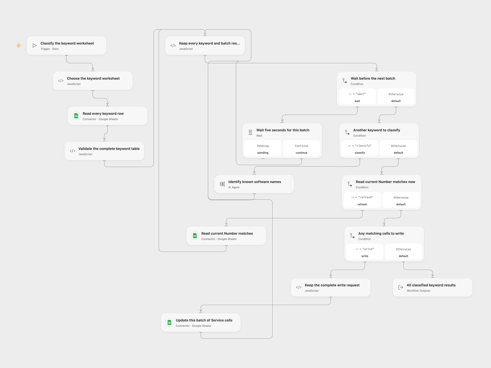

# Classify Software Keywords in Google Sheets

Identify keywords containing a known IT software, service, tool or app name and write yes/no to the matching Service? cells.

<picture>
  <source media="(prefers-color-scheme: dark)" srcset="preview-dark.png">
  
</picture>

[Open Flow JSON](templates/classify-software-keywords-in-google-sheets.openflow.json) · [n8n JSON](templates/classify-software-keywords-in-google-sheets.n8n.json)

## Setup

Set the spreadsheet ID and worksheet name in **Choose the keyword worksheet**. The first row must contain one each of `Number`, `Keyword` and `Service?`. Every populated row needs a Number match key and a nonblank Keyword value. Connect both reads and the write node to Google Sheets with edit access. Configure a gateway route for `gpt-4o-mini`. The original default model is scheduled to shut down on January 14, 2027. Before deploying, check the [official model page](https://platform.openai.com/docs/models/gpt-4o-mini) and [deprecations](https://platform.openai.com/docs/deprecations) for an available replacement, then update the model in both formats.

## Behavior

Read the complete worksheet once, process six keyword rows at a time and wait five seconds before each batch. Classify each keyword separately using the original IT software/service-name question, collecting all six classifications before updating that batch. Refresh the current worksheet and compare each original Number with its current formatted value as text. Update only the first matching row’s Service? cell; the Number key and other columns remain unchanged. Repeated keys can target the same cell; later writes can replace earlier classifications. Keep Number values unique and avoid formatting that changes their displayed text. Unmatched keys are recorded and skipped. An entirely unmatched batch still continues to later batches, repairing the original empty-output loop stall.

The result retains every classified keyword, its original row and per-batch updated/unmatched counts. Empty or header-only sheets complete without model calls, waits or writes. Invalid rows or classifications fail clearly. A failed model or match read stops before that batch’s write; an uncertain write stops later batches without automatic replay or rollback. Earlier batches may already be saved. Check the sheet before restarting. Model classifications need review and are not deterministic. The complete table/state/results must fit the current Code host’s 1 MiB budgets.

## n8n

Set the same spreadsheet ID and worksheet name in its **Choose the keyword worksheet** Code node. Select Google Sheets OAuth2 credentials in the three HTTP nodes and OpenAI credentials in **OpenAI Chat Model**. Keep `gpt-4o-mini`, the six-item loop, five-second wait and structured parser connected. The original Agent uses its formatter tool internally; no external lookup/tool or Memory is added. The native model client can retry a server or connection failure up to twice; its 401, 403 and 429 paths stop after one attempt. Uncertain sheet writes are never automatically replayed. Open Flow uses one classification round with a typed yes/no result and no retry of a failed model transport call; role/formatting instructions differ from the native formatter-tool protocol. The native Agent retains its ten-iteration cap; Open Flow allows one classification round. The native parser is strengthened to a required yes/no schema; both formats reject malformed or non-yes/no classifications before writing that batch. Native empty sheets finish with no result items; Open Flow returns an empty result with Count zero.

Inspiration &amp; credits

## Changes to the source

- Restore the complete keyword classification and Number-matched update loop.
- Keep batches of six, five-second waits and the source model/question.
- Validate yes/no results and continue later batches after an empty update.

Adapted from [Software keyword classification in Google Sheets](https://github.com/Zie619/n8n-workflows/blob/ae8cf6dc5b873cbb4f74587aa9180ed3a9f70682/workflows/Manual/0728_Manual_GoogleSheets_Update_Triggered.json) in [Zie619/n8n-workflows](https://github.com/Zie619/n8n-workflows). The source export does not identify a separate template author or license.

The collection’s [MIT notice](https://github.com/Zie619/n8n-workflows/blob/94007c1445d9258a7da116646b79473e7c7c3282/LICENSE) is pinned at a later revision. This is the collection notice at that revision; it does not establish a separate original template author's license. Our changes are listed above; see [repository licensing](../../README.md#licensing).

> MIT License
>
> Copyright (c) 2025 Zie619
>
> Permission is hereby granted, free of charge, to any person obtaining a copy
> of this software and associated documentation files (the "Software"), to deal
> in the Software without restriction, including without limitation the rights
> to use, copy, modify, merge, publish, distribute, sublicense, and/or sell
> copies of the Software, and to permit persons to whom the Software is
> furnished to do so, subject to the following conditions:
>
> The above copyright notice and this permission notice shall be included in all
> copies or substantial portions of the Software.
>
> THE SOFTWARE IS PROVIDED "AS IS", WITHOUT WARRANTY OF ANY KIND, EXPRESS OR
> IMPLIED, INCLUDING BUT NOT LIMITED TO THE WARRANTIES OF MERCHANTABILITY,
> FITNESS FOR A PARTICULAR PURPOSE AND NONINFRINGEMENT. IN NO EVENT SHALL THE
> AUTHORS OR COPYRIGHT HOLDERS BE LIABLE FOR ANY CLAIM, DAMAGES OR OTHER
> LIABILITY, WHETHER IN AN ACTION OF CONTRACT, TORT OR OTHERWISE, ARISING FROM,
> OUT OF OR IN CONNECTION WITH THE SOFTWARE OR THE USE OR OTHER DEALINGS IN THE
> SOFTWARE.

