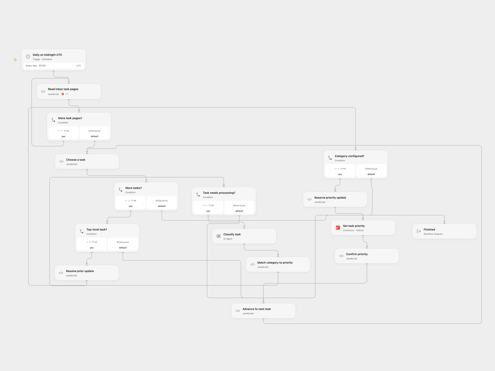

# Classify Todoist Inbox Priorities

Classify top-level Todoist inbox tasks and set their priority from a configured category map.

<!-- template-actions:start -->
 
<!-- template-actions:end -->

<picture>
  <source media="(prefers-color-scheme: dark)" srcset="preview-dark.png">
  
</picture>

## Setup

Connect Todoist and an AI model. Set the inbox project ID in **Read inbox task pages**. Set the same category-to-priority map in **Classify task** and **Match category to priority**.

## Behavior

Daily at midnight UTC, read all active tasks in the configured project. Skip subtasks. Classify each top-level task and set its priority only when the returned category exactly matches the map. Unmatched classifications do nothing. The source's mapping values are sent as task priorities; the workflow does not move tasks between projects. Task titles are sent to the model, which can make mistakes. Enable persistent State and prevent overlapping runs. If an update result is unknown, inspect the task and enter its key in **Resolve prior update** with resolution confirmed or absent; clear those fields after rerunning.

In n8n

Values must be Todoist priorities 1 through 4. Configure the project, categories, model and Todoist credential in n8n. Create a Data Table with text columns item_key and status and select it in the three checkpoint nodes. In n8n inspect a pending Data Table row and mark it done after resolving the update.

Inspiration &amp; credits

## Changes to the source

Replace the private project ID, repair category-key enumeration, explicitly set UTC and preserve the original priority update.

Adapted from [Use AI to organize your Todoist Inbox](https://github.com/enescingoz/awesome-n8n-templates/blob/827110332c21cbe000ab13f6d292d5adb1f1f8db/Other_Integrations_and_Use_Cases/Use%20AI%20to%20organize%20your%20Todoist%20Inbox.json) in [enescingoz/awesome-n8n-templates](https://github.com/enescingoz/awesome-n8n-templates).

Source collection notice: © 2024–2026 Enes Cingoz, [CC BY 4.0](https://github.com/enescingoz/awesome-n8n-templates/blob/827110332c21cbe000ab13f6d292d5adb1f1f8db/LICENSE). The source export does not identify a separate template author or license. See [repository licensing](../../README.md#licensing) for the scope of OOMOL contributions and third-party material.

