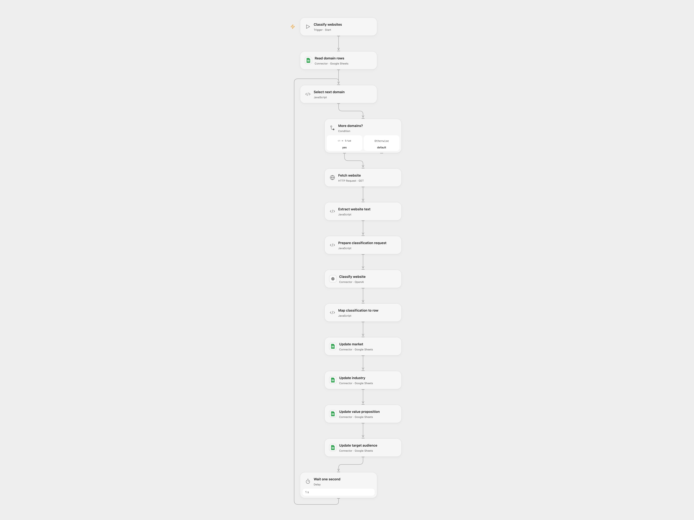

# Classify Website Domains in Google Sheets

Read website domains from a sheet, classify each site and update the matching row.

<picture>
  <source media="(prefers-color-scheme: dark)" srcset="preview-dark.png">
  
</picture>

[Open Flow JSON](templates/classify-website-domains-in-google-sheets.openflow.json) · [n8n JSON](templates/classify-website-domains-in-google-sheets.n8n.json)

## Setup and use

Connect Google Sheets and OpenAI. Set the same spreadsheet ID on **Read domain rows** and all four update nodes. Set the sheet tab in the read range and **Select next domain**. The first row must contain Domain, Market, Industry, Value Proposition and Target Audience headers. Domain values are hostnames without a scheme or www prefix. In n8n select your spreadsheet and sheet on both Sheets nodes and configure OpenAI HTTP Bearer Auth. Use one format.

## Behavior

The workflow fetches each website, extracts and truncates its text to 10,000 characters, asks OpenAI for the source classification, and writes the four results to that row. Open Flow writes the four cells separately and waits one second before the next row. Model outputs can be inaccurate; review the results. Websites and the model may receive the domain and website content. A failed request stops the run; some cells or earlier rows may already be updated. Inspect the sheet before retrying.

Inspiration &amp; credits

## Changes to the source

- Replace private spreadsheet IDs; Open Flow updates individual row cells and uses a current OpenAI Responses model. Both formats stop on errors and use current OpenAI response JSON.

Adapted from [Website domain classification](https://github.com/Zie619/n8n-workflows/blob/ae8cf6dc5b873cbb4f74587aa9180ed3a9f70682/workflows/Wait/0290_Wait_Code_Update_Webhook.json) in [Zie619/n8n-workflows](https://github.com/Zie619/n8n-workflows). The source export does not identify a separate template author or license.

The collection’s [MIT notice](https://github.com/Zie619/n8n-workflows/blob/94007c1445d9258a7da116646b79473e7c7c3282/LICENSE) is pinned at a later revision. This is the collection notice at that revision; it does not establish a separate original template author's license. Our changes are listed above; see [repository licensing](../../README.md#licensing).

> MIT License
>
> Copyright (c) 2025 Zie619
>
> Permission is hereby granted, free of charge, to any person obtaining a copy
> of this software and associated documentation files (the "Software"), to deal
> in the Software without restriction, including without limitation the rights
> to use, copy, modify, merge, publish, distribute, sublicense, and/or sell
> copies of the Software, and to permit persons to whom the Software is
> furnished to do so, subject to the following conditions:
>
> The above copyright notice and this permission notice shall be included in all
> copies or substantial portions of the Software.
>
> THE SOFTWARE IS PROVIDED "AS IS", WITHOUT WARRANTY OF ANY KIND, EXPRESS OR
> IMPLIED, INCLUDING BUT NOT LIMITED TO THE WARRANTIES OF MERCHANTABILITY,
> FITNESS FOR A PARTICULAR PURPOSE AND NONINFRINGEMENT. IN NO EVENT SHALL THE
> AUTHORS OR COPYRIGHT HOLDERS BE LIABLE FOR ANY CLAIM, DAMAGES OR OTHER
> LIABILITY, WHETHER IN AN ACTION OF CONTRACT, TORT OR OTHERWISE, ARISING FROM,
> OUT OF OR IN CONNECTION WITH THE SOFTWARE OR THE USE OR OTHER DEALINGS IN THE
> SOFTWARE.

The bundled htmlparser2 is available under the MIT license and entities under the BSD 2-Clause license; their full notices are included in the workflow module.

