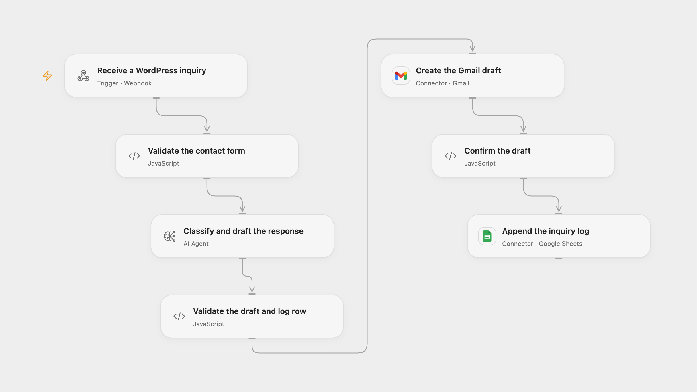

# Classify WordPress Inquiries and Draft Replies

Classify incoming WordPress contact inquiries, prepare Gmail drafts for review and log the inquiries in Google Sheets.

<picture>
  <source media="(prefers-color-scheme: dark)" srcset="preview-dark.png">
  
</picture>

[Open Flow JSON](templates/classify-wordpress-inquiries-and-draft-replies.openflow.json) · [n8n JSON](templates/classify-wordpress-inquiries-and-draft-replies.n8n.json)

## Setup

Connect Gmail and Google Sheets and configure the AI model. Set the spreadsheet ID and range in **Append the inquiry log**. The sheet columns, in order, are DATE, FIRST NAME, LAST NAME, EMAIL, PHONE, MESSAGE, CLASSIFIED and DRAFT. In n8n connect the OpenAI model, Gmail and Google Sheets, and configure the spreadsheet and sheet. Enable one format.

Install [Contact Form 7](https://contactform7.com/) and [CF7 to Webhook](https://wordpress.org/plugins/cf7-to-zapier/). In the form, use exactly five named fields that produce text values: first_name, last_name, email, phone and message; email and message are required and the others may be empty. In the form’s Webhook settings, enable sending and enter this workflow’s webhook URL; use the default POST and JSON body, with no custom body or special mail tags. The plugin sends after Contact Form 7 reports its own mail as sent, so configure that mail delivery too. Each field is limited to 10,000 characters. Open Flow rejects additional JSON keys; n8n ignores them. Protect the webhook with access controls appropriate to your deployment: it does not authenticate the sender itself. Its HTTP 200 acknowledges receipt, not successful drafting or logging.

## Behavior

An Agent classifies the inquiry as Product Info, Order Info or Other request and drafts a subject and reply. The workflow creates a Gmail draft addressed to the submitter and then appends the inquiry, classification and generated reply to the sheet. It does not send the draft. Review it for accuracy and replace any placeholders before sending. Invalid generated results, subjects over 300 characters or replies over 40,000 characters stop before a draft is created. The log date uses UTC. Form content is sent to the configured model; restrict access to executions and the sheet because they contain contact details.

A failed or uncertain Gmail draft creation may already have succeeded and prevents the sheet step. A later sheet error can leave a draft without a log row. Inspect both services before retrying: repeated requests can create duplicates. No workflow-level write retry or cross-run deduplication is added. n8n OAuth may refresh credentials and retry a request once after an HTTP 401.

Inspiration &amp; credits

## Changes to the source

- Combine the source classifier and three writers with identical instructions into one structured Agent. Do not invent facts; use placeholders for unknown details. Correct the sheet category, which the source hard-codes as Other request on every branch, and use EMAIL without the source header’s trailing space.
- Address the draft from the validated form email, use UTC for the log date and replace private spreadsheet values. Configure a current model; the example uses GPT-4.1 in place of the source Gemini models.

Adapted from [WordPress Contact Form (CF7) Responses and Classification](https://github.com/Zie619/n8n-workflows/blob/ae8cf6dc5b873cbb4f74587aa9180ed3a9f70682/workflows/Googlesheets/1860_GoogleSheets_Gmail_Automation_Webhook.json) in [Zie619/n8n-workflows](https://github.com/Zie619/n8n-workflows). The matching [n8n community listing](https://n8n.io/workflows/3472-automate-wordpress-contact-form-cf7-responses-and-classification-with-gemini/) credits Davide Boizza. No separate original template license is stated.

The collection’s [MIT notice](https://github.com/Zie619/n8n-workflows/blob/94007c1445d9258a7da116646b79473e7c7c3282/LICENSE) is pinned at a later revision. This is the collection notice at that revision; it does not establish a separate original template author's license. Our changes are listed above; see [repository licensing](../../README.md#licensing).

> MIT License
>
> Copyright (c) 2025 Zie619
>
> Permission is hereby granted, free of charge, to any person obtaining a copy
> of this software and associated documentation files (the "Software"), to deal
> in the Software without restriction, including without limitation the rights
> to use, copy, modify, merge, publish, distribute, sublicense, and/or sell
> copies of the Software, and to permit persons to whom the Software is
> furnished to do so, subject to the following conditions:
>
> The above copyright notice and this permission notice shall be included in all
> copies or substantial portions of the Software.
>
> THE SOFTWARE IS PROVIDED "AS IS", WITHOUT WARRANTY OF ANY KIND, EXPRESS OR
> IMPLIED, INCLUDING BUT NOT LIMITED TO THE WARRANTIES OF MERCHANTABILITY,
> FITNESS FOR A PARTICULAR PURPOSE AND NONINFRINGEMENT. IN NO EVENT SHALL THE
> AUTHORS OR COPYRIGHT HOLDERS BE LIABLE FOR ANY CLAIM, DAMAGES OR OTHER
> LIABILITY, WHETHER IN AN ACTION OF CONTRACT, TORT OR OTHERWISE, ARISING FROM,
> OUT OF OR IN CONNECTION WITH THE SOFTWARE OR THE USE OR OTHER DEALINGS IN THE
> SOFTWARE.

