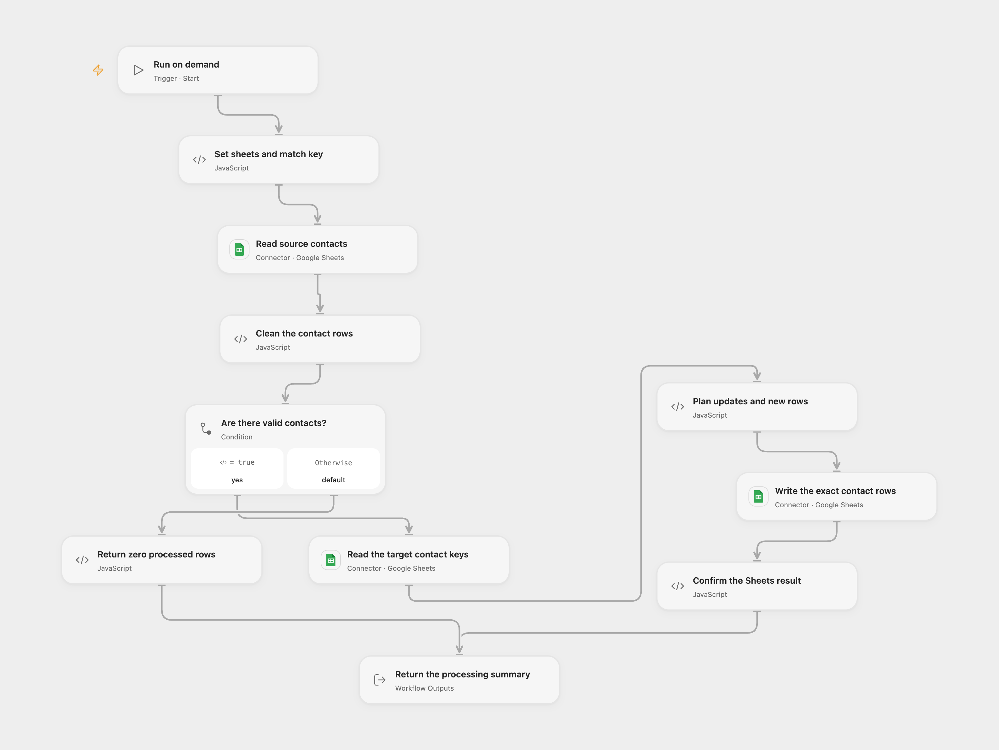

# Clean and Upsert Google Sheets Contacts

Clean contact rows in one Google Sheets tab and update or add them in a separate tab.

<!-- template-actions:start -->
 
<!-- template-actions:end -->

<picture>
  <source media="(prefers-color-scheme: dark)" srcset="preview-dark.png">
  
</picture>

## Setup

1. In **Set sheets and match key**, enter the source and target spreadsheet IDs and tab names. The tabs can belong to the same spreadsheet or to different spreadsheets. Connect Google Sheets to each read node and the write node.
2. In row 1, set source columns A:D to `id`, `name`, `email`, `status` and target columns A:F to `id`, `name`, `email`, `status`, `created_at`, `processed`, in that order. Leave enough rows in the target for new contacts.
3. In **Set sheets and match key**, set `keyColumn` to `id` or `email` based on which field is stable and unique for your data. Store IDs with leading zeros as plain text. Email keys match case-insensitively. Run on demand.

## Behavior

The workflow trims names, lowercases emails, sets blank statuses to `pending`, and skips source rows without a name or email. Every accepted row gets the run's UTC timestamp in `created_at` and the boolean `true` in `processed`. It reads the target, updates an exact match or writes the contact below the last row populated within A:Z, and touches only columns A:F. Sheets receives literal values. [Google Sheets batch update](https://developers.google.com/workspace/sheets/api/reference/rest/v4/spreadsheets.values/batchUpdate)

A missing or duplicate selected key in eligible source rows or populated target rows stops the run before writing. With no eligible contacts, the workflow reports zero. For a nonempty batch, it reports the confirmed count and the numbers of rows updated and added. Run one execution at a time. Avoid editing or moving target rows during a run because the workflow writes by row address. If the write cannot be confirmed, check the target before trying again.

In n8n

Enter the same settings in **Set sheets and match key** and select the Google Sheets OAuth2 credential in both read nodes and the write node. Run the manual trigger to get one summary item.

Inspiration &amp; credits

## Changes to the source

Add a manual trigger, explicit table headings and a required match-key choice. Count rows from the verified write result.

Adapted from [Google Sheets data processing template](https://github.com/Zie619/n8n-workflows/blob/ae8cf6dc5b873cbb4f74587aa9180ed3a9f70682/templates/data-processing/google-sheets-automation-template.json) in [Zie619/n8n-workflows](https://github.com/Zie619/n8n-workflows). Attribution: Zie619 / n8n-workflows.

The collection’s [MIT notice](https://github.com/Zie619/n8n-workflows/blob/94007c1445d9258a7da116646b79473e7c7c3282/LICENSE) is pinned at a later revision. This is the collection notice at that revision; it does not establish a separate original template author's license. Our changes are listed above; see [repository licensing](../../README.md#licensing).

> MIT License
>
> Copyright (c) 2025 Zie619
>
> Permission is hereby granted, free of charge, to any person obtaining a copy
> of this software and associated documentation files (the "Software"), to deal
> in the Software without restriction, including without limitation the rights
> to use, copy, modify, merge, publish, distribute, sublicense, and/or sell
> copies of the Software, and to permit persons to whom the Software is
> furnished to do so, subject to the following conditions:
>
> The above copyright notice and this permission notice shall be included in all
> copies or substantial portions of the Software.
>
> THE SOFTWARE IS PROVIDED "AS IS", WITHOUT WARRANTY OF ANY KIND, EXPRESS OR
> IMPLIED, INCLUDING BUT NOT LIMITED TO THE WARRANTIES OF MERCHANTABILITY,
> FITNESS FOR A PARTICULAR PURPOSE AND NONINFRINGEMENT. IN NO EVENT SHALL THE
> AUTHORS OR COPYRIGHT HOLDERS BE LIABLE FOR ANY CLAIM, DAMAGES OR OTHER
> LIABILITY, WHETHER IN AN ACTION OF CONTRACT, TORT OR OTHERWISE, ARISING FROM,
> OUT OF OR IN CONNECTION WITH THE SOFTWARE OR THE USE OR OTHER DEALINGS IN THE
> SOFTWARE.

