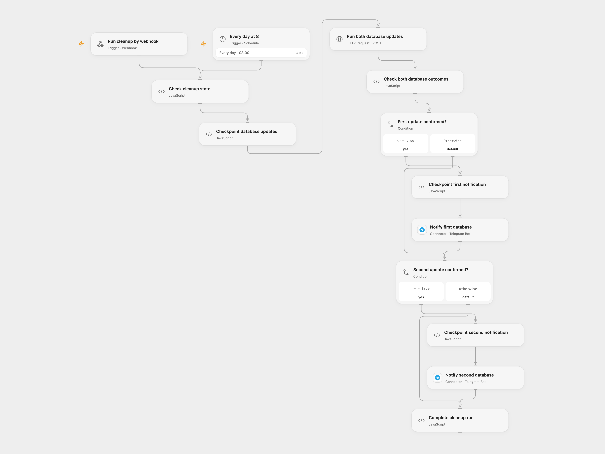

# Clean Old MySQL Packages and Notify

Mark old received packages in two MySQL databases and send a Telegram notification for each confirmed update.

<picture>
  <source media="(prefers-color-scheme: dark)" srcset="preview-dark.png">
  
</picture>

[Open Flow JSON](templates/clean-old-mysql-packages-and-notify.openflow.json) · [n8n JSON](templates/clean-old-mysql-packages-and-notify.n8n.json)

## Setup

Import the supplied n8n workflow and connect each MySQL node to its corresponding database. Both databases must have the source's `i_objeto` schema and support the included SQL. Configure both Telegram nodes with your bot and destination chat.

For direct n8n operation enable **Cron** and **Webhook**, and leave the relay webhook disabled. For Open Flow, disable those two n8n triggers, enable the MySQL relay webhook, and set its production URL in **Run both database updates**. Connect Telegram and configure both chat IDs in Open Flow. Activate one format. The original GET webhook and the POST relay have no authentication; restrict access to their URLs.

## Behavior

Every day at 08:00 UTC or on a GET webhook, each database marks package records older than one month in state `TRANSPORTE-RECEBIDO` by changing `modulo` to `DELETE`. Each confirmed update sends its matching Telegram notification. The source inherited the n8n instance timezone; adjust UTC if needed. The relay attempts both databases and reports their separate outcomes; only a confirmed update gets its matching notification. If a notification result is unknown, later notifications require manual reconciliation.

Enable persistent State and prevent overlapping Open Flow runs. If a database update or notification is uncertain, inspect both databases and Telegram, complete any outstanding work manually, and enter the pending run ID shown in the error in **Check cleanup state** before a later run. Do not automatically replay an uncertain write.

Inspiration &amp; credits

## Changes to the source

- Use a synchronous n8n webhook to retain the source MySQL operations from Open Flow.
- Replace the private chat ID with configuration, and explicitly use UTC.

Adapted from [Clean old packages in two MySQL databases](https://github.com/Zie619/n8n-workflows/blob/ae8cf6dc5b873cbb4f74587aa9180ed3a9f70682/workflows/Telegram/0140_Telegram_Webhook_Automation_Webhook.json) in [Zie619/n8n-workflows](https://github.com/Zie619/n8n-workflows). The source export does not identify a separate template author or license.

The collection’s [MIT notice](https://github.com/Zie619/n8n-workflows/blob/94007c1445d9258a7da116646b79473e7c7c3282/LICENSE) is pinned at a later revision. This is the collection notice at that revision; it does not establish a separate original template author's license. Our changes are listed above; see [repository licensing](../../README.md#licensing).

> MIT License
>
> Copyright (c) 2025 Zie619
>
> Permission is hereby granted, free of charge, to any person obtaining a copy
> of this software and associated documentation files (the "Software"), to deal
> in the Software without restriction, including without limitation the rights
> to use, copy, modify, merge, publish, distribute, sublicense, and/or sell
> copies of the Software, and to permit persons to whom the Software is
> furnished to do so, subject to the following conditions:
>
> The above copyright notice and this permission notice shall be included in all
> copies or substantial portions of the Software.
>
> THE SOFTWARE IS PROVIDED "AS IS", WITHOUT WARRANTY OF ANY KIND, EXPRESS OR
> IMPLIED, INCLUDING BUT NOT LIMITED TO THE WARRANTIES OF MERCHANTABILITY,
> FITNESS FOR A PARTICULAR PURPOSE AND NONINFRINGEMENT. IN NO EVENT SHALL THE
> AUTHORS OR COPYRIGHT HOLDERS BE LIABLE FOR ANY CLAIM, DAMAGES OR OTHER
> LIABILITY, WHETHER IN AN ACTION OF CONTRACT, TORT OR OTHERWISE, ARISING FROM,
> OUT OF OR IN CONNECTION WITH THE SOFTWARE OR THE USE OR OTHER DEALINGS IN THE
> SOFTWARE.

