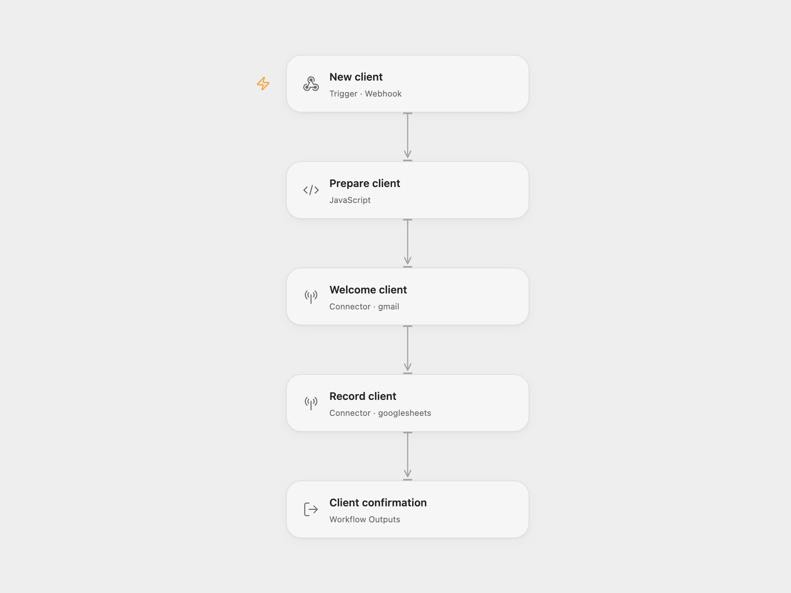

# Client Onboarding

Welcome a new client by Gmail and save their project in Google Sheets. A successful webhook response includes the client ID and name after the email and sheet write complete.

## Setup

Create a sheet named `Clients` with these headers in columns A–F:

| Client ID | Name | Email | Company | Project | Onboarded |
| --- | --- | --- | --- | --- | --- |

For Open Flow, import the JSON and configure:

| Node | Configuration |
| --- | --- |
| Prepare client | Set `senderName` for the email signature. |
| Welcome client | Connect the Gmail account that sends welcome emails. |
| Record client | Connect Google Sheets and replace `YOUR_SPREADSHEET_ID`. The default range is `'Clients'!A:F`. |

For n8n, configure the same signature, Gmail account, and spreadsheet in `Validate`, `Gmail: Welcome Email`, and `Log to Sheets`.

The n8n Code node uses the `crypto` built-in to create client IDs. It is available in n8n Cloud. Self-hosted n8n must [allow the `crypto` module](https://docs.n8n.io/hosting/configuration/configuration-examples/modules-in-code-node/).

Publish and enable the configured workflow and POST to its webhook URL:

```json
{
  "name": "Ada",
  "email": "ada@example.com",
  "company": "Example Studio",
  "project_type": "Website design"
}
```

The aliases `client_name`, `client_email`, and `company_name` take precedence over `name`, `email`, and `company`. Name and a valid email are required. The project defaults to `General`.

The success body is `{"success":true,"clientId":"CF-…","name":"Ada"}`. The welcome email runs before the sheet write. An email failure prevents the sheet write; a sheet failure does not undo a sent email. Both write steps retain the source's two-attempt limit with a one-second retry interval. Open Flow retries only failures the platform identifies as safe to retry and stops when a write's result is unknown; n8n retries any node error. Retrying a request can create another email and row. The webhook waits up to 30 seconds in Open Flow; a timeout does not cancel work already running.

## Changes to the source

- Validate the recipient before sending email or writing a row.
- Use a unique client ID instead of a millisecond timestamp.
- Keep the email-before-sheet order explicit and bind the saved fields and success response to the prepared client.
- Write literal sheet values with RAW formatting, including names or project text starting with `=`.
- Replace server environment variables with editable template configuration.

<picture>
  <source media="(prefers-color-scheme: dark)" srcset="preview-dark.png">
  
</picture>

[Open Flow JSON](templates/client-onboarding.openflow.json) · [n8n JSON](templates/client-onboarding.n8n.json)

<details>
<summary>Source and license</summary>

Adapted from [ClientFlow Lite - Client Onboarding Automation](https://github.com/enescingoz/awesome-n8n-templates/blob/827110332c21cbe000ab13f6d292d5adb1f1f8db/Other_Integrations_and_Use_Cases/ClientFlow%20Lite%20-%20Client%20Onboarding%20Automation.json) in [enescingoz/awesome-n8n-templates](https://github.com/enescingoz/awesome-n8n-templates).

Source collection notice: © 2024–2026 Enes Cingoz, [CC BY 4.0](https://github.com/enescingoz/awesome-n8n-templates/blob/827110332c21cbe000ab13f6d292d5adb1f1f8db/LICENSE). The source export does not identify a separate template author or license. See [repository licensing](../../README.md#licensing) for the scope of OOMOL contributions and third-party material.

</details>
