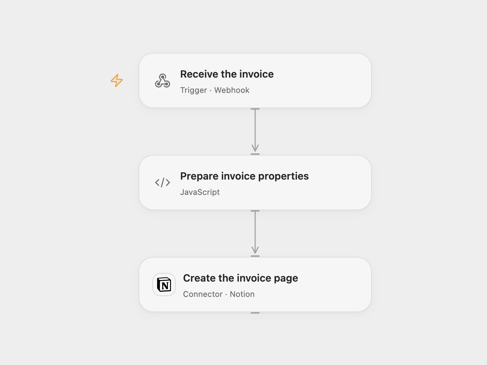

# Clockify Invoice to Notion

Create a Notion database page for a new Clockify invoice.

<picture>
  <source media="(prefers-color-scheme: dark)" srcset="preview-dark.png">
  
</picture>

[Open Flow JSON](templates/clockify-invoice-to-notion.openflow.json) · [n8n JSON](templates/clockify-invoice-to-notion.n8n.json)

## Setup

Create a Notion database with **Invoice number** (title), **Issue date** (date), **Due date** (date) and **Amount** (number). Connect Notion with access to it. In Open Flow, set its data source ID in **Prepare invoice properties**. In n8n, select the Notion credential and database in **Create database page** and map the same properties.

Deploy the webhook and configure a Clockify **Invoice created** webhook with its URL. The endpoint accepts a JSON object containing `number`, `issuedDate`, `dueDate` and numeric `amount`. Protect the endpoint URL and restrict access to invoice information. The original workflow uses an unauthenticated webhook; neither format verifies the Clockify token.

## Behavior

Each accepted delivery creates a Notion page containing those four values. Dates are stored as UTC calendar dates. The amount is copied as sent, with no currency conversion. Duplicate deliveries can create duplicate pages. If page creation fails or the result is uncertain, inspect Notion before replaying.

Open Flow checks the four fields before creation; n8n uses the mapped source fields directly. Open Flow uses the current Notion data source parent; select the corresponding database in n8n.

Inspiration &amp; credits

## Changes to the source

- Replace the original webhook path, database ID and credential with setup.
- Set the n8n workflow timezone to UTC and store invoice dates as UTC calendar dates in both formats. Open Flow checks required invoice fields before creating the page.

Adapted from [Send new Clockify invoice to Notion database](https://github.com/Zie619/n8n-workflows/blob/ae8cf6dc5b873cbb4f74587aa9180ed3a9f70682/workflows/Stickynote/0281_Stickynote_Notion_Create_Webhook.json) in [Zie619/n8n-workflows](https://github.com/Zie619/n8n-workflows). The source export does not identify a separate template author or license.

The collection’s [MIT notice](https://github.com/Zie619/n8n-workflows/blob/94007c1445d9258a7da116646b79473e7c7c3282/LICENSE) is pinned at a later revision. This is the collection notice at that revision; it does not establish a separate original template author's license. Our changes are listed above; see [repository licensing](../../README.md#licensing).

> MIT License
>
> Copyright (c) 2025 Zie619
>
> Permission is hereby granted, free of charge, to any person obtaining a copy
> of this software and associated documentation files (the "Software"), to deal
> in the Software without restriction, including without limitation the rights
> to use, copy, modify, merge, publish, distribute, sublicense, and/or sell
> copies of the Software, and to permit persons to whom the Software is
> furnished to do so, subject to the following conditions:
>
> The above copyright notice and this permission notice shall be included in all
> copies or substantial portions of the Software.
>
> THE SOFTWARE IS PROVIDED "AS IS", WITHOUT WARRANTY OF ANY KIND, EXPRESS OR
> IMPLIED, INCLUDING BUT NOT LIMITED TO THE WARRANTIES OF MERCHANTABILITY,
> FITNESS FOR A PARTICULAR PURPOSE AND NONINFRINGEMENT. IN NO EVENT SHALL THE
> AUTHORS OR COPYRIGHT HOLDERS BE LIABLE FOR ANY CLAIM, DAMAGES OR OTHER
> LIABILITY, WHETHER IN AN ACTION OF CONTRACT, TORT OR OTHERWISE, ARISING FROM,
> OUT OF OR IN CONNECTION WITH THE SOFTWARE OR THE USE OR OTHER DEALINGS IN THE
> SOFTWARE.

