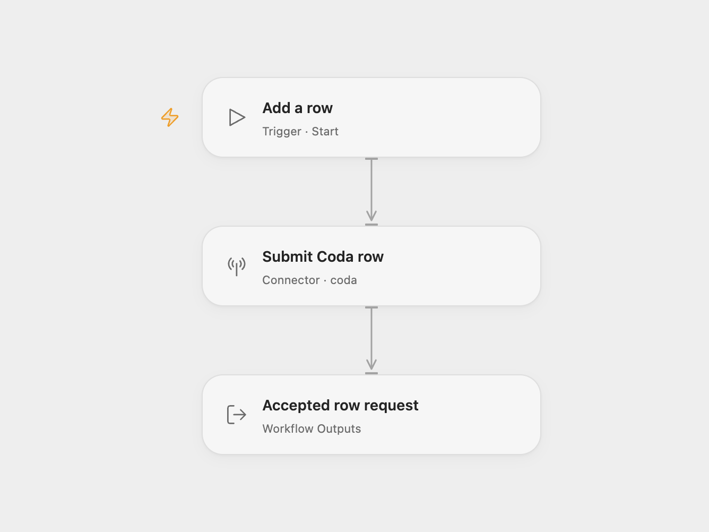

# Coda Table Row Creator

Submit one new row to a Coda table. The example writes values to three columns.

<picture>
  <source media="(prefers-color-scheme: dark)" srcset="preview-dark.png">
  
</picture>

[Open Flow JSON](templates/coda-table-row-creator.openflow.json) · [n8n JSON](templates/coda-table-row-creator.n8n.json)

## Setup

For Open Flow, import the JSON and connect Coda in **Submit Coda row**. Replace `YOUR_CODA_DOC_ID` and `YOUR_CODA_TABLE_ID`. Edit the three `cells` entries in Rows so each `column` matches a destination column name or ID and each `value` contains the data to write. Stable column IDs are preferable when table headings may change.

For n8n, connect Coda and select the document and table in **Coda**. Edit the field names and values in **Set** to match the destination columns.

Run once to submit a row. No key columns are configured, so subsequent runs add new rows instead of updating a matching record. Coda parses the supplied values using its normal rules.

Coda accepts writes asynchronously. Open Flow returns the request ID and any row IDs Coda supplies; these do not confirm that the row has finished appearing in the document. n8n returns the submitted field values after Coda accepts the request. Check the destination table before retrying an uncertain write.

## Changes to the source

- Add clear document and table placeholders.
- Keep the source’s three-column row and expose Coda’s acceptance identifiers in Open Flow.

Source and license

Adapted from [Insert data into a new row for a table in Coda](https://github.com/Zie619/n8n-workflows/blob/ae8cf6dc5b873cbb4f74587aa9180ed3a9f70682/workflows/Manual/0014_Manual_Coda_Create_Triggered.json) in [Zie619/n8n-workflows](https://github.com/Zie619/n8n-workflows). The source export does not identify a separate template author or license.

The collection’s [MIT notice](https://github.com/Zie619/n8n-workflows/blob/94007c1445d9258a7da116646b79473e7c7c3282/LICENSE) is pinned at a later revision. This is the collection notice at that revision; it does not establish a separate original template author's license. Our changes are listed above; see [repository licensing](../../README.md#licensing).

> MIT License
>
> Copyright (c) 2025 Zie619
>
> Permission is hereby granted, free of charge, to any person obtaining a copy
> of this software and associated documentation files (the "Software"), to deal
> in the Software without restriction, including without limitation the rights
> to use, copy, modify, merge, publish, distribute, sublicense, and/or sell
> copies of the Software, and to permit persons to whom the Software is
> furnished to do so, subject to the following conditions:
>
> The above copyright notice and this permission notice shall be included in all
> copies or substantial portions of the Software.
>
> THE SOFTWARE IS PROVIDED "AS IS", WITHOUT WARRANTY OF ANY KIND, EXPRESS OR
> IMPLIED, INCLUDING BUT NOT LIMITED TO THE WARRANTIES OF MERCHANTABILITY,
> FITNESS FOR A PARTICULAR PURPOSE AND NONINFRINGEMENT. IN NO EVENT SHALL THE
> AUTHORS OR COPYRIGHT HOLDERS BE LIABLE FOR ANY CLAIM, DAMAGES OR OTHER
> LIABILITY, WHETHER IN AN ACTION OF CONTRACT, TORT OR OTHERWISE, ARISING FROM,
> OUT OF OR IN CONNECTION WITH THE SOFTWARE OR THE USE OR OTHER DEALINGS IN THE
> SOFTWARE.

