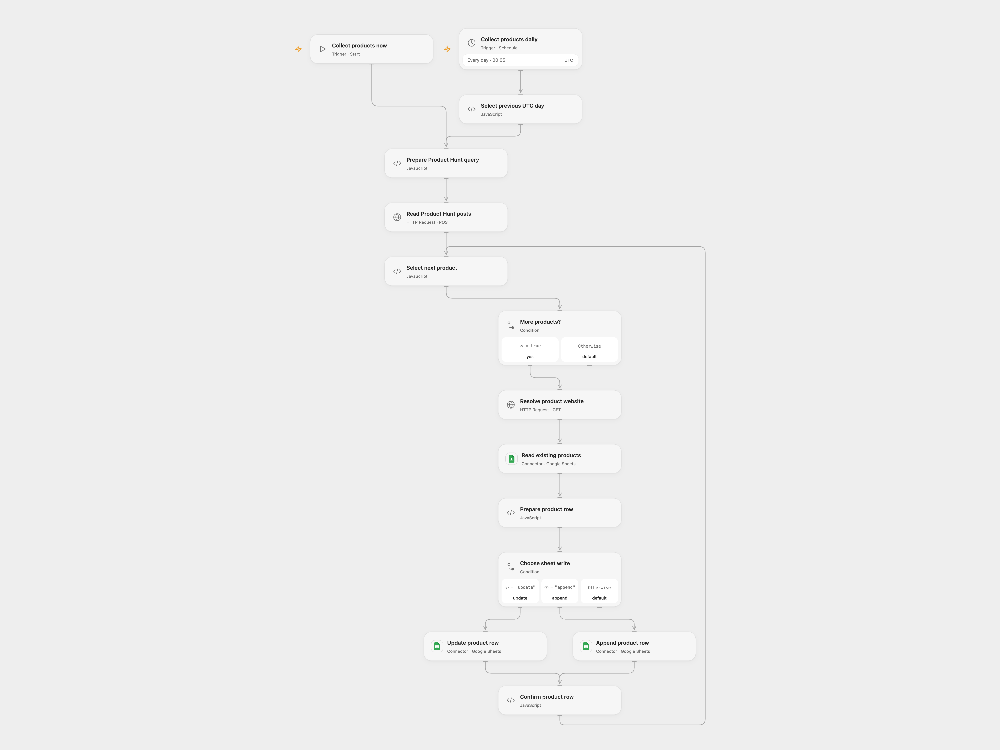

# Collect Daily Product Hunt Posts

Collect up to ten Product Hunt posts for a UTC day and maintain a Google Sheets list.

<!-- template-actions:start -->
 
<!-- template-actions:end -->

<picture>
  <source media="(prefers-color-scheme: dark)" srcset="preview-dark.png">
  
</picture>

## Setup

Bind PRODUCT_HUNT_TOKEN as a secret, connect Google Sheets, set the spreadsheet ID on the three Sheets nodes and create a Products sheet with id, name, tagline, description and next_url headers. Set a unique sheet namespace in **Select next product**. Enable persistent State. After an uncertain sheet write, inspect the post ID: set the matching pending row to done if confirmed or delete it if absent, then run for the original UTC day.

## Behavior

The workflow reads up to ten posts for the current UTC day and resolves each Product Hunt website redirect. It updates existing rows by post ID or appends new rows. The daily schedule runs at 00:05 UTC and collects the preceding complete UTC day. For a manual run, enter a date as YYYY-MM-DD, or leave it blank for today. Avoid overlapping runs and edits. If a sheet write is uncertain, inspect the post ID in the sheet, enter the pending key and confirmed or absent in **Select next product**, run for the original UTC day, then clear recovery fields.

In n8n

In n8n configure the date for manual runs in **Choose manual date** and the namespace in **Prepare Product Hunt query**, connect an HTTP Header Auth credential with Authorization set to Bearer followed by your Product Hunt token, set the spreadsheet and sheet IDs, and select a Data Table with item_key and status text columns.

Inspiration &amp; credits

Correct broken source merge references, match by post ID and stop for uncertain writes.

Adapted from [Get Product Hunt products](https://github.com/Zie619/n8n-workflows/blob/ae8cf6dc5b873cbb4f74587aa9180ed3a9f70682/workflows/Code/0863_Code_Schedule_Import_Webhook.json) in [Zie619/n8n-workflows](https://github.com/Zie619/n8n-workflows). Attribution: Zie619 / n8n-workflows.

The collection’s [MIT notice](https://github.com/Zie619/n8n-workflows/blob/94007c1445d9258a7da116646b79473e7c7c3282/LICENSE) is pinned at a later revision. This is the collection notice at that revision; it does not establish a separate original template author's license. Our changes are listed above; see [repository licensing](../../README.md#licensing).

> MIT License
>
> Copyright (c) 2025 Zie619
>
> Permission is hereby granted, free of charge, to any person obtaining a copy
> of this software and associated documentation files (the "Software"), to deal
> in the Software without restriction, including without limitation the rights
> to use, copy, modify, merge, publish, distribute, sublicense, and/or sell
> copies of the Software, and to permit persons to whom the Software is
> furnished to do so, subject to the following conditions:
>
> The above copyright notice and this permission notice shall be included in all
> copies or substantial portions of the Software.
>
> THE SOFTWARE IS PROVIDED "AS IS", WITHOUT WARRANTY OF ANY KIND, EXPRESS OR
> IMPLIED, INCLUDING BUT NOT LIMITED TO THE WARRANTIES OF MERCHANTABILITY,
> FITNESS FOR A PARTICULAR PURPOSE AND NONINFRINGEMENT. IN NO EVENT SHALL THE
> AUTHORS OR COPYRIGHT HOLDERS BE LIABLE FOR ANY CLAIM, DAMAGES OR OTHER
> LIABILITY, WHETHER IN AN ACTION OF CONTRACT, TORT OR OTHERWISE, ARISING FROM,
> OUT OF OR IN CONNECTION WITH THE SOFTWARE OR THE USE OR OTHER DEALINGS IN THE
> SOFTWARE.

