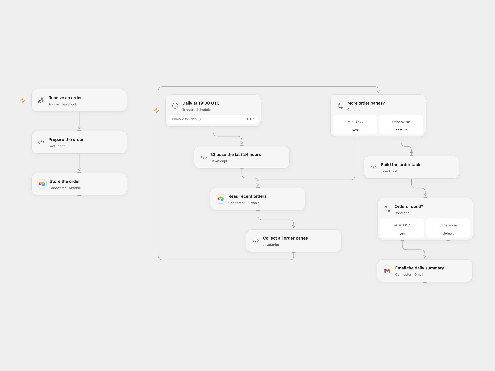

# Collect Orders and Email a Daily Summary

Store orders received by webhook in Airtable and email a daily table of recent orders.

<picture>
  <source media="(prefers-color-scheme: dark)" srcset="preview-dark.png">
  
</picture>

[Open Flow JSON](templates/collect-orders-and-email-daily-summary.openflow.json) · [n8n JSON](templates/collect-orders-and-email-daily-summary.n8n.json)

## Setup

Connect Airtable and set the same base and table on the read and create nodes. Create fields `time` (date and time), `orderID` (number), and `orderPrice` (number). Connect Gmail and set the summary recipient. Enable one format. POST JSON such as `{"orderID":123,"orderPrice":42.5}` to the webhook. The endpoint is public and has no authentication; restrict access to its URL.

## Behavior

Each POST stores one order with the receipt time. At 19:00 UTC, read all matching Airtable pages for the preceding 24 hours and send an HTML table if any orders were found. Records exactly at either boundary are excluded, as in the source. The source used the instance timezone; adjust the schedule and time-window logic together if another timezone is needed.

The webhook acknowledges admission, not completion of the Airtable write. If a write or email response is lost, inspect Airtable or Gmail before retrying; automatic replay is not configured. Do not overlap duplicate webhook requests for the same order.

Inspiration &amp; credits

## Changes to the source

- Remove private base, table and recipient values; fetch all order pages and escape values in the HTML table. Set the schedule timezone to UTC.

Adapted from [Aggregate daily orders with Airtable](https://github.com/Zie619/n8n-workflows/blob/ae8cf6dc5b873cbb4f74587aa9180ed3a9f70682/workflows/Code/0571_Code_Webhook_Send_Webhook.json) in [Zie619/n8n-workflows](https://github.com/Zie619/n8n-workflows). The source export does not identify a separate template author or license.

The collection’s [MIT notice](https://github.com/Zie619/n8n-workflows/blob/94007c1445d9258a7da116646b79473e7c7c3282/LICENSE) is pinned at a later revision. This is the collection notice at that revision; it does not establish a separate original template author's license. Our changes are listed above; see [repository licensing](../../README.md#licensing).

> MIT License
>
> Copyright (c) 2025 Zie619
>
> Permission is hereby granted, free of charge, to any person obtaining a copy
> of this software and associated documentation files (the "Software"), to deal
> in the Software without restriction, including without limitation the rights
> to use, copy, modify, merge, publish, distribute, sublicense, and/or sell
> copies of the Software, and to permit persons to whom the Software is
> furnished to do so, subject to the following conditions:
>
> The above copyright notice and this permission notice shall be included in all
> copies or substantial portions of the Software.
>
> THE SOFTWARE IS PROVIDED "AS IS", WITHOUT WARRANTY OF ANY KIND, EXPRESS OR
> IMPLIED, INCLUDING BUT NOT LIMITED TO THE WARRANTIES OF MERCHANTABILITY,
> FITNESS FOR A PARTICULAR PURPOSE AND NONINFRINGEMENT. IN NO EVENT SHALL THE
> AUTHORS OR COPYRIGHT HOLDERS BE LIABLE FOR ANY CLAIM, DAMAGES OR OTHER
> LIABILITY, WHETHER IN AN ACTION OF CONTRACT, TORT OR OTHERWISE, ARISING FROM,
> OUT OF OR IN CONNECTION WITH THE SOFTWARE OR THE USE OR OTHER DEALINGS IN THE
> SOFTWARE.

