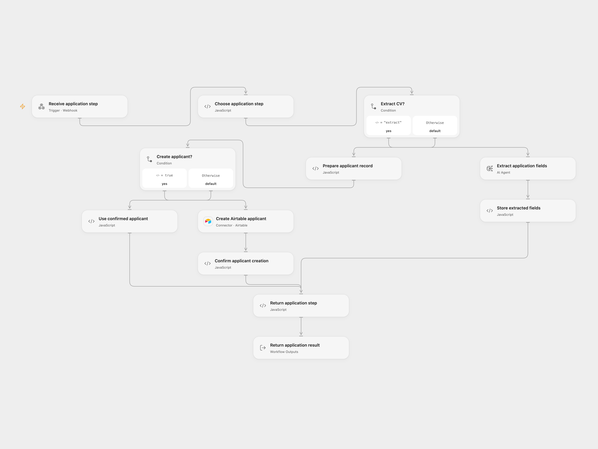

# Collect Two-Step CV Applications

Extract a PDF CV into an editable application form and store the confirmed application with its PDF.

<!-- template-actions:start -->
 
<!-- template-actions:end -->

<picture>
  <source media="(prefers-color-scheme: dark)" srcset="preview-dark.png">
  
</picture>

## Setup

Import the n8n workflow. Configure the Airtable base and table in **Create application** and Open Flow **Prepare applicant record**, and replace the base ID in **Upload PDF attachment**. The table needs Name, Address, Email, Telephone, Education, Skills & Technologies, Years of Experience, Cover Letter and Submitted By text fields, plus a File attachment field. Connect Airtable and an AI model. Adapt the sample job posting in the extraction prompt in both formats. Select one Data Table with text columns item_key and status for the n8n checkpoint nodes. Prevent overlapping runs.

For Open Flow set **Choose processing mode** to relay and configure the same deployed webhook URL in **Extract fields with Open Flow** and **Create applicant with Open Flow**. Enable persistent State. Protect the Open Flow endpoint at your deployment boundary; it has no built-in authentication. For direct n8n leave mode direct and connect the OpenAI and Airtable credentials. Use one mode only.

## Behavior

The first form collects a name, consent and a PDF. The workflow classifies it as a CV, extracts candidate details and drafts a cover letter. A non-CV returns to a PDF upload form. The applicant reviews and edits the prefilled application in the same form session before a single Airtable record is created and the original PDF is attached. Model extraction and generated text can be inaccurate; the applicant should review them. PDFs must contain readable text; scanned PDFs need OCR. Complete text and enclosing data must fit the Open Flow host 1 MiB per-Code input/output limit. CVs and personal information are sent to the configured model and stored in Airtable and execution history. Protect access and configure a retention policy; this workflow does not automatically delete applications.

If record creation is uncertain, inspect Airtable. In Open Flow enter its pending key in **Prepare applicant record**, set resolution to confirmed with the matching record ID or absent if no record exists, replay the same submission, then clear the fields. If attachment upload is uncertain, inspect the record's File field before retrying. In n8n reconcile the pending Data Table row and finish the missing attachment manually; mark done if complete, or delete the row only if neither record nor attachment exists.

Inspiration &amp; credits

Keep both form steps in one session and create one confirmed applicant record instead of matching an earlier record by editable name and email.

Adapted from [Two-step CV application form](https://github.com/Zie619/n8n-workflows/blob/ae8cf6dc5b873cbb4f74587aa9180ed3a9f70682/workflows/Extractfromfile/1493_Extractfromfile_Form_Automation_Webhook.json) in [Zie619/n8n-workflows](https://github.com/Zie619/n8n-workflows). The source export does not identify a separate template author or license.

The collection’s [MIT notice](https://github.com/Zie619/n8n-workflows/blob/94007c1445d9258a7da116646b79473e7c7c3282/LICENSE) is pinned at a later revision. This is the collection notice at that revision; it does not establish a separate original template author's license. Our changes are listed above; see [repository licensing](../../README.md#licensing).

> MIT License
>
> Copyright (c) 2025 Zie619
>
> Permission is hereby granted, free of charge, to any person obtaining a copy
> of this software and associated documentation files (the "Software"), to deal
> in the Software without restriction, including without limitation the rights
> to use, copy, modify, merge, publish, distribute, sublicense, and/or sell
> copies of the Software, and to permit persons to whom the Software is
> furnished to do so, subject to the following conditions:
>
> The above copyright notice and this permission notice shall be included in all
> copies or substantial portions of the Software.
>
> THE SOFTWARE IS PROVIDED "AS IS", WITHOUT WARRANTY OF ANY KIND, EXPRESS OR
> IMPLIED, INCLUDING BUT NOT LIMITED TO THE WARRANTIES OF MERCHANTABILITY,
> FITNESS FOR A PARTICULAR PURPOSE AND NONINFRINGEMENT. IN NO EVENT SHALL THE
> AUTHORS OR COPYRIGHT HOLDERS BE LIABLE FOR ANY CLAIM, DAMAGES OR OTHER
> LIABILITY, WHETHER IN AN ACTION OF CONTRACT, TORT OR OTHERWISE, ARISING FROM,
> OUT OF OR IN CONNECTION WITH THE SOFTWARE OR THE USE OR OTHER DEALINGS IN THE
> SOFTWARE.

