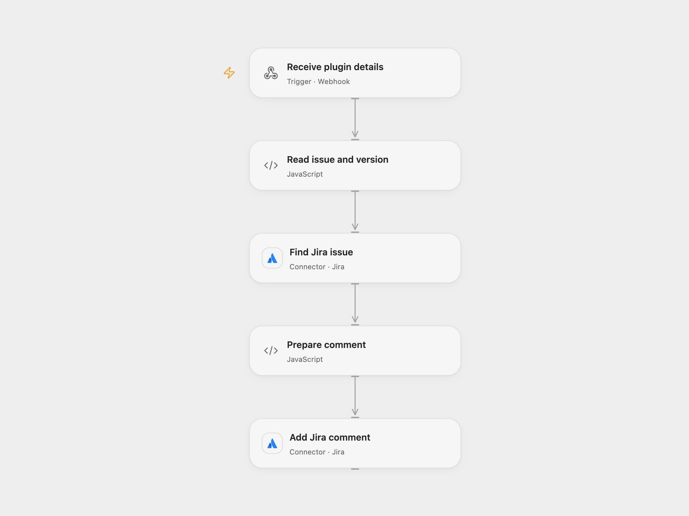

# Comment on Jira for a Figma Version

Post Figma Commit plugin version details to the linked Jira issue.

<picture>
  <source media="(prefers-color-scheme: dark)" srcset="preview-dark.png">
  
</picture>

[Open Flow JSON](templates/comment-jira-on-figma-version.openflow.json) · [n8n JSON](templates/comment-jira-on-figma-version.n8n.json)

## Setup

Connect Jira with permission to read issues and add comments. Deploy the webhook and configure its URL in the [Figma Commit plugin](https://github.com/omid-d3v/Figma-Commit-plugin-with-webhook/tree/b01238619d812f1f4ad3ddde9b429063ad285f7a). Supply a Jira issue key or browse URL, design link, changes, page and status in the plugin. In n8n connect both Jira nodes and configure the plugin with the n8n webhook URL.

## Behavior

The plugin sends the details by POST. The workflow reads the linked Jira issue and adds a comment containing page name, version details, design link and current time. The webhook does not authenticate the sender, so restrict access to the endpoint as appropriate. Its acknowledgment confirms receipt; the Jira comment may still fail. The plugin creates Figma version history after a successful webhook response. Repeating a request may create another comment.

Inspiration &amp; credits

## Changes to the source

- Replace the source Figma event trigger with a webhook matching the plugin's actual POST and accept a Jira browse URL as well as an issue key.

Adapted from [Automate Figma Versioning and Jira Updates](https://github.com/Zie619/n8n-workflows/blob/ae8cf6dc5b873cbb4f74587aa9180ed3a9f70682/workflows/Figma/1069_Figma_Stickynote_Update_Triggered.json) in [Zie619/n8n-workflows](https://github.com/Zie619/n8n-workflows). The source export does not identify a separate template author or license.

The collection’s [MIT notice](https://github.com/Zie619/n8n-workflows/blob/94007c1445d9258a7da116646b79473e7c7c3282/LICENSE) is pinned at a later revision. This is the collection notice at that revision; it does not establish a separate original template author's license. Our changes are listed above; see [repository licensing](../../README.md#licensing).

> MIT License
>
> Copyright (c) 2025 Zie619
>
> Permission is hereby granted, free of charge, to any person obtaining a copy
> of this software and associated documentation files (the "Software"), to deal
> in the Software without restriction, including without limitation the rights
> to use, copy, modify, merge, publish, distribute, sublicense, and/or sell
> copies of the Software, and to permit persons to whom the Software is
> furnished to do so, subject to the following conditions:
>
> The above copyright notice and this permission notice shall be included in all
> copies or substantial portions of the Software.
>
> THE SOFTWARE IS PROVIDED "AS IS", WITHOUT WARRANTY OF ANY KIND, EXPRESS OR
> IMPLIED, INCLUDING BUT NOT LIMITED TO THE WARRANTIES OF MERCHANTABILITY,
> FITNESS FOR A PARTICULAR PURPOSE AND NONINFRINGEMENT. IN NO EVENT SHALL THE
> AUTHORS OR COPYRIGHT HOLDERS BE LIABLE FOR ANY CLAIM, DAMAGES OR OTHER
> LIABILITY, WHETHER IN AN ACTION OF CONTRACT, TORT OR OTHERWISE, ARISING FROM,
> OUT OF OR IN CONNECTION WITH THE SOFTWARE OR THE USE OR OTHER DEALINGS IN THE
> SOFTWARE.

