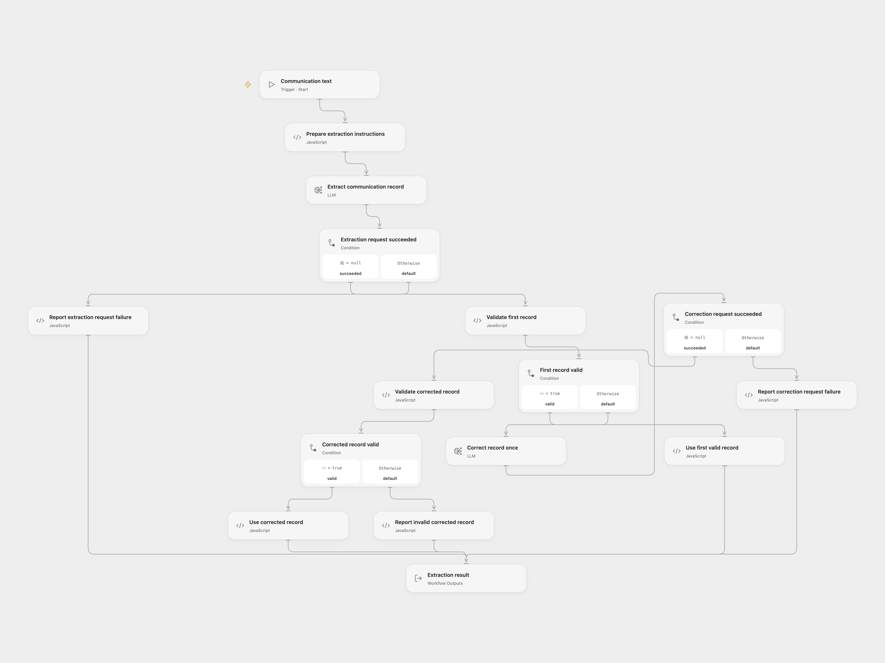

# Communication Record Extractor

Turn a text description of an email, phone call, or other communication into a structured record. Validate the model output and allow one correction step when its format is invalid.

<picture>
  <source media="(prefers-color-scheme: dark)" srcset="preview-dark.png">
  
</picture>

[Open Flow JSON](templates/communication-record-extractor.openflow.json) · [n8n JSON](templates/communication-record-extractor.n8n.json)

## Setup and use

For Open Flow, select your configured `mistral-nemo:latest` model in **Extract communication record** and **Correct record once**. Use a service appropriate for the contact information you submit. Use Run with:

```json
{
  "text": "Ada Lovelace emailed about an invoice. Her contact address is ada@example.com."
}
```

For n8n, edit **Set Communication Text**, connect **Ollama Chat Model** to an Ollama service reachable from n8n, and use Execute Workflow. Both model steps use that connection and temperature `0.1`. You can choose another available model in both formats; extraction quality may differ.

The result has `status`, `record`, `repaired`, and `error`. A successful record requires string `name` and `commtype`, with communication type `email`, `phone`, or `other`. Optional string fields are `surname`, `contacts`, `timestamp`, and `subject`. A supplied timestamp must be a date-time with timezone. Current UTC time is included in the extraction instructions.

A valid first result uses one extraction step with `repaired: false`. Invalid JSON or fields trigger one correction step. A second invalid result returns `status: failed` and no record. Model request failures do not trigger a format correction without a completion; handled failures return a failed result, and fatal platform failures stop the run. n8n’s model adapter can retry transient requests with backoff within a step. No workflow-level retries are configured.

Submitted text and any correction completion are sent to the selected model service. The workflow returns the record and does not save it to a contact system. Check extracted values against the original text; the instruction to include contacts only when provided is model guidance.

<details>
<summary>Inspiration &amp; credits</summary>

## Changes to the source

- Replace the hosted chat input with ordinary single-text input in both formats.
- Keep schema validation and at most one correction visible as separate steps.
- Read actual Basic LLM Chain text output, accept the source’s optional output wrapper, and return known record fields with explicit failure status.
- Preserve the original record schema and make the current-time context UTC.

Adapted from [Extract personal data with self-hosted LLM Mistral NeMo](https://github.com/enescingoz/awesome-n8n-templates/blob/827110332c21cbe000ab13f6d292d5adb1f1f8db/OpenAI_and_LLMs/Extract%20personal%20data%20with%20self-hosted%20LLM%20Mistral%20NeMo.json) in [enescingoz/awesome-n8n-templates](https://github.com/enescingoz/awesome-n8n-templates).

Source collection notice: © 2024–2026 Enes Cingoz, [CC BY 4.0](https://github.com/enescingoz/awesome-n8n-templates/blob/827110332c21cbe000ab13f6d292d5adb1f1f8db/LICENSE). The source export does not identify a separate template author or license. See [repository licensing](../../README.md#licensing) for the scope of OOMOL contributions and third-party material.

</details>
