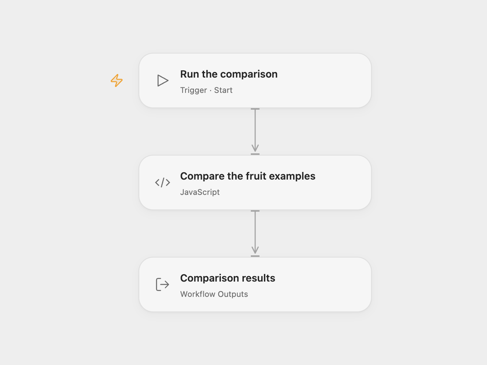

# Compare Example Fruit Datasets

Compare two sample fruit datasets by fruit name and inspect four result groups.

<picture>
  <source media="(prefers-color-scheme: dark)" srcset="preview-dark.png">
  
</picture>

[Open Flow JSON](templates/compare-example-fruit-datasets.openflow.json) · [n8n JSON](templates/compare-example-fruit-datasets.n8n.json)

## Setup and use

Run the example manually. In n8n open **Compare Datasets** to inspect its four output branches. In Open Flow inspect the four output arrays; edit the example arrays and comparison code to experiment with other fruit records.

## Behavior

Both datasets contain five example fruits. Matching uses the fruit name. Strawberry appears only in A, kiwi only in B, and apple, orange and banana are the same. Grape appears in both with different colors: green in A and purple in B. The different result identifies the matching key and shows the values from both inputs.

Inspiration &amp; credits

## Changes to the source

- Open Flow reproduces the supplied sample comparison in a Code node and returns arrays for the four result groups.

Adapted from [Comparing data with the Compare Datasets node](https://github.com/Zie619/n8n-workflows/blob/ae8cf6dc5b873cbb4f74587aa9180ed3a9f70682/workflows/Manual/0315_Manual_Comparedatasets_Automate_Triggered.json) in [Zie619/n8n-workflows](https://github.com/Zie619/n8n-workflows). The matching [n8n listing](https://n8n.io/workflows/1943-comparing-data-with-the-compare-datasets-node/) credits n8n Team. No separate original template license was identified.

The collection’s [MIT notice](https://github.com/Zie619/n8n-workflows/blob/94007c1445d9258a7da116646b79473e7c7c3282/LICENSE) is pinned at a later revision. This is the collection notice at that revision; it does not establish a separate original template author's license. Our changes are listed above; see [repository licensing](../../README.md#licensing).

> MIT License
>
> Copyright (c) 2025 Zie619
>
> Permission is hereby granted, free of charge, to any person obtaining a copy
> of this software and associated documentation files (the "Software"), to deal
> in the Software without restriction, including without limitation the rights
> to use, copy, modify, merge, publish, distribute, sublicense, and/or sell
> copies of the Software, and to permit persons to whom the Software is
> furnished to do so, subject to the following conditions:
>
> The above copyright notice and this permission notice shall be included in all
> copies or substantial portions of the Software.
>
> THE SOFTWARE IS PROVIDED "AS IS", WITHOUT WARRANTY OF ANY KIND, EXPRESS OR
> IMPLIED, INCLUDING BUT NOT LIMITED TO THE WARRANTIES OF MERCHANTABILITY,
> FITNESS FOR A PARTICULAR PURPOSE AND NONINFRINGEMENT. IN NO EVENT SHALL THE
> AUTHORS OR COPYRIGHT HOLDERS BE LIABLE FOR ANY CLAIM, DAMAGES OR OTHER
> LIABILITY, WHETHER IN AN ACTION OF CONTRACT, TORT OR OTHERWISE, ARISING FROM,
> OUT OF OR IN CONNECTION WITH THE SOFTWARE OR THE USE OR OTHER DEALINGS IN THE
> SOFTWARE.

