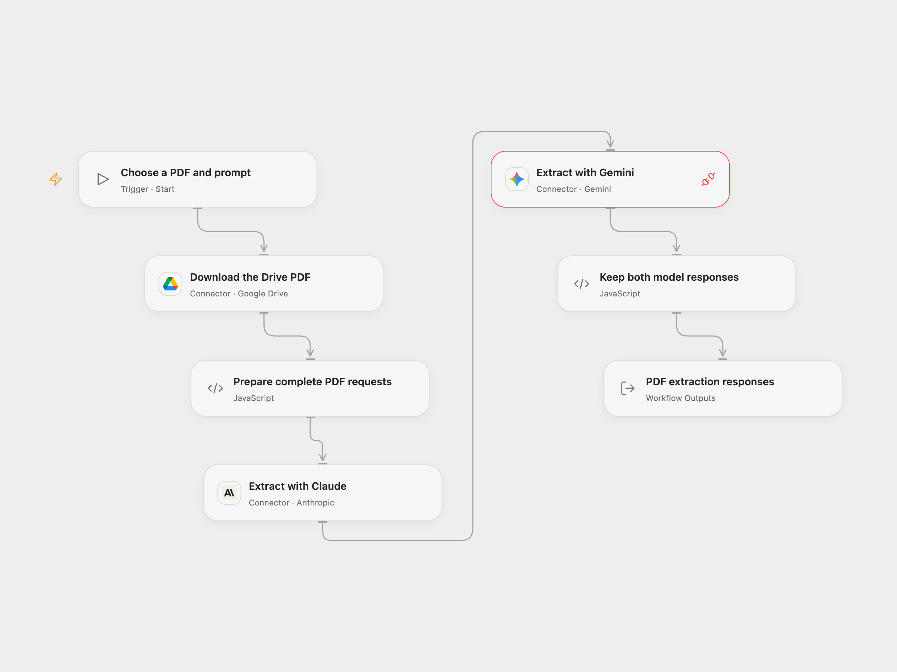

# Compare PDF Extraction with Claude and Gemini

Extract the same information from a Drive PDF with Claude and Gemini and compare their responses.

<picture>
  <source media="(prefers-color-scheme: dark)" srcset="preview-dark.png">
  
</picture>

[Open Flow JSON](templates/compare-pdf-extraction-claude-gemini.openflow.json) · [n8n JSON](templates/compare-pdf-extraction-claude-gemini.n8n.json)

## Setup

Connect Google Drive, Anthropic and Gemini. Provide a Drive file ID and a prompt, for example “Extract the VAT numbers for each country”. The selected PDF must be accessible to the Drive Connection. Set the HTTP host on **Prepare complete PDF requests** to the hostname of your deployment's connector transit URL. Anyone with access to the transit URL can retrieve the PDF while it remains available. Both model services receive the complete PDF and prompt.

The configured models are claude-sonnet-5-5 and gemini-3.8-flash. Choose models supported by your accounts if needed. In n8n set the Google Drive, Anthropic and Gemini credentials and choose the file and prompt. Both model calls are enabled; disable either n8n node only if you want one response.

## Behavior

Open Flow downloads the PDF into connector transit, checks the byte count when supplied and sends the same Base64 bytes to Claude and Gemini. It returns both provider responses. Calls run in order and a failure stops the run; review usage before repeating. The source n8n workflow fans out from the binary conversion and exposes each response separately. Model outputs can differ and should be checked against the PDF.

Complete PDF bytes and encoded requests must fit Open Flow's HTTP and Code budgets. This does not compare model accuracy or guarantee extraction. Verify authorization to send the document to both services.

Inspiration &amp; credits

Adapted from [Extract and process information directly from PDF using Claude and Gemini](https://github.com/enescingoz/awesome-n8n-templates/blob/827110332c21cbe000ab13f6d292d5adb1f1f8db/PDF_and_Document_Processing/Extract%20and%20process%20information%20directly%20from%20PDF%20using%20Claude%20and%20Gemini.json) in [enescingoz/awesome-n8n-templates](https://github.com/enescingoz/awesome-n8n-templates).

Source collection notice: © 2024–2026 Enes Cingoz, [CC BY 4.0](https://github.com/enescingoz/awesome-n8n-templates/blob/827110332c21cbe000ab13f6d292d5adb1f1f8db/LICENSE). The source export does not identify a separate template author or license. See [repository licensing](../../README.md#licensing) for the scope of OOMOL contributions and third-party material.

