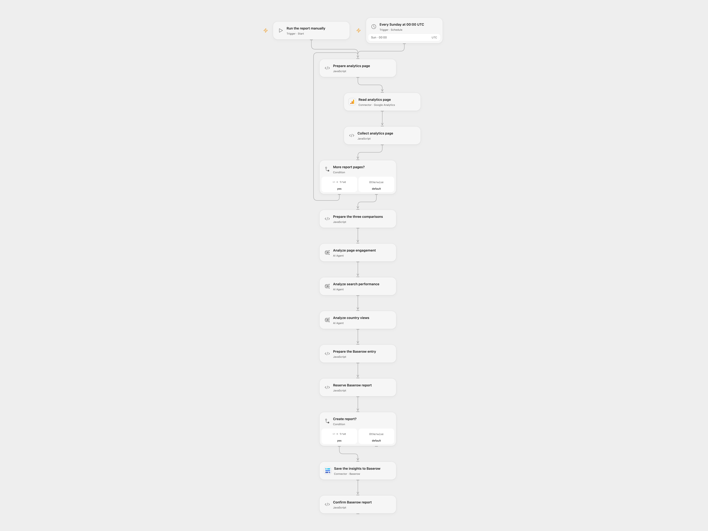

# Compare Weekly GA4 SEO Insights in Baserow

Compare weekly page engagement, search performance and country views with AI and save the insights to Baserow.

<!-- template-actions:start -->
 
<!-- template-actions:end -->

<picture>
  <source media="(prefers-color-scheme: dark)" srcset="preview-dark.png">
  
</picture>

## Setup

Connect Google Analytics with access to the property and linked Search Console data. The Open Flow Baserow Connection targets Baserow Cloud; n8n can use the host configured in its Baserow credential. Set the property ID in **Prepare analytics page**. Configure the AI model, set the same blog name in **Prepare the Baserow entry** and **Reserve Baserow report**, and connect Baserow and set the table ID in **Save the insights to Baserow**. Enable persistent State and prevent overlapping executions. Create a Baserow table with fields Name, Page Views, Search Report, Country Views and Blog; Use text fields for Name and Blog, and long-text fields for the three reports. In n8n select Google Analytics credentials on all six report nodes, connect the AI model and Baserow, and configure the property, blog, Baserow table and five field IDs. Select a Data Table with item_key and status text columns; use the same blog name in the checkpoint key and row. Prevent overlapping executions. Activate only one format.

## Behavior

Every Sunday at 00:00 UTC, or when run manually, the workflow reads all six report series: page engagement, organic Google Search and country views for the seven date labels before the current UTC date and the preceding seven dates. Google Analytics interprets those dates in the property’s reporting timezone, so the latest date can be in progress. The property and linked Search Console data must support the listed dimensions and metrics.

Three Agents independently compare each pair, each requested to produce a Markdown table and five SEO suggestions. The resulting three reports, current timestamp and blog name are saved in one Baserow row. Review the output: AI can make incorrect interpretations or recommendations. Empty analytics results are supplied as empty tables. Reports and execution data must fit platform limits; errors stop before Baserow instead of saving truncated input.

An uncertain Baserow write may already have succeeded. Inspect the table before retrying; enter the exact pending key and confirmed or absent in **Reserve Baserow report**, rerun, then clear the fields. In n8n mark the matching pending Data Table row done only after confirming the entry, or delete it only if absent. Confirmed rows are skipped for the same date and blog; clear the checkpoint after review for an intentional repeat. n8n schedules at a fixed second within the minute; Open Flow starts at the minute boundary.

Inspiration &amp; credits

## Changes to the source

- Use two non-overlapping seven-day UTC date labels, fill the missing totalUsers metric and replace private IDs and blog name. The original mixes relative dates and a fixed past end date.
- Use configured AI Agents in place of the source OpenRouter requests; the example uses GPT-4.1. Pass readable JSON to the Agents instead of URL-encoded strings. n8n sends GA pagination in the request body.

Adapted from [Send Google Analytics data to A.I. to analyze then save results in Baserow](https://github.com/Zie619/n8n-workflows/blob/ae8cf6dc5b873cbb4f74587aa9180ed3a9f70682/workflows/Googleanalytics/1529_Googleanalytics_Code_Automation_Webhook.json) in [Zie619/n8n-workflows](https://github.com/Zie619/n8n-workflows). The source links [Keith Rumjahn’s article](https://rumjahn.com/how-i-used-a-i-to-be-an-seo-expert-and-analyzed-my-google-analytics-data-in-n8n-and-make-com/). No separate original template license is stated.

The collection’s [MIT notice](https://github.com/Zie619/n8n-workflows/blob/94007c1445d9258a7da116646b79473e7c7c3282/LICENSE) is pinned at a later revision. This is the collection notice at that revision; it does not establish a separate original template author's license. Our changes are listed above; see [repository licensing](../../README.md#licensing).

> MIT License
>
> Copyright (c) 2025 Zie619
>
> Permission is hereby granted, free of charge, to any person obtaining a copy
> of this software and associated documentation files (the "Software"), to deal
> in the Software without restriction, including without limitation the rights
> to use, copy, modify, merge, publish, distribute, sublicense, and/or sell
> copies of the Software, and to permit persons to whom the Software is
> furnished to do so, subject to the following conditions:
>
> The above copyright notice and this permission notice shall be included in all
> copies or substantial portions of the Software.
>
> THE SOFTWARE IS PROVIDED "AS IS", WITHOUT WARRANTY OF ANY KIND, EXPRESS OR
> IMPLIED, INCLUDING BUT NOT LIMITED TO THE WARRANTIES OF MERCHANTABILITY,
> FITNESS FOR A PARTICULAR PURPOSE AND NONINFRINGEMENT. IN NO EVENT SHALL THE
> AUTHORS OR COPYRIGHT HOLDERS BE LIABLE FOR ANY CLAIM, DAMAGES OR OTHER
> LIABILITY, WHETHER IN AN ACTION OF CONTRACT, TORT OR OTHERWISE, ARISING FROM,
> OUT OF OR IN CONNECTION WITH THE SOFTWARE OR THE USE OR OTHER DEALINGS IN THE
> SOFTWARE.

