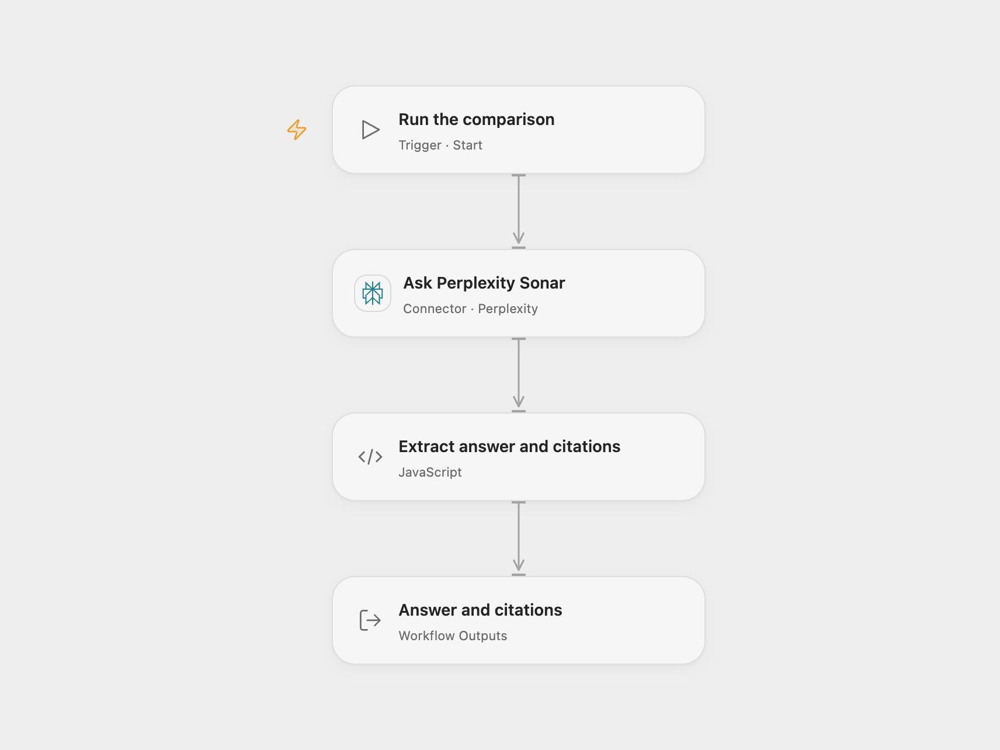

# Compare Workflow Tools with Perplexity

Ask Perplexity Sonar to compare workflow tools using selected domains and return citations.

<picture>
  <source media="(prefers-color-scheme: dark)" srcset="preview-dark.png">
  
</picture>

[Open Flow JSON](templates/compare-workflow-tools-with-perplexity.openflow.json) · [n8n JSON](templates/compare-workflow-tools-with-perplexity.n8n.json)

## Setup and use

Connect Perplexity with a Sonar-capable API key. Edit the system and user messages and domain filter in **Ask Perplexity Sonar**. The example asks about n8n and Make, limits search to their domains and uses a one-month recency filter. In n8n, configure Header Auth with your Perplexity bearer key and edit **Set Params**.

## Behavior

One manual run returns the first answer and citation URLs. Search results and generated text vary over time; review cited sources before relying on the answer. An API failure stops the run. The source's system prompt asks for an n8n-favoring perspective; edit it for a different perspective.

Inspiration &amp; credits

## Changes to the source

- Use the formal Perplexity completion Action in Open Flow to retain the search domain and recency filters and citation output. Trim whitespace around domain names and construct the n8n request as JSON values.

Adapted from [Compare workflow tools with Perplexity](https://github.com/Zie619/n8n-workflows/blob/ae8cf6dc5b873cbb4f74587aa9180ed3a9f70682/workflows/Manual/0710_Manual_Stickynote_Automation_Webhook.json) in [Zie619/n8n-workflows](https://github.com/Zie619/n8n-workflows). The source export does not identify a separate template author or license.

The collection’s [MIT notice](https://github.com/Zie619/n8n-workflows/blob/94007c1445d9258a7da116646b79473e7c7c3282/LICENSE) is pinned at a later revision. This is the collection notice at that revision; it does not establish a separate original template author's license. Our changes are listed above; see [repository licensing](../../README.md#licensing).

> MIT License
>
> Copyright (c) 2025 Zie619
>
> Permission is hereby granted, free of charge, to any person obtaining a copy
> of this software and associated documentation files (the "Software"), to deal
> in the Software without restriction, including without limitation the rights
> to use, copy, modify, merge, publish, distribute, sublicense, and/or sell
> copies of the Software, and to permit persons to whom the Software is
> furnished to do so, subject to the following conditions:
>
> The above copyright notice and this permission notice shall be included in all
> copies or substantial portions of the Software.
>
> THE SOFTWARE IS PROVIDED "AS IS", WITHOUT WARRANTY OF ANY KIND, EXPRESS OR
> IMPLIED, INCLUDING BUT NOT LIMITED TO THE WARRANTIES OF MERCHANTABILITY,
> FITNESS FOR A PARTICULAR PURPOSE AND NONINFRINGEMENT. IN NO EVENT SHALL THE
> AUTHORS OR COPYRIGHT HOLDERS BE LIABLE FOR ANY CLAIM, DAMAGES OR OTHER
> LIABILITY, WHETHER IN AN ACTION OF CONTRACT, TORT OR OTHERWISE, ARISING FROM,
> OUT OF OR IN CONNECTION WITH THE SOFTWARE OR THE USE OR OTHER DEALINGS IN THE
> SOFTWARE.

