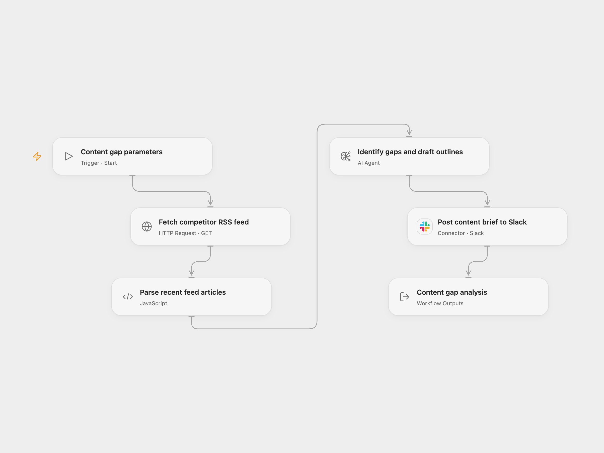

# Competitor Content Gap Brief

Fetch a competitor RSS feed, analyze recent topics for SEO content gaps, and post 3 article outlines to Slack.

<picture>
  <source media="(prefers-color-scheme: dark)" srcset="preview-dark.png">
  
</picture>

## Requirements

- Slack connection with chat:write permission and access to the target channel
- Configured AI model on the Open Flow AI Agent node
- Publicly accessible competitor RSS or Atom feed URL

## Setup

1. Import `templates/competitor-content-gap-brief.openflow.json` into Open Flow.
2. Replace any placeholder values (such as `YOUR_SLACK_CHANNEL_ID` or `YOUR_GATEWAY_MODEL_ID`) with your own configuration.
3. Connect your required integrations (for example, Slack) and run or activate the workflow trigger.
