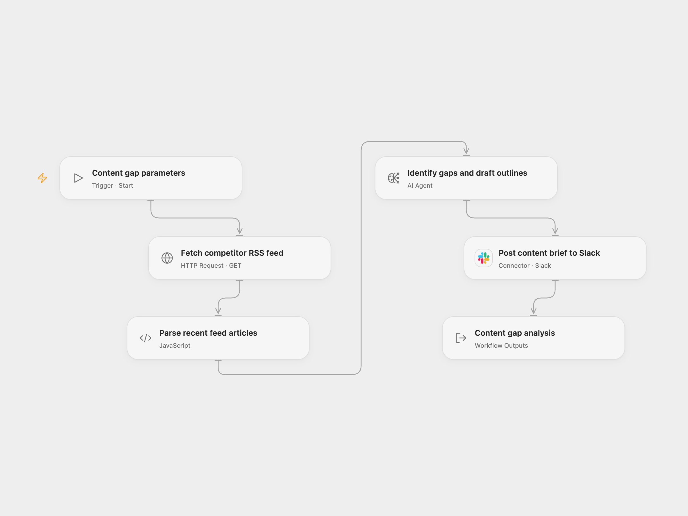

# 競合コンテンツギャップ・ブリーフ

競合の RSS フィードを取得し、最近のトピックから SEO のコンテンツギャップを分析して、記事アウトラインを 3 本 Slack に投稿します。

<!-- template-actions:start -->

<!-- template-actions:end -->

<picture>
  <source media="(prefers-color-scheme: dark)" srcset="../../preview-dark.png">
  
</picture>

## 前提条件

- chat:write 権限を持ち、対象チャンネルにアクセスできる Slack 接続
- Open Flow AI Agent ノードに設定済みの AI モデル
- 公開アクセス可能な競合の RSS または Atom フィード URL

## セットアップ

1. `templates/competitor-content-gap-brief.openflow.json` を Open Flow にインポートします。
2. プレースホルダー値（`YOUR_SLACK_CHANNEL_ID` や `YOUR_GATEWAY_MODEL_ID` など）をご自身の設定に置き換えます。
3. 必要な連携（Slack など）を接続し、ワークフローのトリガーを実行または有効化します。
