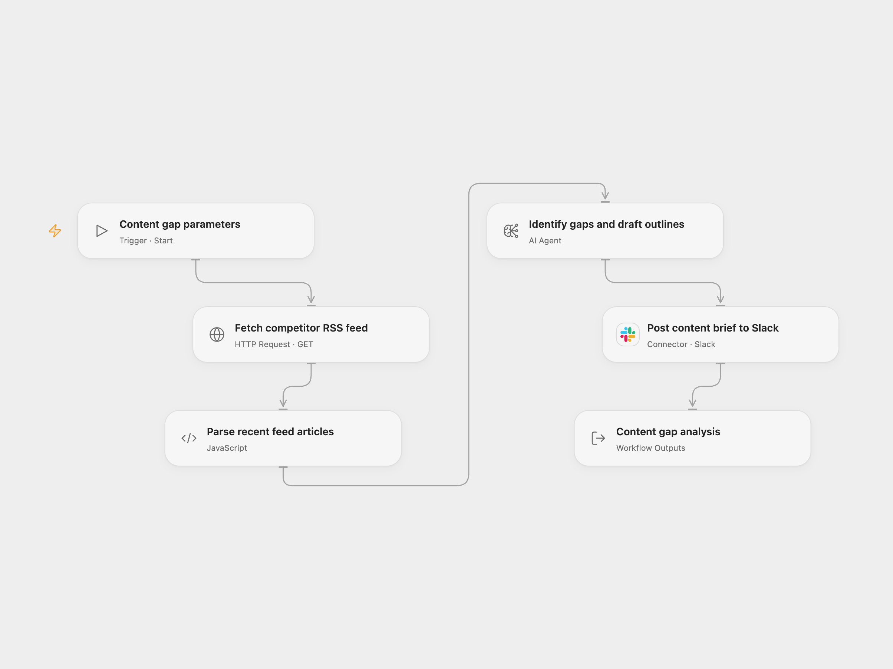

# 竞品内容缺口简报

获取竞品 RSS 订阅源，分析近期主题中的 SEO 内容缺口，并将 3 篇文章大纲发送到 Slack。

<picture>
  <source media="(prefers-color-scheme: dark)" srcset="../../preview-dark.png">
  
</picture>

## 前提条件

- 具有 chat:write 权限并可访问目标频道的 Slack 连接
- 已在 Open Flow AI Agent 节点上配置 AI 模型
- 可公开访问的竞品 RSS 或 Atom 订阅源 URL

## 配置步骤

1. 将 `templates/competitor-content-gap-brief.openflow.json` 导入 Open Flow。
2. 将占位值（如 `YOUR_SLACK_CHANNEL_ID` 或 `YOUR_GATEWAY_MODEL_ID`）替换为你自己的配置。
3. 连接所需的集成（例如 Slack），然后运行或启用工作流触发器。
