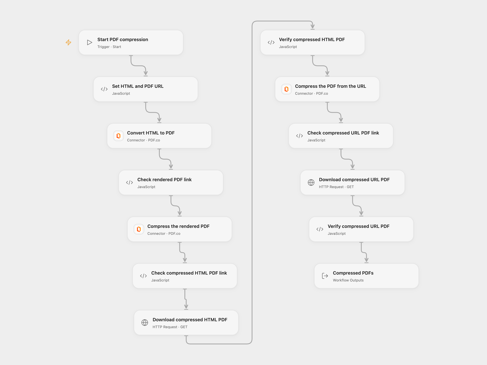

# Compress PDFs from HTML and a URL

Turn HTML into a compressed PDF and compress a second PDF from a download URL in the same manual run.

<!-- template-actions:start -->
 
<!-- template-actions:end -->

<picture>
  <source media="(prefers-color-scheme: dark)" srcset="preview-dark.png">
  
</picture>

## Setup

1. In **Set HTML and PDF URL**, enter your HTML and a direct PDF link that PDF.co can download. The defaults use sample HTML and a public W3C test document.
2. Select the same PDF.co connection in **Convert HTML to PDF**, **Compress the rendered PDF**, and **Compress the PDF from the URL**.
3. Run the workflow manually. Download both files from **Compressed PDFs**.

## Behavior

The workflow renders the HTML with PDF.co and passes its temporary PDF link to the compressor. It then compresses the document at the configured URL. Each compressed result is downloaded and checked for a PDF header. The output files are `html-compressed.pdf` and `url-compressed.pdf`.

The workflow stops on an error. If the second document fails, the first PDF remains available in its node output. PDF.co processes the input documents and generates temporary links. The downloads must fit the deployed workflow's Artifact limits.

In n8n

On a self-hosted instance, install `@custom-js/n8n-nodes-pdf-toolkit` version `1.58.0`. Assign the same CustomJS API credential in **Convert HTML to PDF**, **Compress the rendered PDF**, and **Compress the PDF from the URL**. Edit **Set HTML and PDF URL** and run manually. **Verify compressed HTML PDF** and **Verify compressed URL PDF** each return a named PDF in the `data` binary field.

The HTML path passes binary data directly from rendering to compression, subject to the CustomJS 6 MB request limit. On the URL path CustomJS retrieves the linked PDF itself.

Inspiration &amp; credits

## Changes to the source

- Use PDF.co Actions and named PDF artifacts in Open Flow. The n8n import retains the CustomJS binary and URL compression modes.
- Use public example input, check both PDF outputs and give them distinct download names.
- [Original n8n listing by CustomJS](https://n8n.io/workflows/3869-convert-html-to-pdf-and-compress-files-with-customjs-api/) and [PDF.co compression API](https://developer.pdf.co/api/pdf-compress).

Adapted from [Convert HTML to PDF and compress files with CustomJS API](https://github.com/Zie619/n8n-workflows/blob/ae8cf6dc5b873cbb4f74587aa9180ed3a9f70682/workflows/Manual/0908_Manual_Stickynote_Automate_Triggered.json) in [Zie619/n8n-workflows](https://github.com/Zie619/n8n-workflows). Attribution: CustomJS (original workflow); Zie619 / n8n-workflows (collection).

The collection’s [MIT notice](https://github.com/Zie619/n8n-workflows/blob/94007c1445d9258a7da116646b79473e7c7c3282/LICENSE) is pinned at a later revision. This is the collection notice at that revision; it does not establish a separate original template author's license. Our changes are listed above; see [repository licensing](../../README.md#licensing).

> MIT License
>
> Copyright (c) 2025 Zie619
>
> Permission is hereby granted, free of charge, to any person obtaining a copy
> of this software and associated documentation files (the "Software"), to deal
> in the Software without restriction, including without limitation the rights
> to use, copy, modify, merge, publish, distribute, sublicense, and/or sell
> copies of the Software, and to permit persons to whom the Software is
> furnished to do so, subject to the following conditions:
>
> The above copyright notice and this permission notice shall be included in all
> copies or substantial portions of the Software.
>
> THE SOFTWARE IS PROVIDED "AS IS", WITHOUT WARRANTY OF ANY KIND, EXPRESS OR
> IMPLIED, INCLUDING BUT NOT LIMITED TO THE WARRANTIES OF MERCHANTABILITY,
> FITNESS FOR A PARTICULAR PURPOSE AND NONINFRINGEMENT. IN NO EVENT SHALL THE
> AUTHORS OR COPYRIGHT HOLDERS BE LIABLE FOR ANY CLAIM, DAMAGES OR OTHER
> LIABILITY, WHETHER IN AN ACTION OF CONTRACT, TORT OR OTHERWISE, ARISING FROM,
> OUT OF OR IN CONNECTION WITH THE SOFTWARE OR THE USE OR OTHER DEALINGS IN THE
> SOFTWARE.

