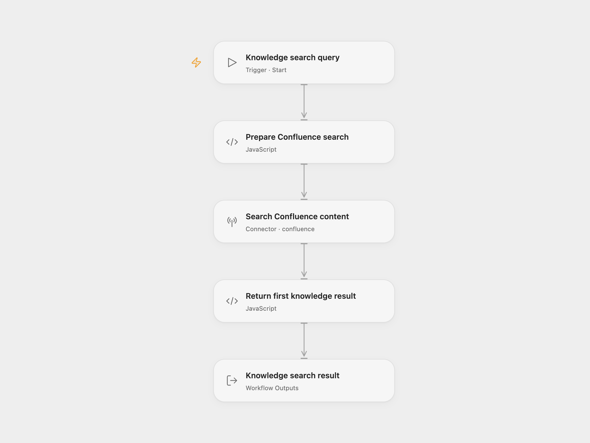

# Confluence Knowledge Search

Search a Confluence knowledge base and return the first matching result's title, article link, and excerpt.

<picture>
  <source media="(prefers-color-scheme: dark)" srcset="preview-dark.png">
  
</picture>

[Open Flow JSON](templates/confluence-knowledge-search.openflow.json) · [n8n JSON](templates/confluence-knowledge-search.n8n.json)

## Setup and use

In Open Flow, connect Confluence in **Search Confluence content**. The account needs permission to search and view the relevant content. Replace `wikiBaseUrl` in **Prepare Confluence search** with the same site's HTTPS wiki URL, ending in `/wiki`, such as `https://your-site.atlassian.net/wiki`. This URL provides the base for article links returned by the search.

Use Run and supply:

```json
{"query":"password reset"}
```

For n8n, replace the tenant in **Query Confluence** while keeping `/wiki/rest/api/search`. Select an HTTP Basic credential using your Atlassian email as the username and an API token as the password. Edit **Search Query**, then run **Run Search**. Another workflow can call **Execute Workflow Trigger** with a `query` string.

## Behavior

The workflow issues one [Confluence CQL search](https://developer.atlassian.com/cloud/confluence/rest/v1/api-group-search/#api-wiki-rest-api-search-get) with `text ~ "your query"` and a page limit of 25. It returns the first hit and does not fetch later pages. Confluence controls search ranking and visibility. [Text search syntax](https://developer.atlassian.com/cloud/confluence/performing-text-searches-using-cql/) still applies inside the search text; quotes and backslashes are escaped for the surrounding CQL string. Blank queries and control characters are rejected before searching.

The result has `found` and `response`. A match returns a text block with `Title`, `Link`, and `Content`. The excerpt is kept as supplied, including any highlight markup. As in the source, the response ends with a consumer hint about sharing the article link for password-reset questions. Its action is document search and link retrieval.

No matches return `found: false` with a short message. A failed search or malformed first result stops the run. The workflow uses a 30-second request limit and has no workflow-level retry or persistent state. Repeating a run performs another search.

## Changes to the source

- Replace the source tenant with configuration placeholders and use the platform's Confluence connector in Open Flow.
- Escape the query's CQL string and return an explicit empty result instead of indexing a missing first hit.
- Quote titles and links safely in the response text, and make timeout and redirect handling explicit.
- Add a manual n8n entry while preserving the callable workflow entry, and document the actual search steps.

<details>
<summary>Source and license</summary>

Adapted from [KB Tool - Confluence Knowledge Base](https://github.com/enescingoz/awesome-n8n-templates/blob/827110332c21cbe000ab13f6d292d5adb1f1f8db/Other_Integrations_and_Use_Cases/KB%20Tool%20-%20Confluence%20Knowledge%20Base.json) in [enescingoz/awesome-n8n-templates](https://github.com/enescingoz/awesome-n8n-templates).

Source collection notice: © 2024–2026 Enes Cingoz, [CC BY 4.0](https://github.com/enescingoz/awesome-n8n-templates/blob/827110332c21cbe000ab13f6d292d5adb1f1f8db/LICENSE). The source export does not identify a separate template author or license. This adaptation includes the changes above; see [repository licensing](../../README.md#licensing) for OOMOL contributions and third-party material.

</details>
