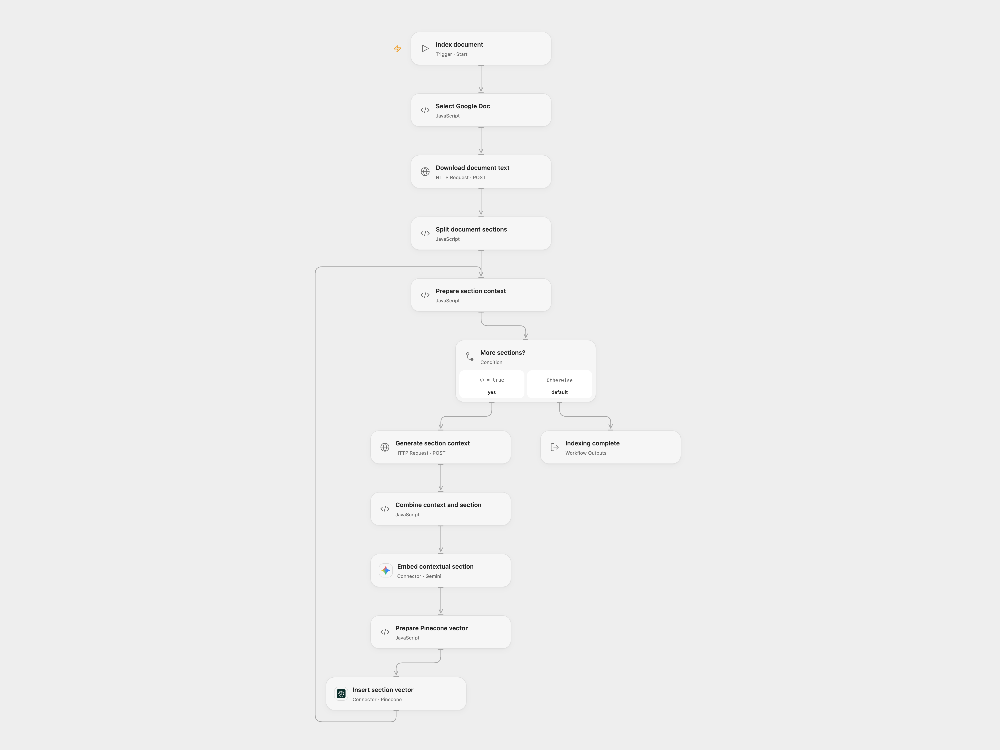

# Contextualize Drive Sections for Pinecone

Add whole-document context to each Google Doc section and index its embedding in Pinecone.

<picture>
  <source media="(prefers-color-scheme: dark)" srcset="preview-dark.png">
  
</picture>

[Open Flow JSON](templates/contextualize-drive-sections-for-pinecone.openflow.json) · [n8n JSON](templates/contextualize-drive-sections-for-pinecone.n8n.json)

## Setup and use

Import the n8n workflow, connect Google Drive, Gemini and Pinecone and configure its OpenRouter credentials and model. Activate the document relay. In Open Flow set the Google Doc ID, relay URL, OpenRouter model and Pinecone index host, bind OPENROUTER_API_KEY, and connect Gemini and Pinecone. Use a Pinecone index with 3072 dimensions and the default namespace. The relay does not authenticate callers; restrict access to trusted senders. Use the same index and embedding model when querying.

## Behavior

Run either format manually. The Google Doc is exported as text and split at the source's explicit SECTIONEND separator. For each section the workflow asks OpenRouter to place it in the context of the full document, embeds the resulting context plus section, and stores a vector with the combined text. Open Flow also records the document ID and section index as vector metadata. Each section must fit the selected model's input limits and the full document must fit the context model and workflow limits. Gemini 001 output is configured for 3072 dimensions; create a matching index and re-embed documents when changing models.

Pinecone inserts use new IDs on each run. If a write response is lost, inspect the index before retrying because a vector may already exist.

Inspiration &amp; credits

## Changes to the source

- Replace the retired Gemini text-embedding-004 with gemini-embedding-001 at 3072 dimensions and explicitly load each contextualized section instead of serializing the entire input JSON. Open Flow records the document ID and section index as vector metadata. Add a Google Doc text relay for Open Flow and replace private identifiers.

Adapted from [RAG_Context-Aware Chunking _ Google Drive to Pinecone via OpenRouter & Gemini](https://github.com/enescingoz/awesome-n8n-templates/blob/827110332c21cbe000ab13f6d292d5adb1f1f8db/Google_Drive_and_Google_Sheets/RAG_Context-Aware%20Chunking%20_%20Google%20Drive%20to%20Pinecone%20via%20OpenRouter%20%26%20Gemini.json) in [enescingoz/awesome-n8n-templates](https://github.com/enescingoz/awesome-n8n-templates).

Source collection notice: © 2024–2026 Enes Cingoz, [CC BY 4.0](https://github.com/enescingoz/awesome-n8n-templates/blob/827110332c21cbe000ab13f6d292d5adb1f1f8db/LICENSE). The source export does not identify a separate template author or license. See [repository licensing](../../README.md#licensing) for the scope of OOMOL contributions and third-party material.

