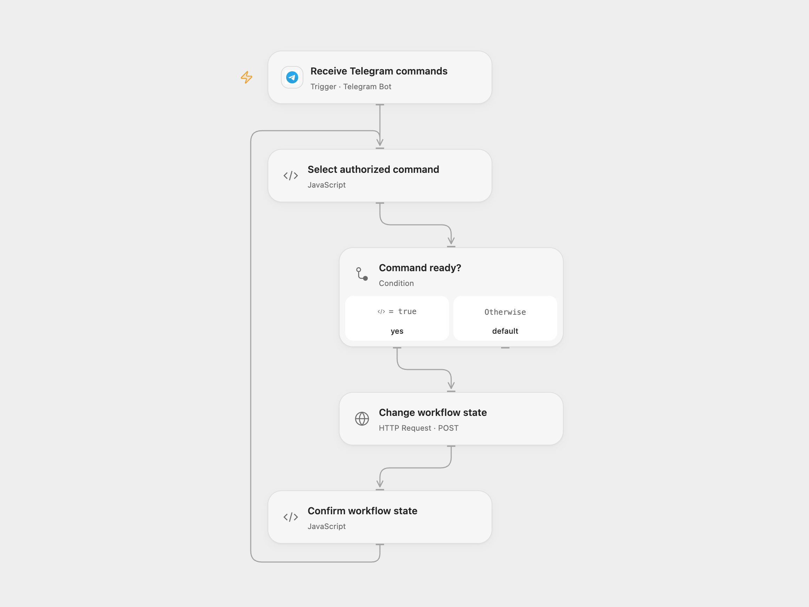

# Control n8n Workflows from Telegram

Start or stop two configured n8n workflows from an authorized Telegram chat.

<picture>
  <source media="(prefers-color-scheme: dark)" srcset="preview-dark.png">
  
</picture>

[Open Flow JSON](templates/control-n8n-workflows-from-telegram.openflow.json) · [n8n JSON](templates/control-n8n-workflows-from-telegram.n8n.json)

## Setup

Connect a Telegram bot. In **Select authorized command**, set the numeric private chat ID, HTTPS n8n base URL, and the marketing and sales workflow IDs. Store an n8n API key with workflow activation access as Secret Variable `N8N_API_KEY`. Enable persistent State and prevent overlapping runs. Use a private chat and control access to the bot. Only one active Telegram webhook can use a bot at a time.

In n8n, configure the Telegram and n8n credentials, set the same chat and workflow IDs in **Configure commands**, create a Data Table with text columns update_id and status, and select it in the checkpoint nodes. Activate one format.

## Behavior

From the configured chat, send `/start marketing`, `/stop marketing`, `/start sales` or `/stop sales`. Other chats and messages are ignored. These commands change whether the selected workflows run. There is no confirmation message.

An uncertain action remains pending and is not automatically repeated. Inspect n8n before resolving it. In Open Flow set **acknowledgeId** to the pending Telegram update ID after inspection, then send another authorized command; queued commands continue and the acknowledged command is treated as handled. Clear that field afterward. In n8n mark its pending Data Table row done if handled or remove it only when a retry is safe. Processed IDs accumulate until deliberately cleared. Telegram delivery and activation state are not an exactly-once guarantee.

Inspiration &amp; credits

## Changes to the source

- Replace empty IDs and inconsistent sample labels with explicit configuration and exact commands.
- Record a pending update before changing workflow state and block automatic replay after an unknown result.

Adapted from [Telegram workflow activator](https://github.com/Zie619/n8n-workflows/blob/ae8cf6dc5b873cbb4f74587aa9180ed3a9f70682/workflows/Filter/0335_Filter_Telegram_Send_Triggered.json) in [Zie619/n8n-workflows](https://github.com/Zie619/n8n-workflows). The source export does not identify a separate template author or license.

The collection’s [MIT notice](https://github.com/Zie619/n8n-workflows/blob/94007c1445d9258a7da116646b79473e7c7c3282/LICENSE) is pinned at a later revision. This is the collection notice at that revision; it does not establish a separate original template author's license. Our changes are listed above; see [repository licensing](../../README.md#licensing).

> MIT License
>
> Copyright (c) 2025 Zie619
>
> Permission is hereby granted, free of charge, to any person obtaining a copy
> of this software and associated documentation files (the "Software"), to deal
> in the Software without restriction, including without limitation the rights
> to use, copy, modify, merge, publish, distribute, sublicense, and/or sell
> copies of the Software, and to permit persons to whom the Software is
> furnished to do so, subject to the following conditions:
>
> The above copyright notice and this permission notice shall be included in all
> copies or substantial portions of the Software.
>
> THE SOFTWARE IS PROVIDED "AS IS", WITHOUT WARRANTY OF ANY KIND, EXPRESS OR
> IMPLIED, INCLUDING BUT NOT LIMITED TO THE WARRANTIES OF MERCHANTABILITY,
> FITNESS FOR A PARTICULAR PURPOSE AND NONINFRINGEMENT. IN NO EVENT SHALL THE
> AUTHORS OR COPYRIGHT HOLDERS BE LIABLE FOR ANY CLAIM, DAMAGES OR OTHER
> LIABILITY, WHETHER IN AN ACTION OF CONTRACT, TORT OR OTHERWISE, ARISING FROM,
> OUT OF OR IN CONNECTION WITH THE SOFTWARE OR THE USE OR OTHER DEALINGS IN THE
> SOFTWARE.

