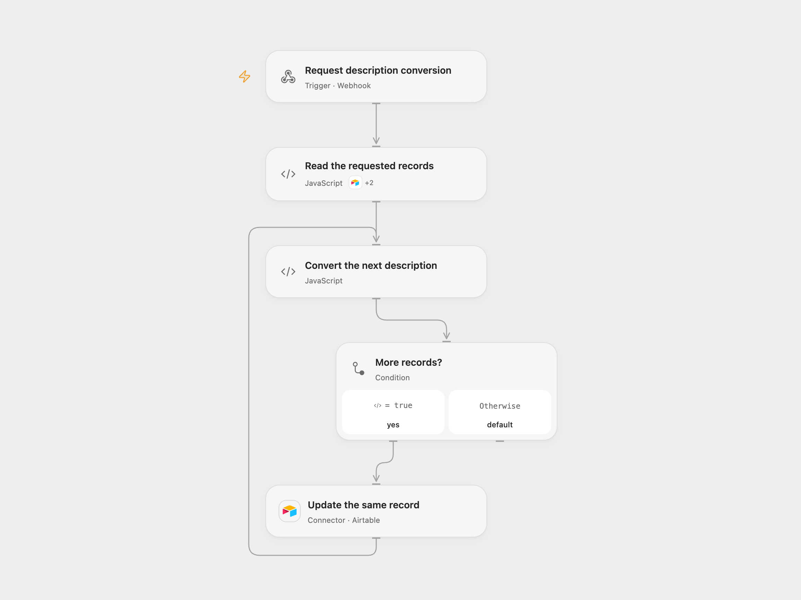

# Convert Airtable Markdown Descriptions to HTML

Convert one Airtable video description or the first three descriptions from Markdown to HTML.

<picture>
  <source media="(prefers-color-scheme: dark)" srcset="preview-dark.png">
  
</picture>

[Open Flow JSON](templates/convert-airtable-markdown-descriptions-to-html.openflow.json) · [n8n JSON](templates/convert-airtable-markdown-descriptions-to-html.n8n.json)

## Setup

Connect Airtable with access to the same base and table in **Read the requested records** and **Update the same record**. Set the base and table IDs in both nodes. Create a Markdown text field named `📥 Video Description` and a text field named `Video description HTML`. In n8n connect Airtable and set the same base and table in the read and update nodes. Activate one format.

## Use

Send a GET request to the workflow webhook. Include `recordId` as a query parameter to convert that record; omit it to convert the first three records returned by Airtable. The one-record path enables simplified autolinks, while the three-record path uses the converter defaults, matching the source. The HTML is stored in the same record. Markdown can contain raw HTML; sanitize the result before using it in an untrusted web page.

The endpoint can trigger Airtable writes. The webhook acknowledgment does not confirm the updates. A failed or uncertain update may have succeeded, and earlier updates remain; inspect the table before replaying. No automatic retry is added.

Inspiration &amp; credits

## Changes to the source

- Replace the private Airtable IDs and retain each original record ID through conversion.
- Open Flow bundles Showdown 2.1.0 for the same Markdown conversion options.

Adapted from [Airtable markdown to html](https://github.com/Zie619/n8n-workflows/blob/ae8cf6dc5b873cbb4f74587aa9180ed3a9f70682/workflows/Markdown/1540_Markdown_Stickynote_Automation_Webhook.json) in [Zie619/n8n-workflows](https://github.com/Zie619/n8n-workflows). The source export does not identify a separate template author or license.

The collection’s [MIT notice](https://github.com/Zie619/n8n-workflows/blob/94007c1445d9258a7da116646b79473e7c7c3282/LICENSE) is pinned at a later revision. This is the collection notice at that revision; it does not establish a separate original template author's license. Our changes are listed above; see [repository licensing](../../README.md#licensing).

> MIT License
>
> Copyright (c) 2025 Zie619
>
> Permission is hereby granted, free of charge, to any person obtaining a copy
> of this software and associated documentation files (the "Software"), to deal
> in the Software without restriction, including without limitation the rights
> to use, copy, modify, merge, publish, distribute, sublicense, and/or sell
> copies of the Software, and to permit persons to whom the Software is
> furnished to do so, subject to the following conditions:
>
> The above copyright notice and this permission notice shall be included in all
> copies or substantial portions of the Software.
>
> THE SOFTWARE IS PROVIDED "AS IS", WITHOUT WARRANTY OF ANY KIND, EXPRESS OR
> IMPLIED, INCLUDING BUT NOT LIMITED TO THE WARRANTIES OF MERCHANTABILITY,
> FITNESS FOR A PARTICULAR PURPOSE AND NONINFRINGEMENT. IN NO EVENT SHALL THE
> AUTHORS OR COPYRIGHT HOLDERS BE LIABLE FOR ANY CLAIM, DAMAGES OR OTHER
> LIABILITY, WHETHER IN AN ACTION OF CONTRACT, TORT OR OTHERWISE, ARISING FROM,
> OUT OF OR IN CONNECTION WITH THE SOFTWARE OR THE USE OR OTHER DEALINGS IN THE
> SOFTWARE.

Open Flow bundles [Showdown 2.1.0](https://github.com/showdownjs/showdown) under MIT; the notice is included in the workflow code.

