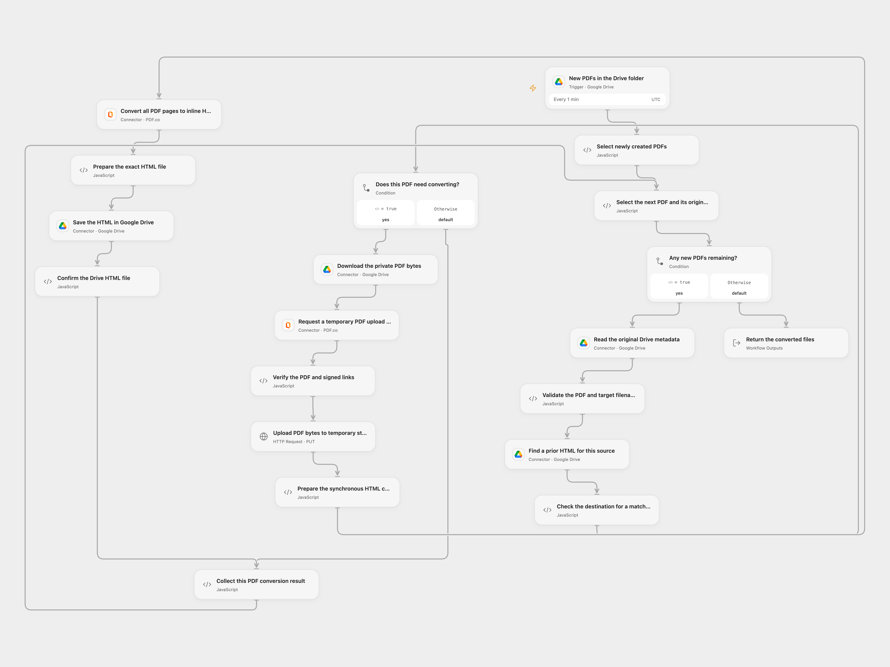

# Convert New Drive PDFs to HTML

Convert new PDFs in a Google Drive folder with PDF.co and save the HTML under the original filename.

<!-- template-actions:start -->
 
<!-- template-actions:end -->

<picture>
  <source media="(prefers-color-scheme: dark)" srcset="preview-dark.png">
  
</picture>

## Setup

1. Select the source folder in **New PDFs in the Drive folder**. In **Validate the PDF and target filename**, set the destination folder ID. You can use the same My Drive folder for both. Select the same Google Drive account for the trigger, reads and upload. Allow Provider API access for the Drive download and prior-output lookup.
2. Connect PDF.co with Provider API access in **Request a temporary PDF upload link** and **Convert all PDF pages to inline HTML**. Use this workflow for PDFs that your account may send to PDF.co. [PDF.co temporary uploads](https://developer.pdf.co/api/file-upload/overview)
3. Publish the workflow and let it establish its initial folder baseline. Upload a new PDF to the selected source folder.

## Behavior

The workflow checks the source folder every minute. For each new PDF, it downloads the private Drive file using the connected account and uses matching signed PDF.co links to upload it temporarily and convert all pages. The source PDF's sharing settings stay private. The PDF.co input copy expires automatically after about an hour. Keep the workflow's execution history private because it can contain temporary signed links.

The HTML is saved in the destination Drive folder with the source basename and an `.html` extension. Each output records the source file ID in a property private to the connected Drive app. Keep the same Drive connection to find existing outputs. Two PDFs with the same name remain separate. HTML files in the watched folder are ignored. The run returns the Drive receipt and the newly converted HTML as a downloadable file. PDF.co's rendered HTML is kept as returned.

The PDF must fit within 3,000,000 bytes and the converted HTML within 2,000,000 bytes. The conversion must complete within the PDF.co Provider Proxy’s 30-second request timeout. If Drive accepts an upload without confirming it, check the destination before retrying the source. The first confirmed HTML per source ID and destination is reused. Avoid concurrent manual reruns for the same PDF.

In n8n

Set both Google Drive folder IDs in **Set folders and select the scan window**. Use the same Google Drive OAuth2 credential for the reads and upload. In both PDF.co API nodes, use a Header Auth credential with the header name `x-api-key`. The temporary storage PUT uses the signed URL and the PDF content type.

Publish the workflow on a self-hosted instance in regular mode with `N8N_CONCURRENCY_PRODUCTION_LIMIT=1`. This instance-wide setting serializes production runs so the scan watermark can advance in order. The first scheduled run establishes the baseline. Each later run scans the complete window since the last completed scan, up to 25 Drive pages. If a scan exceeds that limit, it fails before any conversion and keeps the previous watermark. The workflow allows up to 120 seconds per PDF.co conversion. [n8n concurrency control](https://docs.n8n.io/hosting/scaling/concurrency-control/)

The watermark advances once Drive returns the complete list. If a later conversion fails, review that execution to identify any PDFs that need recovery. For an `unconfirmed` upload, **Confirm the Drive HTML file** records the source ID. Check the destination before any manual recovery. Keep execution history private.

Inspiration &amp; credits

Adapted from [Automated PDF to HTML Conversion](https://github.com/Zie619/n8n-workflows/blob/ae8cf6dc5b873cbb4f74587aa9180ed3a9f70682/workflows/Http/0934_HTTP_Code_Automate_Webhook.json) in [Zie619/n8n-workflows](https://github.com/Zie619/n8n-workflows). Attribution: WeblineIndia (original workflow); Zie619 (collection).

The collection’s [MIT notice](https://github.com/Zie619/n8n-workflows/blob/94007c1445d9258a7da116646b79473e7c7c3282/LICENSE) is pinned at a later revision. This is the collection notice at that revision; it does not establish a separate original template author's license. Our changes are listed above; see [repository licensing](../../README.md#licensing).

> MIT License
>
> Copyright (c) 2025 Zie619
>
> Permission is hereby granted, free of charge, to any person obtaining a copy
> of this software and associated documentation files (the "Software"), to deal
> in the Software without restriction, including without limitation the rights
> to use, copy, modify, merge, publish, distribute, sublicense, and/or sell
> copies of the Software, and to permit persons to whom the Software is
> furnished to do so, subject to the following conditions:
>
> The above copyright notice and this permission notice shall be included in all
> copies or substantial portions of the Software.
>
> THE SOFTWARE IS PROVIDED "AS IS", WITHOUT WARRANTY OF ANY KIND, EXPRESS OR
> IMPLIED, INCLUDING BUT NOT LIMITED TO THE WARRANTIES OF MERCHANTABILITY,
> FITNESS FOR A PARTICULAR PURPOSE AND NONINFRINGEMENT. IN NO EVENT SHALL THE
> AUTHORS OR COPYRIGHT HOLDERS BE LIABLE FOR ANY CLAIM, DAMAGES OR OTHER
> LIABILITY, WHETHER IN AN ACTION OF CONTRACT, TORT OR OTHERWISE, ARISING FROM,
> OUT OF OR IN CONNECTION WITH THE SOFTWARE OR THE USE OR OTHER DEALINGS IN THE
> SOFTWARE.

The [original n8n gallery workflow](https://n8n.io/workflows/3275-convert-pdf-to-html-using-pdfco-and-google-drive/) credits WeblineIndia. This version uses a private Drive download, a temporary PDF.co upload and a source-specific HTML filename. It writes the HTML bytes together with their source ID. [PDF.co PDF-to-HTML endpoint](https://developer.pdf.co/api/pdf-to-html)

