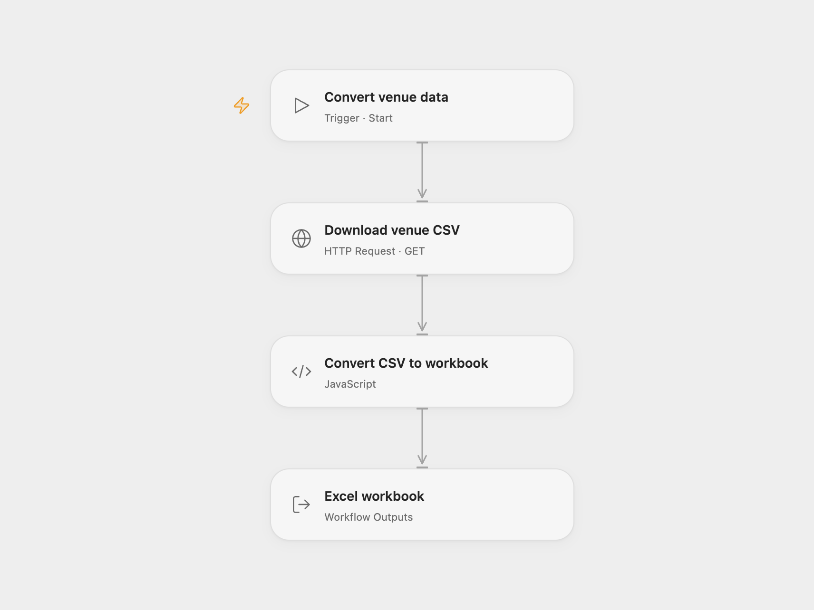

# Convert Potsdam Venue CSV to Excel

Download Potsdam venue data as CSV and convert it to an Excel workbook.

<picture>
  <source media="(prefers-color-scheme: dark)" srcset="preview-dark.png">
  
</picture>

[Open Flow JSON](templates/convert-potsdam-venue-csv-to-excel.openflow.json) · [n8n JSON](templates/convert-potsdam-venue-csv-to-excel.n8n.json)

## Setup and use

Run manually to download the public Potsdam venue dataset and produce converted_csv.xlsx. The workbook contains a sheet named csv_page. Use either Open Flow or n8n.

## Behavior

The workflow parses semicolon-delimited CSV with a header row and writes an Excel workbook. Dataset availability and contents depend on the Potsdam open-data service.

Inspiration &amp; credits

## Changes to the source

- Open Flow returns a downloadable workbook artifact.

Adapted from [Convert Potsdam venue CSV to Excel](https://github.com/Zie619/n8n-workflows/blob/ae8cf6dc5b873cbb4f74587aa9180ed3a9f70682/workflows/Manual/2017_Manual_Stickynote_Import_Webhook.json) in [Zie619/n8n-workflows](https://github.com/Zie619/n8n-workflows). The source export does not identify a separate template author or license.

The collection’s [MIT notice](https://github.com/Zie619/n8n-workflows/blob/94007c1445d9258a7da116646b79473e7c7c3282/LICENSE) is pinned at a later revision. This is the collection notice at that revision; it does not establish a separate original template author's license. Our changes are listed above; see [repository licensing](../../README.md#licensing).

> MIT License
>
> Copyright (c) 2025 Zie619
>
> Permission is hereby granted, free of charge, to any person obtaining a copy
> of this software and associated documentation files (the "Software"), to deal
> in the Software without restriction, including without limitation the rights
> to use, copy, modify, merge, publish, distribute, sublicense, and/or sell
> copies of the Software, and to permit persons to whom the Software is
> furnished to do so, subject to the following conditions:
>
> The above copyright notice and this permission notice shall be included in all
> copies or substantial portions of the Software.
>
> THE SOFTWARE IS PROVIDED "AS IS", WITHOUT WARRANTY OF ANY KIND, EXPRESS OR
> IMPLIED, INCLUDING BUT NOT LIMITED TO THE WARRANTIES OF MERCHANTABILITY,
> FITNESS FOR A PARTICULAR PURPOSE AND NONINFRINGEMENT. IN NO EVENT SHALL THE
> AUTHORS OR COPYRIGHT HOLDERS BE LIABLE FOR ANY CLAIM, DAMAGES OR OTHER
> LIABILITY, WHETHER IN AN ACTION OF CONTRACT, TORT OR OTHERWISE, ARISING FROM,
> OUT OF OR IN CONNECTION WITH THE SOFTWARE OR THE USE OR OTHER DEALINGS IN THE
> SOFTWARE.

The [Potsdam venue dataset](https://opendata.potsdam.de/explore/dataset/veranstaltungsplaetze-potsdam/) is published by Landeshauptstadt Potsdam under [Datenlizenz Deutschland Zero 2.0](https://www.govdata.de/dl-de/zero-2-0).

SheetJS xlsx 0.20.2 is included under the [Apache License 2.0](https://www.apache.org/licenses/LICENSE-2.0); copyright 2013-present SheetJS. The full license is included in the workflow module.

