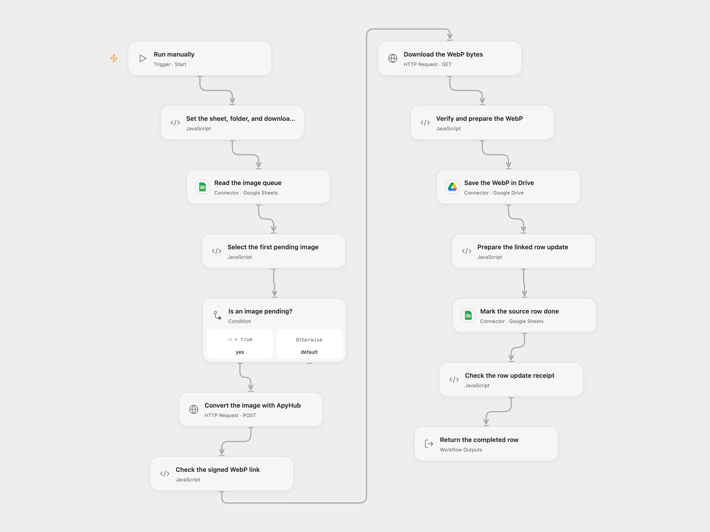

# Convert Sheet Images to WebP in Drive

Convert one pending JPEG or PNG from Google Sheets to WebP, save a Drive copy, and update its source row.

<!-- template-actions:start -->
 
<!-- template-actions:end -->

<picture>
  <source media="(prefers-color-scheme: dark)" srcset="preview-dark.png">
  
</picture>

## Setup

1. Put the headers `FROM`, `TO`, and `DONE` in cells A1, B1, and C1. Put public HTTPS JPEG or PNG links in **FROM** and leave **DONE** empty for pending rows.
2. In **Set the sheet, folder, and download origin**, set the spreadsheet ID, tab name, Drive folder ID, and exact HTTPS origin used by your ApyHub signed download links. The origin is the scheme and hostname without a path. Select a Google Sheets connection for the read and write steps and a Google Drive connection for the upload.
3. Bind your ApyHub token as the secret Variable `APYHUB_TOKEN` in **Convert the image with ApyHub**. Run the workflow manually. [ApyHub JPEG and PNG conversion](https://apyhub.com/apyhub/service/convert-jpeg-to-webp), [ApyHub PNG to WebP](https://apyhub.com/apyhub/service/convert-png-to-webp)

## Behavior

Each manual run looks at the first row whose **DONE** cell is empty. A blank URL or an unsupported format on that row leaves the queue unchanged. The workflow sends the URL to ApyHub, checks and downloads the resulting WebP, and saves the original base name with a `.webp` extension in Drive. It then writes the ApyHub link to **TO** and `x` to **DONE** on that row. The ApyHub link can expire. Use the Drive file for a lasting copy.

Converted files may be up to 2 MiB. Run one execution at a time and keep the rows in place until it finishes. If Drive may have accepted the file but Sheets did not confirm the row update, check both services before rerunning to avoid a duplicate file. Live ApyHub, Drive and Sheets accounts were not used for the tests.

In n8n

Set the same four values in **Set the sheet, folder, and download origin**. Bind the Google Sheets OAuth credential to **Read the image queue** and **Mark the source row done**, a Google Drive OAuth credential to **Save the WebP in Drive**, and a Header Auth credential named `apy-token` to **Convert the image with ApyHub**. Run the manual trigger after configuration.

Inspiration &amp; credits

Adapted from [Convert image from jpg/png to webp](https://github.com/Zie619/n8n-workflows/blob/ae8cf6dc5b873cbb4f74587aa9180ed3a9f70682/workflows/Code/1518_Code_Manual_Process_Webhook.json) in [Zie619/n8n-workflows](https://github.com/Zie619/n8n-workflows). Attribution: Zie619 / n8n-workflows.

The collection’s [MIT notice](https://github.com/Zie619/n8n-workflows/blob/94007c1445d9258a7da116646b79473e7c7c3282/LICENSE) is pinned at a later revision. This is the collection notice at that revision; it does not establish a separate original template author's license. Our changes are listed above; see [repository licensing](../../README.md#licensing).

> MIT License
>
> Copyright (c) 2025 Zie619
>
> Permission is hereby granted, free of charge, to any person obtaining a copy
> of this software and associated documentation files (the "Software"), to deal
> in the Software without restriction, including without limitation the rights
> to use, copy, modify, merge, publish, distribute, sublicense, and/or sell
> copies of the Software, and to permit persons to whom the Software is
> furnished to do so, subject to the following conditions:
>
> The above copyright notice and this permission notice shall be included in all
> copies or substantial portions of the Software.
>
> THE SOFTWARE IS PROVIDED "AS IS", WITHOUT WARRANTY OF ANY KIND, EXPRESS OR
> IMPLIED, INCLUDING BUT NOT LIMITED TO THE WARRANTIES OF MERCHANTABILITY,
> FITNESS FOR A PARTICULAR PURPOSE AND NONINFRINGEMENT. IN NO EVENT SHALL THE
> AUTHORS OR COPYRIGHT HOLDERS BE LIABLE FOR ANY CLAIM, DAMAGES OR OTHER
> LIABILITY, WHETHER IN AN ACTION OF CONTRACT, TORT OR OTHERWISE, ARISING FROM,
> OUT OF OR IN CONNECTION WITH THE SOFTWARE OR THE USE OR OTHER DEALINGS IN THE
> SOFTWARE.

