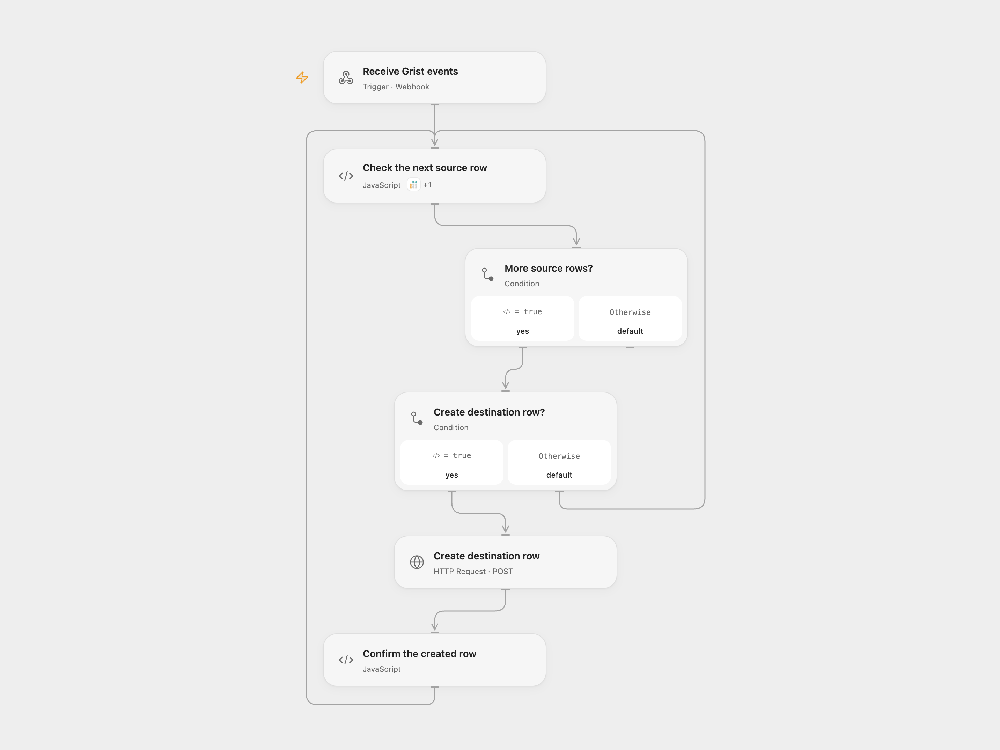

# Copy Confirmed Grist Rows Once

Create a destination Grist row for each confirmed source row that is not already present.

<picture>
  <source media="(prefers-color-scheme: dark)" srcset="preview-dark.png">
  
</picture>

[Open Flow JSON](templates/copy-confirmed-grist-rows-once.openflow.json) · [n8n JSON](templates/copy-confirmed-grist-rows-once.n8n.json)

## Setup

In Grist, create a source table with a boolean **Confirmed** column and a destination table with a **Source** column that stores source row IDs. Configure a Grist webhook for source row additions and updates.

Import the included n8n workflow and configure its webhook URL in Grist. For Open Flow, deploy the workflow, connect Grist and set the destination document and table IDs in **Check the next source row**. Store the same Grist API key as Secret Variable `GRIST_API_KEY` for **Create destination row**. Set **Choose delivery mode** to `relay` and the Open Flow URL in **Forward to Open Flow**. To run directly in n8n, leave the mode at `direct`, connect Grist in **get existing** and **Create Row**, and set the destination IDs in both. Activate one mode only. Both webhooks accept requests without authentication; restrict access to their URLs.

## Behavior

Each webhook can contain multiple source rows. For each row whose Confirmed value is true, look for the same source ID in the destination's Source column. Create a row containing that ID only when no match exists. Existing rows are left unchanged, including manual edits. Other source columns are not copied.

This is a lookup followed by a create, not an atomic uniqueness guarantee. Avoid concurrent runs for the same source row, or enforce uniqueness in the destination. Acknowledgment confirms webhook receipt rather than creation. If a lookup or write fails, later rows in that batch may remain unprocessed; earlier rows remain. An uncertain write may have succeeded, so inspect Grist before replaying.

Inspiration &amp; credits

## Changes to the source

- Process every row in a Grist webhook batch rather than only the first.
- Add a relay for Open Flow because Grist sends a top-level JSON array.

Adapted from [Transfer confirmed Grist rows](https://github.com/Zie619/n8n-workflows/blob/ae8cf6dc5b873cbb4f74587aa9180ed3a9f70682/workflows/Grist/0479_Grist_Stickynote_Create_Webhook.json) in [Zie619/n8n-workflows](https://github.com/Zie619/n8n-workflows). The source export does not identify a separate template author or license.

The collection’s [MIT notice](https://github.com/Zie619/n8n-workflows/blob/94007c1445d9258a7da116646b79473e7c7c3282/LICENSE) is pinned at a later revision. This is the collection notice at that revision; it does not establish a separate original template author's license. Our changes are listed above; see [repository licensing](../../README.md#licensing).

> MIT License
>
> Copyright (c) 2025 Zie619
>
> Permission is hereby granted, free of charge, to any person obtaining a copy
> of this software and associated documentation files (the "Software"), to deal
> in the Software without restriction, including without limitation the rights
> to use, copy, modify, merge, publish, distribute, sublicense, and/or sell
> copies of the Software, and to permit persons to whom the Software is
> furnished to do so, subject to the following conditions:
>
> The above copyright notice and this permission notice shall be included in all
> copies or substantial portions of the Software.
>
> THE SOFTWARE IS PROVIDED "AS IS", WITHOUT WARRANTY OF ANY KIND, EXPRESS OR
> IMPLIED, INCLUDING BUT NOT LIMITED TO THE WARRANTIES OF MERCHANTABILITY,
> FITNESS FOR A PARTICULAR PURPOSE AND NONINFRINGEMENT. IN NO EVENT SHALL THE
> AUTHORS OR COPYRIGHT HOLDERS BE LIABLE FOR ANY CLAIM, DAMAGES OR OTHER
> LIABILITY, WHETHER IN AN ACTION OF CONTRACT, TORT OR OTHERWISE, ARISING FROM,
> OUT OF OR IN CONNECTION WITH THE SOFTWARE OR THE USE OR OTHER DEALINGS IN THE
> SOFTWARE.

