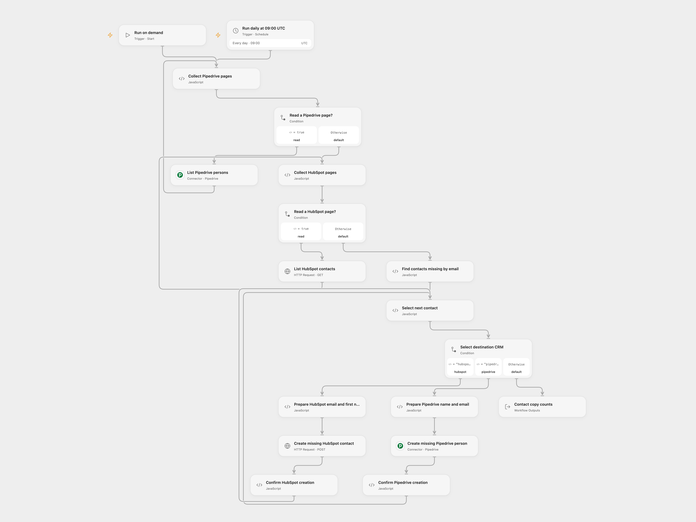

# Copy Missing Contacts Between Pipedrive and HubSpot

Compare both CRMs by email on a schedule and add contacts that exist in only one account.

<!-- template-actions:start -->
 
<!-- template-actions:end -->

<picture>
  <source media="(prefers-color-scheme: dark)" srcset="preview-dark.png">
  
</picture>

## Setup

1. Connect the Pipedrive account whose visible persons you want to compare.
2. Create a HubSpot private app token with `crm.objects.contacts.read` and `crm.objects.contacts.write`. Bind it as the same Secret Variable in **List HubSpot contacts** and **Create missing HubSpot contact**. Use the token value without the `Bearer ` prefix.
3. Use **Run on demand** for a manual run. The schedule runs daily at 09:00 UTC after publishing. Change it in the schedule node if needed. Keep one active copy of the workflow per pair of CRM accounts and let each run finish before starting another.

## Behavior

The workflow reads every page from both CRMs before creating any contacts. It compares email addresses without regard to case and recognizes additional addresses already recorded on either side. It sends the first listed Pipedrive email or the primary HubSpot email and the first name. It skips contacts without a usable email, ambiguous emails shared by multiple source records, and HubSpot contacts without the name required by Pipedrive.

Existing matches keep their fields. A read failure stops the run before writes. The workflow creates contacts sequentially. If a write conflicts, fails, or returns an unclear result, check the destination CRM before rerunning. A new run starts with fresh reads. Previously confirmed creates will appear as matches.

In n8n

Use **Header Auth** with header name `x-api-token` for the Pipedrive requests. Use the same HubSpot **Bearer Auth** credential for both HubSpot requests. The schedule uses the workflow timezone (UTC by default). You can also use **Run on demand**.

Inspiration &amp; credits

Adapted from [Scheduled Pipedrive and HubSpot contact sync](https://github.com/Zie619/n8n-workflows/blob/ae8cf6dc5b873cbb4f74587aa9180ed3a9f70682/workflows/Hubspot/0129_HubSpot_Cron_Update_Scheduled.json) in [Zie619/n8n-workflows](https://github.com/Zie619/n8n-workflows). Attribution: Zie619 / n8n-workflows.

The collection’s [MIT notice](https://github.com/Zie619/n8n-workflows/blob/94007c1445d9258a7da116646b79473e7c7c3282/LICENSE) is pinned at a later revision. This is the collection notice at that revision; it does not establish a separate original template author's license. Our changes are listed above; see [repository licensing](../../README.md#licensing).

> MIT License
>
> Copyright (c) 2025 Zie619
>
> Permission is hereby granted, free of charge, to any person obtaining a copy
> of this software and associated documentation files (the "Software"), to deal
> in the Software without restriction, including without limitation the rights
> to use, copy, modify, merge, publish, distribute, sublicense, and/or sell
> copies of the Software, and to permit persons to whom the Software is
> furnished to do so, subject to the following conditions:
>
> The above copyright notice and this permission notice shall be included in all
> copies or substantial portions of the Software.
>
> THE SOFTWARE IS PROVIDED "AS IS", WITHOUT WARRANTY OF ANY KIND, EXPRESS OR
> IMPLIED, INCLUDING BUT NOT LIMITED TO THE WARRANTIES OF MERCHANTABILITY,
> FITNESS FOR A PARTICULAR PURPOSE AND NONINFRINGEMENT. IN NO EVENT SHALL THE
> AUTHORS OR COPYRIGHT HOLDERS BE LIABLE FOR ANY CLAIM, DAMAGES OR OTHER
> LIABILITY, WHETHER IN AN ACTION OF CONTRACT, TORT OR OTHERWISE, ARISING FROM,
> OUT OF OR IN CONNECTION WITH THE SOFTWARE OR THE USE OR OTHER DEALINGS IN THE
> SOFTWARE.

