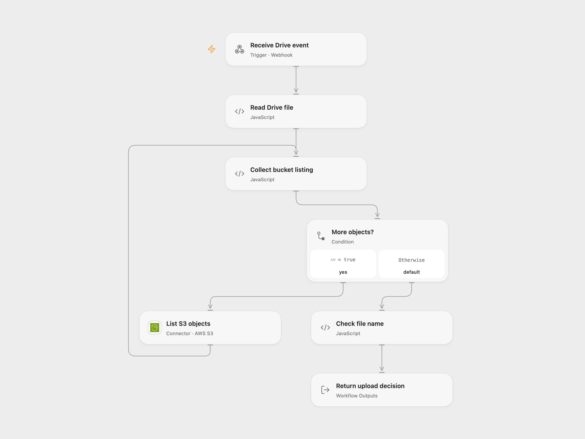

# Copy New Drive Files to S3

Copy updated Google Drive files to S3 when their names are absent from the bucket.

<picture>
  <source media="(prefers-color-scheme: dark)" srcset="preview-dark.png">
  
</picture>

[Open Flow JSON](templates/copy-new-drive-files-to-s3.openflow.json) · [n8n JSON](templates/copy-new-drive-files-to-s3.n8n.json)

## Setup and use

Configure the Google Drive folder, AWS S3 bucket and credentials in n8n. For Open Flow configure the same bucket and S3 connection in **List S3 objects**, set the URL in **Ask Open Flow**, and enable that relay. Enable only one of the n8n-only or Open Flow decision branches. Activate the n8n workflow. Restrict access to the Open Flow endpoint, which does not authenticate the sender.

## Behavior

The Drive trigger polls for updated files. Each file name is compared with all S3 object keys; if absent, n8n downloads the Drive file and uploads its bytes with source=gdrive tagging and AES256 server-side encryption. Open Flow skips any existing name. The n8n-only S3 V1 listing omits zero-byte objects, so those names can be uploaded again. The check and upload are separate operations, so concurrent runs can race. A lost upload response may mean the object was written; inspect S3 before retrying. Relay or download failures require inspecting and manually recovering affected events.

Inspiration &amp; credits

## Changes to the source

- Connect the S3 listing, compare the actual file names, and add Drive download before binary upload. Add an optional Open Flow decision relay.

Adapted from [Drive folder to S3](https://github.com/Zie619/n8n-workflows/blob/ae8cf6dc5b873cbb4f74587aa9180ed3a9f70682/workflows/Awss3/0151_Awss3_GoogleDrive_Import_Triggered.json) in [Zie619/n8n-workflows](https://github.com/Zie619/n8n-workflows). The source export does not identify a separate template author or license.

The collection’s [MIT notice](https://github.com/Zie619/n8n-workflows/blob/94007c1445d9258a7da116646b79473e7c7c3282/LICENSE) is pinned at a later revision. This is the collection notice at that revision; it does not establish a separate original template author's license. Our changes are listed above; see [repository licensing](../../README.md#licensing).

> MIT License
>
> Copyright (c) 2025 Zie619
>
> Permission is hereby granted, free of charge, to any person obtaining a copy
> of this software and associated documentation files (the "Software"), to deal
> in the Software without restriction, including without limitation the rights
> to use, copy, modify, merge, publish, distribute, sublicense, and/or sell
> copies of the Software, and to permit persons to whom the Software is
> furnished to do so, subject to the following conditions:
>
> The above copyright notice and this permission notice shall be included in all
> copies or substantial portions of the Software.
>
> THE SOFTWARE IS PROVIDED "AS IS", WITHOUT WARRANTY OF ANY KIND, EXPRESS OR
> IMPLIED, INCLUDING BUT NOT LIMITED TO THE WARRANTIES OF MERCHANTABILITY,
> FITNESS FOR A PARTICULAR PURPOSE AND NONINFRINGEMENT. IN NO EVENT SHALL THE
> AUTHORS OR COPYRIGHT HOLDERS BE LIABLE FOR ANY CLAIM, DAMAGES OR OTHER
> LIABILITY, WHETHER IN AN ACTION OF CONTRACT, TORT OR OTHERWISE, ARISING FROM,
> OUT OF OR IN CONNECTION WITH THE SOFTWARE OR THE USE OR OTHER DEALINGS IN THE
> SOFTWARE.

