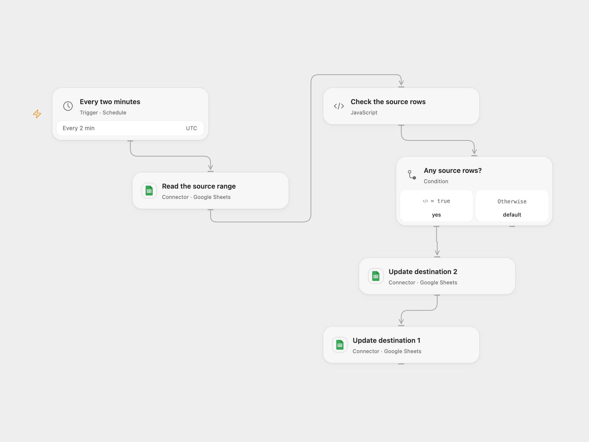

# Copy Sheet Data to Two Destinations

Copy a Google Sheets data range to two destination spreadsheets every two minutes.

<picture>
  <source media="(prefers-color-scheme: dark)" srcset="preview-dark.png">
  
</picture>

[Open Flow JSON](templates/copy-sheet-data-to-two-destinations.openflow.json) · [n8n JSON](templates/copy-sheet-data-to-two-destinations.n8n.json)

## Setup

Connect Google Sheets with read access to the source and write access to both destinations. Set the source spreadsheet ID and range in **Read the source range**. Set the destination spreadsheet ID and corresponding range in each **Update destination** node. In n8n set the three spreadsheet IDs and the range on **Read Sheet**; both write ranges reference that source range by default. Connect Google Sheets. Enable one format.

## Behavior

Every two minutes, read the configured source values without formatting and write the returned rows to both destinations as raw values. An empty source produces no writes. Values outside the returned range are not cleared, so deleting source rows does not remove old destination rows. Formula results are copied as values rather than formulas.

Open Flow updates destination 2 and then destination 1; if either update fails, later steps stop. The n8n format retains the source's two branches. A failed or uncertain write may already have succeeded; inspect both destinations before retrying. The source cron specifies second zero, and both formats use two-minute boundaries.

Inspiration &amp; credits

## Changes to the source

- Replace the blank spreadsheet settings with separate configurable source and destination IDs.
- Make the empty-source behavior and Open Flow write order explicit.

Adapted from [Copy a Google Sheets range to two spreadsheets](https://github.com/Zie619/n8n-workflows/blob/ae8cf6dc5b873cbb4f74587aa9180ed3a9f70682/workflows/Googlesheets/1106_GoogleSheets_Cron_Automate_Scheduled.json) in [Zie619/n8n-workflows](https://github.com/Zie619/n8n-workflows). The source export does not identify a separate template author or license.

The collection’s [MIT notice](https://github.com/Zie619/n8n-workflows/blob/94007c1445d9258a7da116646b79473e7c7c3282/LICENSE) is pinned at a later revision. This is the collection notice at that revision; it does not establish a separate original template author's license. Our changes are listed above; see [repository licensing](../../README.md#licensing).

> MIT License
>
> Copyright (c) 2025 Zie619
>
> Permission is hereby granted, free of charge, to any person obtaining a copy
> of this software and associated documentation files (the "Software"), to deal
> in the Software without restriction, including without limitation the rights
> to use, copy, modify, merge, publish, distribute, sublicense, and/or sell
> copies of the Software, and to permit persons to whom the Software is
> furnished to do so, subject to the following conditions:
>
> The above copyright notice and this permission notice shall be included in all
> copies or substantial portions of the Software.
>
> THE SOFTWARE IS PROVIDED "AS IS", WITHOUT WARRANTY OF ANY KIND, EXPRESS OR
> IMPLIED, INCLUDING BUT NOT LIMITED TO THE WARRANTIES OF MERCHANTABILITY,
> FITNESS FOR A PARTICULAR PURPOSE AND NONINFRINGEMENT. IN NO EVENT SHALL THE
> AUTHORS OR COPYRIGHT HOLDERS BE LIABLE FOR ANY CLAIM, DAMAGES OR OTHER
> LIABILITY, WHETHER IN AN ACTION OF CONTRACT, TORT OR OTHERWISE, ARISING FROM,
> OUT OF OR IN CONNECTION WITH THE SOFTWARE OR THE USE OR OTHER DEALINGS IN THE
> SOFTWARE.

