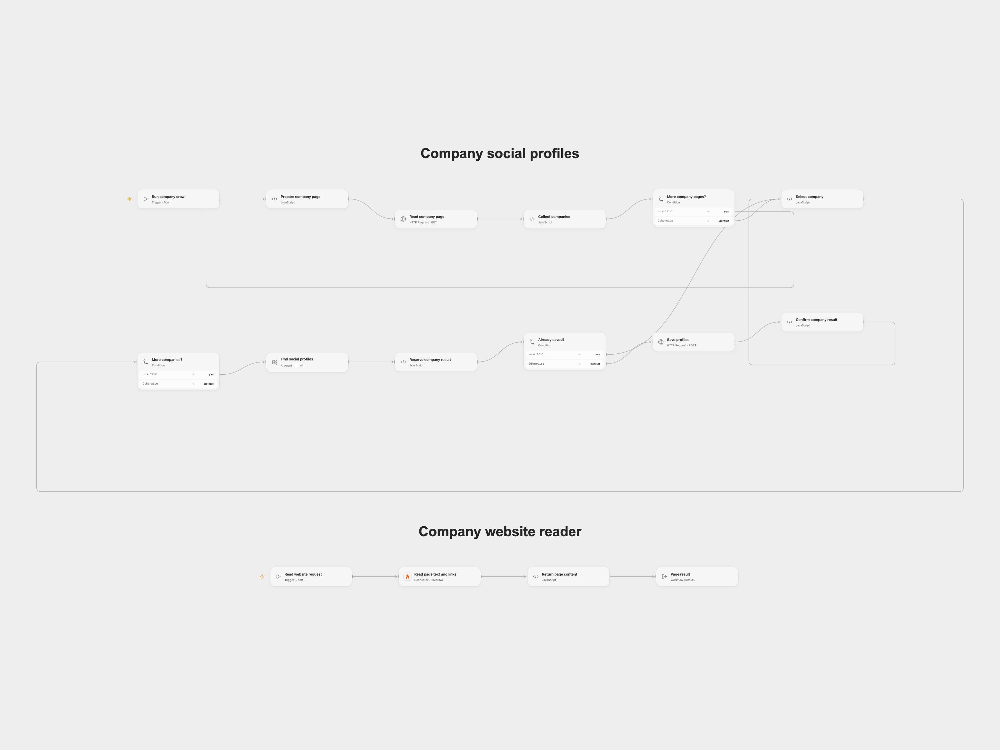

# Crawl Company Social Profiles

Find company social profiles by exploring their websites and save the results to Supabase.

<!-- template-actions:start -->
[](https://openflow.run/templates/crawl-company-social-profiles/) [](templates/crawl-company-social-profiles.n8n.json)
<!-- template-actions:end -->

<picture>
  <source media="(prefers-color-scheme: dark)" srcset="preview-dark.png">
  
</picture>

## Setup

Import **Company social profiles** and **Company website reader** from the bundle. Create Supabase input columns id, name and website and output columns company_name, company_website and social_media (JSON). Set the REST URLs and bind SUPABASE_API_KEY and SUPABASE_AUTHORIZATION (including Bearer) as secret variables. Configure a Firecrawl connection and a tool-capable model. Publish **Company website reader** and refresh the tool interface in the main workflow. Enable persistent State and avoid overlapping runs.

## Behavior

The workflow retrieves all companies. Open Flow reads Supabase in pages of 100 and uses Firecrawl for page text and links. The agent follows website links and returns social profiles for each company. Website content is untrusted and model results need review. Inspect Supabase after an uncertain insert before clearing the pending checkpoint. The website, content and model output are sent to Firecrawl, the model provider and Supabase.

<details>
<summary>In n8n</summary>

In n8n connect Supabase and OpenAI, and select a Data Table with item_key and status text columns in the checkpoint nodes. n8n uses its native HTTP, HTML and Markdown nodes as the agent tools. n8n retains a reservation for completed results and skips them on later runs; reconcile reservations manually.

</details>

<details>
<summary>Inspiration &amp; credits</summary>

Adapted from [Autonomous AI crawler](https://github.com/enescingoz/awesome-n8n-templates/blob/827110332c21cbe000ab13f6d292d5adb1f1f8db/AI_Research_RAG_and_Data_Analysis/Autonomous%20AI%20crawler.json) in [enescingoz/awesome-n8n-templates](https://github.com/enescingoz/awesome-n8n-templates).

Source collection notice: © 2024–2026 Enes Cingoz, [CC BY 4.0](https://github.com/enescingoz/awesome-n8n-templates/blob/827110332c21cbe000ab13f6d292d5adb1f1f8db/LICENSE). The source export does not identify a separate template author or license. See [repository licensing](../../README.md#licensing) for the scope of OOMOL contributions and third-party material.


Changes from the source: Correct the required social_media schema, use a Firecrawl page tool, paginate the input and add write checkpoints.

Collection license notice:

```text
Creative Commons Attribution 4.0 International License

Copyright (c) 2024-2026 Enes Cingoz

You are free to:

  Share - copy and redistribute the material in any medium or format
  Adapt - remix, transform, and build upon the material for any purpose,
  even commercially.

Under the following terms:

  Attribution - You must give appropriate credit, provide a link to the
  license, and indicate if changes were made. You may do so in any
  reasonable manner, but not in any way that suggests the licensor
  endorses you or your use.

  No additional restrictions - You may not apply legal terms or
  technological measures that legally restrict others from doing
  anything the license permits.

Notices:

  You do not have to comply with the license for elements of the
  material in the public domain or where your use is permitted by an
  applicable exception or limitation.

  No warranties are given. The license may not give you all of the
  permissions necessary for your intended use. For example, other rights
  such as publicity, privacy, or moral rights may limit how you use the
  material.

For the full license text, see:
https://creativecommons.org/licenses/by/4.0/legalcode
```

</details>
