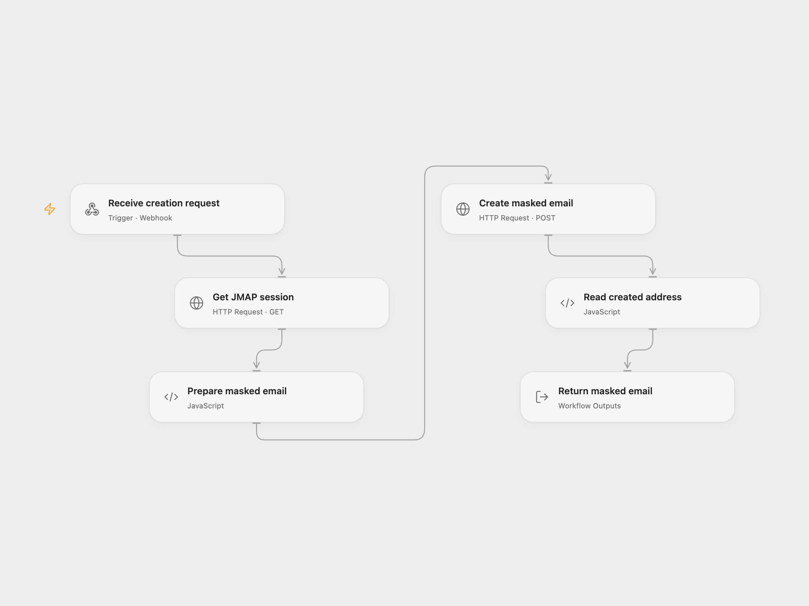

# Create a Fastmail Masked Email

Create a Fastmail masked email and return the address to the webhook caller.

<picture>
  <source media="(prefers-color-scheme: dark)" srcset="preview-dark.png">
  
</picture>

[Open Flow JSON](templates/create-a-fastmail-masked-email.openflow.json) · [n8n JSON](templates/create-a-fastmail-masked-email.n8n.json)

## Setup and use

Bind a Fastmail API token with Masked Email access to both Open Flow HTTP nodes as secret Variable FASTMAIL_API_TOKEN. In n8n configure HTTP Header Auth with Authorization as the header name and Bearer followed by a space and the token as its value. Activate one workflow and send a JSON POST with optional state and description fields to its webhook. The default state is pending and the default description is Test via N8n.

## Behavior

The endpoint reads the Fastmail session, creates one masked email in its primary Masked Email account, and returns an object with email and desciption. The spelling desciption follows the source response. The Open Flow webhook accepts the declared state and description fields. The endpoint does not verify the caller; restrict access because requests create masked addresses. If creation succeeds but the response is lost, inspect Fastmail before retrying to avoid another address.

Inspiration &amp; credits

## Changes to the source

- Return JSON explicitly in n8n and fail when Fastmail does not confirm creation. Open Flow returns the workflow result synchronously.

Adapted from [Create a Fastmail masked email](https://github.com/Zie619/n8n-workflows/blob/ae8cf6dc5b873cbb4f74587aa9180ed3a9f70682/workflows/Http/0606_HTTP_Respondtowebhook_Create_Webhook.json) in [Zie619/n8n-workflows](https://github.com/Zie619/n8n-workflows). The source export does not identify a separate template author or license.

The collection’s [MIT notice](https://github.com/Zie619/n8n-workflows/blob/94007c1445d9258a7da116646b79473e7c7c3282/LICENSE) is pinned at a later revision. This is the collection notice at that revision; it does not establish a separate original template author's license. Our changes are listed above; see [repository licensing](../../README.md#licensing).

> MIT License
>
> Copyright (c) 2025 Zie619
>
> Permission is hereby granted, free of charge, to any person obtaining a copy
> of this software and associated documentation files (the "Software"), to deal
> in the Software without restriction, including without limitation the rights
> to use, copy, modify, merge, publish, distribute, sublicense, and/or sell
> copies of the Software, and to permit persons to whom the Software is
> furnished to do so, subject to the following conditions:
>
> The above copyright notice and this permission notice shall be included in all
> copies or substantial portions of the Software.
>
> THE SOFTWARE IS PROVIDED "AS IS", WITHOUT WARRANTY OF ANY KIND, EXPRESS OR
> IMPLIED, INCLUDING BUT NOT LIMITED TO THE WARRANTIES OF MERCHANTABILITY,
> FITNESS FOR A PARTICULAR PURPOSE AND NONINFRINGEMENT. IN NO EVENT SHALL THE
> AUTHORS OR COPYRIGHT HOLDERS BE LIABLE FOR ANY CLAIM, DAMAGES OR OTHER
> LIABILITY, WHETHER IN AN ACTION OF CONTRACT, TORT OR OTHERWISE, ARISING FROM,
> OUT OF OR IN CONNECTION WITH THE SOFTWARE OR THE USE OR OTHER DEALINGS IN THE
> SOFTWARE.

