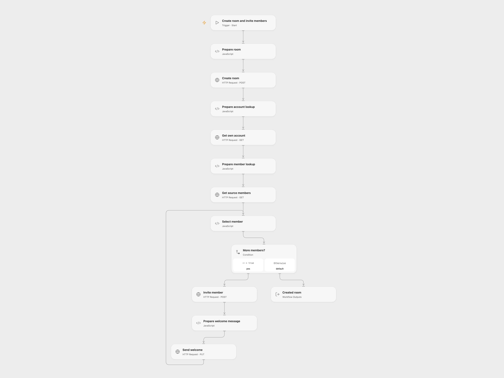

# Create a Matrix Room and Invite Members

Create a Matrix room, invite members of another room and send a welcome message.

<picture>
  <source media="(prefers-color-scheme: dark)" srcset="preview-dark.png">
  
</picture>

[Open Flow JSON](templates/create-a-matrix-room-and-invite-members.openflow.json) · [n8n JSON](templates/create-a-matrix-room-and-invite-members.n8n.json)

## Setup and use

Bind the Matrix access token as secret Variable MATRIX_ACCESS_TOKEN in each HTTP node. Run with the homeserver base URL, source room ID, new room name and alias. In n8n configure Matrix credentials, replace the source room ID and new alias, and run manually. Use one format.

## Behavior

The workflow creates a public room, reads the source room members, invites everyone except the authenticated account and sends a welcome message after each invitation. The source room may include former or invited members; check membership before running. These actions create a room and notify people. If a write outcome is unknown, inspect the room and invitations before retrying.

Inspiration &amp; credits

## Changes to the source

- Open Flow accepts room settings as inputs and calls the Matrix API. Both formats use the member event state_key as the user ID.

Adapted from [Create a Matrix room and invite members](https://github.com/Zie619/n8n-workflows/blob/ae8cf6dc5b873cbb4f74587aa9180ed3a9f70682/workflows/Manual/1158_Manual_Matrix_Create_Triggered.json) in [Zie619/n8n-workflows](https://github.com/Zie619/n8n-workflows). The source export does not identify a separate template author or license.

The collection’s [MIT notice](https://github.com/Zie619/n8n-workflows/blob/94007c1445d9258a7da116646b79473e7c7c3282/LICENSE) is pinned at a later revision. This is the collection notice at that revision; it does not establish a separate original template author's license. Our changes are listed above; see [repository licensing](../../README.md#licensing).

> MIT License
>
> Copyright (c) 2025 Zie619
>
> Permission is hereby granted, free of charge, to any person obtaining a copy
> of this software and associated documentation files (the "Software"), to deal
> in the Software without restriction, including without limitation the rights
> to use, copy, modify, merge, publish, distribute, sublicense, and/or sell
> copies of the Software, and to permit persons to whom the Software is
> furnished to do so, subject to the following conditions:
>
> The above copyright notice and this permission notice shall be included in all
> copies or substantial portions of the Software.
>
> THE SOFTWARE IS PROVIDED "AS IS", WITHOUT WARRANTY OF ANY KIND, EXPRESS OR
> IMPLIED, INCLUDING BUT NOT LIMITED TO THE WARRANTIES OF MERCHANTABILITY,
> FITNESS FOR A PARTICULAR PURPOSE AND NONINFRINGEMENT. IN NO EVENT SHALL THE
> AUTHORS OR COPYRIGHT HOLDERS BE LIABLE FOR ANY CLAIM, DAMAGES OR OTHER
> LIABILITY, WHETHER IN AN ACTION OF CONTRACT, TORT OR OTHERWISE, ARISING FROM,
> OUT OF OR IN CONNECTION WITH THE SOFTWARE OR THE USE OR OTHER DEALINGS IN THE
> SOFTWARE.

