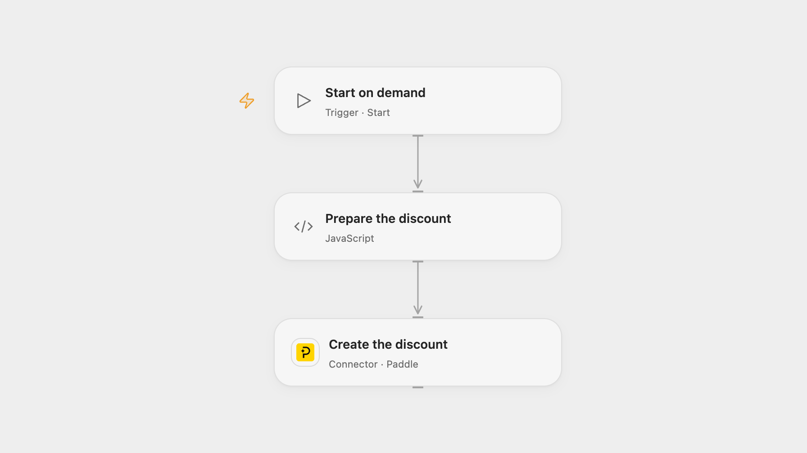

# Create a Paddle Checkout Discount

Create a flat EUR checkout discount in Paddle Billing.

<picture>
  <source media="(prefers-color-scheme: dark)" srcset="preview-dark.png">
  
</picture>

[Open Flow JSON](templates/create-a-paddle-checkout-discount.openflow.json) · [n8n JSON](templates/create-a-paddle-checkout-discount.n8n.json)

## Setup

Connect Paddle Billing with an API key that has discount.write and product.read permissions. In Open Flow, set a unique code in **Prepare the discount** using letters and numbers only. In n8n, configure a Header Auth credential named Authorization with the value Bearer followed by your Paddle Billing API key, then set the code in **Prepare the discount**. Run one format.

## Behavior

Each manual run creates a nonrecurring EUR 2 checkout discount, usable across products unless changed in Paddle. The result is returned by Paddle. A failed or uncertain creation may already have created a discount; inspect Paddle before retrying.

Inspiration &amp; credits

## Changes to the source

- Use Paddle Billing discounts and an API key in place of the legacy Paddle Classic coupon node. Billing requires an alphanumeric code, so set a new code instead of the source example.
- Represent EUR 2 as 200 minor units and provide the required description.

Adapted from [Create a coupon on Paddle](https://github.com/Zie619/n8n-workflows/blob/ae8cf6dc5b873cbb4f74587aa9180ed3a9f70682/workflows/Manual/1019_Manual_Paddle_Create_Triggered.json) in [Zie619/n8n-workflows](https://github.com/Zie619/n8n-workflows). The matching [n8n community listing](https://n8n.io/workflows/659-create-a-coupon-on-paddle/) credits Harshil Agrawal. The original template does not state a separate license.

The collection’s [MIT notice](https://github.com/Zie619/n8n-workflows/blob/94007c1445d9258a7da116646b79473e7c7c3282/LICENSE) is pinned at a later revision. This is the collection notice at that revision; it does not establish a separate original template author's license. Our changes are listed above; see [repository licensing](../../README.md#licensing).

> MIT License
>
> Copyright (c) 2025 Zie619
>
> Permission is hereby granted, free of charge, to any person obtaining a copy
> of this software and associated documentation files (the "Software"), to deal
> in the Software without restriction, including without limitation the rights
> to use, copy, modify, merge, publish, distribute, sublicense, and/or sell
> copies of the Software, and to permit persons to whom the Software is
> furnished to do so, subject to the following conditions:
>
> The above copyright notice and this permission notice shall be included in all
> copies or substantial portions of the Software.
>
> THE SOFTWARE IS PROVIDED "AS IS", WITHOUT WARRANTY OF ANY KIND, EXPRESS OR
> IMPLIED, INCLUDING BUT NOT LIMITED TO THE WARRANTIES OF MERCHANTABILITY,
> FITNESS FOR A PARTICULAR PURPOSE AND NONINFRINGEMENT. IN NO EVENT SHALL THE
> AUTHORS OR COPYRIGHT HOLDERS BE LIABLE FOR ANY CLAIM, DAMAGES OR OTHER
> LIABILITY, WHETHER IN AN ACTION OF CONTRACT, TORT OR OTHERWISE, ARISING FROM,
> OUT OF OR IN CONNECTION WITH THE SOFTWARE OR THE USE OR OTHER DEALINGS IN THE
> SOFTWARE.

